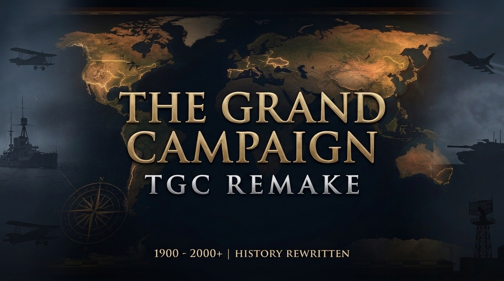

<p align="center">
  
</p>

<h1 align="center">The Grand Campaign — TGC Remake</h1>

<p align="center">
  <strong>One Century. Four World Timelines. Every Nation Plays to Win.</strong><br>
  <em>Un Siglo Entero. Cuatro Líneas Temporales. Cada Nación Tiene Su Propia Historia.</em>
</p>

<p align="center">
  <a href="https://github.com/ArturoHDZG/DarkestHour-TGC-Remake/releases"></a>
  <a href="https://github.com/ArturoHDZG/DarkestHour-TGC-Remake/actions/workflows/audit.yml"></a>
  <a href="docs/TECHNICAL.md"></a>
</p>

<p align="center">
  <a href="#-english--welcome-to-the-century">English</a> •
  <a href="#-español--un-siglo-para-reescribir-la-historia">Español</a> •
  <a href="#-support-the-project--apoya-el-proyecto">Buy Me a Coffee ☕</a> •
  <a href="docs/TECHNICAL.md">Technical Documentation</a>
</p>

---

## ☕ Support the Project / Apoya el Proyecto

> **If you enjoyed this work and spent hours rewriting history, you can buy me a coffee!** ☕  
> *Si te gustó mi trabajo y disfrutaste reescribiendo un siglo de historia, puedes invitarme un café.*
>
> Developing, researching, writing, and balancing **14,500+ historical and alternate-history events** across an entire century took hundreds of hours of solo passion. Any tip keeps updates, fixes, and future expansions alive!
>
> <!-- Official donation link -->
> [](https://ko-fi.com/arturohdzg)

---

## 🌍 English — Welcome to the Century

**The Grand Campaign (TGC Remake)** is a massive, community-driven revival and expansion of the legendary *The Grand Campaign (v2.4.90)* mod for **Darkest Hour: A Hearts of Iron Game**.

Forget abrupt endgame walls after 1945 or empty minor nations waiting on the sidelines. **TGC Remake** bridges the **Belle Époque of 1900** all the way past the **Year 2000**, turning an entire century of diplomacy, industrial booms, revolutions, world wars, and ideological showdowns into a living, reactive sandbox.

### ✨ What Makes TGC Remake Special?

* **⏳ 4 Deep World Timelines (1900–2000+)**:
  * **Historical Path**: From the Boxer Rebellion, Dreadnought arms race, and WWI through the Roaring Twenties, WWII, the Space Race, Decolonization, and the end of the Cold War.
  * **Branch 1 — *Pax Germanica***: What if the Central Powers won the Great War? Navigate a German-led *Mitteleuropa*, a surviving Austro-Hungarian Federation, and a Berlin–Baghdad Ottoman sphere.
  * **Branch 2 — *Pax Fascista***: Survive or shatter an Axis-dominated world, command exiled governments from Ottawa, or ignite global resistance across occupied *Reichskommissariats*.
  * **Branch 3 — *Pax Sovietica***: Steer a world under Eurasian socialist hegemony, People's Republics across Europe, reform movements, and Sino-Soviet multipolar rivalry.
* **👑 All 10 Great Powers Rebuilt & Leveled**: Germany (`U08`/`GER`), Britain (`ENG`), France (`FRA`/`U01`), USA (`USA`), Russia/USSR (`RUS`/`SOV`), Italy (`ITA`/`RSI`), Japan (`JAP`), China (`CHI`/`CHC`), Austria-Hungary/Austria (`U09`/`AUS`), and the Ottoman Empire/Turkey (`OTT`/`TUR`).
* **🌎 Every Nation Matters — 11 Cultural-Political World Blocks + Minor Uplift**:
  * Over **880 new regional & systemic events** across the British Commonwealth, Francophonie & Quebec, Ibero-America & Iberia (incl. Portugal), North Africa, the Middle East, Sub-Saharan Africa, India/Pakistan/Bangladesh, Southeast Asia, Nordic/Baltic Europe, Central-Balkan Europe, and Interior Asia/Caucasus/Korea.
  * **No Empty Tags Left Behind**: Previously empty formables and microstates (Trieste, Bangladesh, Quebec, United Baltic Duchy, Crimea, California, Texas, Euskadi, Central Asia, and more) now have rich political choices—plus **industrial & economic uplift events** giving weak minor nations a fighting chance!
* **🏙️ Modernized Urban Map**: **183 urban provinces** brought to life with city sprites, custom illustrations, and clean 1900 & 1914 campaign starts.

### 🚀 Quick Installation (3 Steps)
1. Download the single complete package **`TCG_Remake_v3.0.0-alpha.2_Full.zip`** from [**Releases**](https://github.com/ArturoHDZG/DarkestHour-TGC-Remake/releases).
2. Extract it into your Darkest Hour `Mods` folder so the game files sit at:
   ```text
   <Your Darkest Hour Folder>\Mods\TCG Remake\
   ```
   *(Double-check that `db\`, `config\`, `gfx\`, `map\`, and `scenarios\` sit directly inside `Mods\TCG Remake\` without an extra nested folder).*
3. Open **Darkest Hour Launcher**, choose **`TCG Remake`**, select **English** or **Spanish**, and play!

### ⚠️ Language Support Notice (English & Spanish Only)
> **This mod is officially localized ONLY in English and Spanish.**  
> All new events and expansions were authored in Spanish (the creator's native tongue) and fully translated into English for the international community. Other language columns (French, Italian, German, Polish, Portuguese, Russian) are intentionally blank on new content—selecting another game language will show empty boxes or `UNKNOWN STRING WANTED`.  
> **Native speakers welcome!** Check [docs/TRANSLATION_GUIDE.md](docs/TRANSLATION_GUIDE.md) if you'd like to contribute a translation.

---
---

## 🇪🇸 Español — Un Siglo Para Reescribir la Historia

**The Grand Campaign (TGC Remake)** es una renovación monumental del mítico mod *The Grand Campaign (v2.4.90)* para **Darkest Hour**.

Olvídate de campañas que se quedan sin contenido tras 1945 o países menores vacíos sin eventos propios. **TGC Remake** conecta de forma continua desde la **Belle Époque de 1900** hasta el **año 2000+**, dándote decisiones políticas, industriales, económicas y diplomáticas sin importar qué nación elijas.

### ✨ ¿Qué ofrece esta edición?
* **⏳ 4 Grandes Ramas Temporales (1900–2000+)**:
  * **Tronco Histórico**: Primera Guerra Mundial, Entreguerras, Segunda Guerra Mundial, Guerra Fría, Descolonización, Carrera Espacial y transición al siglo XXI.
  * **Rama 1 — *Pax Germanica***: Un mundo moldeado tras la victoria de los Imperios Centrales (`U08`, `U09`, `OTT`).
  * **Rama 2 — *Pax Fascista***: Hegemonía del Eje, gobiernos aliados en el exilio y redes globales de resistencia clandestina.
  * **Rama 3 — *Pax Soviética***: Dominio socialista euroasiático, Repúblicas Populares, reformas internas y rivalidad multipolar.
* **👑 Las 10 Grandes Potencias al 100%**: Todas niveladas con cientos de eventos multi-opción de 1900 a 2000+.
* **🌎 El Mundo Entero Vivo (11 Bloques + Estímulo a Países Menores)**:
  * Commonwealth, Francofonía y Quebec, **Comunidad Iberoamericana (incluyendo España y Portugal)**, África del Norte, Oriente Medio, África Subsahariana, Subcontinente Indio, Sudeste Asiático, Europa Atlántica/Nórdica/Báltica, Europa Central-Balcánica y Asia Interior/Cáucaso/Corea.
  * **Rescate de naciones vacías y bonificaciones industriales**: Microestados y países formables que antes tenían 0 eventos ahora son totalmente jugables, y las naciones más débiles cuentan con eventos domésticos que impulsan ligeramente su Capacidad Industrial (CI), ingresos y recursos para competir en el tablero mundial.
* **🏙️ Mapa Urbano Renovado**: **183 provincias urbanas** con ilustraciones y sprites propios para jugar desde **1900** o **1914**.

### 🚀 Instalación Rápida en 3 Pasos
1. Descarga el paquete único completo **`TCG_Remake_v3.0.0-alpha.2_Full.zip`** desde [**Releases**](https://github.com/ArturoHDZG/DarkestHour-TGC-Remake/releases).
2. Descomprímelo dentro de la carpeta `Mods` de tu Darkest Hour para que quede exactamente así:
   ```text
   <Carpeta de Darkest Hour>\Mods\TCG Remake\
   ```
3. Abre el **Launcher de Darkest Hour**, selecciona **`TCG Remake`**, elige idioma **Español** o **English**, ¡y a jugar!

### ⚠️ Aviso Importante de Idiomas (Solo Español e Inglés)
> **El mod solo está localizado oficialmente al Español y al Inglés.**  
> Las columnas de francés, italiano, alemán, polaco, portugués y ruso están en blanco en todo el contenido nuevo; si cambias el idioma del juego a otro distinto, aparecerán cuadros vacíos o `UNKNOWN STRING WANTED`. Si eres hablante nativo y quieres ayudar a traducirlo, revisa [docs/TRANSLATION_GUIDE.md](docs/TRANSLATION_GUIDE.md).

---

## 🛠️ For Modders, Bug Reports & Documentation / Documentación Técnica
* **Want the technical specs, ID ranges, audit scripts, and mod architecture?** $\rightarrow$ Read [**docs/TECHNICAL.md**](docs/TECHNICAL.md) & [**docs/WALKTHROUGH.md**](docs/WALKTHROUGH.md).
* **Found a bug during gameplay?** Enable `1 # Extra debug logs` in `settings.cfg` and open an Issue with your **`savedebug.txt`** using our [Bug Report template](.github/ISSUE_TEMPLATE/bug_report.md).
* **Security & Safe Downloads**: Read [SECURITY.md](SECURITY.md) — every release ships with `SHA256SUMS.txt` and zero unauthorized executables.

---

## 📜 Credits / Créditos
* **Original Mod Base**: *The Grand Campaign (v2.4.90)* created by **ejwith9953**, *World in Flames 2 (WiF2)* contributors, and all original creators credited in [`Readme.txt`](Readme.txt).
* **Base Game**: *Darkest Hour: A Hearts of Iron Game* by the **Darkest Hour Team**.
* **TGC Remake Overhaul & Expansion**: **Arturo Hernández Garza** ([ArturoHDZG](https://github.com/ArturoHDZG)).
