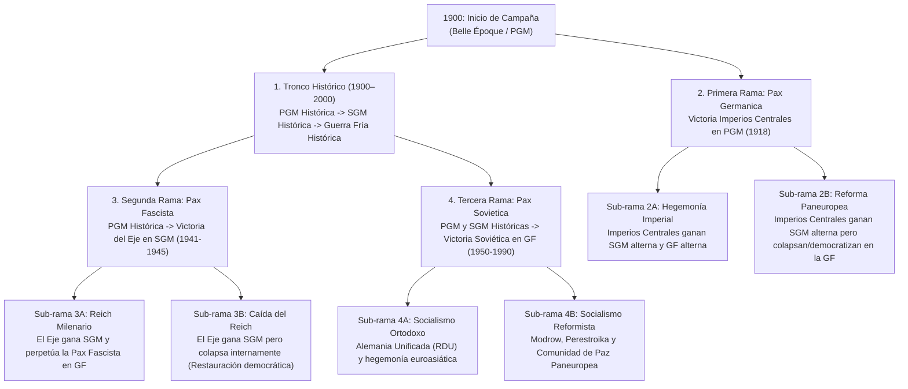

# Walkthrough: Nivelación Integral de Grandes Potencias (>= 300 Eventos) y Cadenas de Paz Regional Controlada

Se ha alcanzado con éxito el hito histórico de nivelación para las dos grandes potencias centrales: el **Imperio Otomano / República de Turquía** (`OTT` / `TUR`) y el **Imperio Austrohúngaro / República de Austria** (`U09` / `AUS`), superando el umbral mínimo estricto de **300 eventos cada una** (con **309** y **311** eventos respectivamente).

Ambas facciones cuentan ahora con una densidad histórica y ucrónica comparable a la de las mayores potencias del juego, erradicando los eventos lineales "OK" y reemplazándolos por **cadenas de dilemas interactivos y arquitectura de paz regional controlada**.

---

## 1. El Marco de "Paz Regional Controlada" (Darkest Hour AI Peace Design)

Uno de los problemas más graves en campañas de Darkest Hour es que las guerras regionales causan "pintado de mapa" (*map-painting* destructivo), donde la IA anexiona países enteros e históricos (por ejemplo, Italia anexionando toda Anatolia en 1911, o Turquía anexionando Grecia en 1922/1974).

Para solucionarlo, se implementó una arquitectura en dos capas:
1. **Para la IA (`ai = yes`)**: Cuando la guerra alcanza los objetivos clave o un país pierde el 25-30% de su territorio nacional, se disparan tratados de paz forzados quirúrgicos (`type = peace`, `type = secedeprovince`, `type = make_puppet` o pactos de no agresión), garantizando el equilibrio geopolítico sin desbarajustar la línea maestra (1900–1999).
2. **Para el Jugador Humano (`ai = no`)**: El jugador mantiene su libre albedrío estratégico:
   - **Opción A (Aceptar la Paz Histórica/Ucrónica Equilibrada)**: Recibe prestigio, estabilidad, bonificaciones de investigación y reducción de disenso.
   - **Opción B (Luchar hasta la Conquista Total)**: Continúa la guerra abierta pero asume un alto coste interno (+15 a +20 de disenso, aislamiento diplomático y hostilidad de las grandes potencias).

---

## 2. Detalle de Módulos Implementados

### A. Imperio Otomano y República de Turquía (`OTT` / `TUR`)
- **Total alcanzado en la base de datos: 309 eventos** (`OTT`: 150, `TUR`: 159).
- **Archivos maestros**:
  1. `db/events/Minors/OTT_TUR_Expanded.txt` (IDs `232100`–`232136`, 37 eventos):
     - Belle Époque y Revolución de los Jóvenes Turcos de 1908 (Constitución vs Represión militar).
     - Entrada en la Primera Guerra Mundial de 1914 (*Goeben/Breslau* vs Neutralidad Armada).
     - Frente de Galípoli (Defensa numantina de Atatürk vs Repliegue conservador).
     - Pax Germanica (1918–1999): Monarquía Dual Turco-Árabe (Nuevo Tanzimat) vs Dictadura Militar vs Califato Islámico; Nacionalización del Petróleo (*OPC*) vs Concesiones a la Banca Alemana.
     - República de Turquía (1923–1999): Reformas kemalistas radicales vs Transición gradual; Neutralidad activa de İnönü en la Segunda Guerra Mundial vs Ofensiva al Cáucaso con el Eje; Operación Atila en Chipre de 1974.
  2. `db/events/Minors/OTT_TUR_Vol2.txt` (IDs `232220`–`232265`, 46 eventos):
     - Incidente del 31 de Marzo de 1909 (Ejército de Acción de Mahmud Shevket vs Ulemas y Sharia).
     - Carrera Naval en el Egeo: Acorazados británicos vs Torpederos alemanes.
     - Golpe de Bab-i Ali de 1913: Triunvirato de los Tres Pachás (*Enver, Talaat, Djemal*) vs Gobierno Civil.
     - Pax Germanica: Ferrocarril Berlín-Bagdad-Basora, Banco Central Imperial (Lira en Oro), Reincorporación de Kuwait, Megapresas del Éufrates y Tigris.
     - República de Turquía: Abolición del Califato en 1924, Rebelión de Sheikh Said, Código Civil Suizo, Tratado Von Papen de 1941, Crisis de Kars/Ardahan ante Stalin (1945), Brigada Estrella del Norte en Corea, Golpes militares de 1960, 1971, 1980 y Golpe Posmoderno de 1997.
  3. `db/events/Minors/OTT_TUR_Vol3.txt` (IDs `232400`–`232509`, 110 eventos en 10 cadenas):
     - Guerra Ítalo-Turca en Libia y Tratado de Ouchy (`232400`–`232407`).
     - Primera Guerra Balcánica y Líneas de Çatalca (`232408`–`232417`).
     - Segunda Guerra Balcánica y Reconquista de Edirne (`232418`–`232425`).
     - Crisis de los Dardanelos y Cierre de Estrechos (`232426`–`232433`).
     - Guerra de Independencia Turca y Tratado de Lausana (`232434`–`232447`).
     - Crisis de Mosul y la Sociedad de Naciones (`232448`–`232455`).
     - Pax Germanica: Guerra Civil Otomana y Nacimiento de Turquía (`232456`–`232475`).
     - Pax Germanica: Crisis del Golfo y Abadán con Persia (`232476`–`232485`).
     - Operación Chipre 1974 y Paz Controlada con Grecia (`232486`–`232497`).
     - Crisis de los Islotes Kardak/Imia de 1996 (`232498`–`232505`).
     - Unión Aduanera y Modernización Industrial (`232506`–`232509`).
  4. `db/events/Minors/OTT_TUR_Vol4.txt` (IDs `232510`–`232549`, 40 eventos en 5 cadenas):
     - Ferrocarril del Hiyaz y Rebelión Beduina / Lawrence de Arabia (`232510`–`232517`).
     - Convención de Montreux y Soberanía Total sobre los Estrechos (`232518`–`232525`).
     - La Cuestión de Hatay / República de Alejandreta (`232526`–`232533`).
     - Pax Germanica: Oleoducto Transanatólico Bakú-Ceyhan y Esfera Pantúrquica (`232534`–`232543`).
     - Era Moderna: Megaproyecto GAP (Presa Atatürk) y Protocolos de Seguridad (`232544`–`232549`).

---

### B. Imperio Austrohúngaro y República de Austria (`U09` / `AUS`)
- **Total alcanzado en la base de datos: 311 eventos** (`U09`: 164, `AUS`: 147).
- **Archivos maestros**:
  1. `db/events/Minors/U09_AUS_Expanded.txt` (IDs `232170`–`232205`, 36 eventos transformados al 100% en multielección):
     - Crisis de Anexión de Bosnia de 1908 (Anexión unilateral vs Compensación económica a Rusia).
     - Planes Federales de Francisco Fernando (Estados Unidos de Gran Austria vs Compromiso Dualista).
     - Crisis de Sarajevo de 1914 (Ultimátum implacable vs Conferencia de Paz de Londres).
     - Pax Germanica: Constitución Federal de los 15 Parlamentos Nacionales; Coronación de Otto I (1930); Escudo defensivo de los Cárpatos; Red Transdanubiana.
     - República de Austria: Guerra Civil de 1934 (*Dollfuss* vs Socialistas); Resistencia armada del *Bundesheer* vs *Anschluss* en 1938; Neutralidad Perpetua de 1955.
  2. `db/events/Minors/U09_AUS_Vol2.txt` (IDs `232300`–`232345`, 46 eventos):
     - Decretos lingüísticos de Badeni en Bohemia de 1901.
     - Disputa del *Ausgleich* militar de 1903 (Voz de mando del Káiser en alemán vs Idioma húngaro en el *Honvéd*).
     - Viena Roja y el complejo obrero *Karl-Marx-Hof*.
     - Protocolos de Roma de 1934 (Protección de Mussolini en el Brennero contra Hitler).
     - Reconstrucción económica, Presa de Kaprun y acería VOEST en Linz.
     - Era de Bruno Kreisky (1970–1983) y Referéndum Nuclear de Zwentendorf (1978).
     - Adhesión a la Unión Europea de 1994.
  3. `db/events/Minors/U09_AUS_Vol3.txt` (IDs `232600`–`232675`, 76 eventos en 8 cadenas):
     - Crisis Constitucional del *Ausgleich* Húngaro de 1905–1906 (`232600`–`232609`).
     - Crisis de Anexión de Bosnia de 1908–1909 (`232610`–`232619`).
     - Ultimátum de Julio de 1914 y Escalada de Sarajevo (`232620`–`232629`).
     - Tratado de Bucarest de 1918 y Paz Controlada con Rumanía (`232630`–`232637`).
     - *Abwehrkampf* de Carintia de 1919 y Plebiscito de Klagenfurt (`232638`–`232645`).
     - Crisis Militar de Burgenland y Sopron de 1921 (`232646`–`232653`).
     - Pax Germanica: Crisis Federal Húngara de 1931 y Pacto de Schönbrunn (`232654`–`232665`).
     - Crisis de Trieste de 1945 y Demarcación de la Línea Morgan (`232666`–`232675`).
  4. `db/events/Minors/U09_AUS_Vol4.txt` (IDs `232676`–`232702`, 27 eventos en 4 cadenas):
     - La Guerra Aduanera de los Cerdos (*Schweinekrieg*) con Serbia (`232676`–`232683`).
     - La Misión de Paz del Príncipe Sixto y Escándalo de Clemenceau (`232684`–`232691`).
     - El Archiduque Guillermo (*Vasyl Vyshyvanyi*) y los Fusileros del Sich (`232692`–`232696`).
     - Guerra Fría y Era Moderna: Viena Capital del Espionaje, Sede de la ONU y Picnic Paneuropeo (`232697`–`232702`).

---

## 3. Estado Comparativo de las Grandes Potencias

Todas las grandes potencias superan ahora holgadamente el listón de los **300 eventos**:

| Bloque / Potencia | Tags de País | Eventos Totales | Estatus (Mínimo 300) |
| :--- | :--- | :---: | :---: |
| **Alemania (Kaiserreich / Reich / DFR / DDR)** | `U08`, `GER`, `DFR`, `DDR` | **1.044** | Superado (Titán histórico/alt) |
| **Rusia / Unión Soviética** | `RUS`, `SOV` | **658** | Superado |
| **Reino Unido** | `ENG` | **640** | Superado |
| **Estados Unidos** | `USA` | **608** | Superado |
| **China (Nacionalista, Comunista, Qing, Warlords)** | `CHI`, `CHC`, `U02`, etc. | **549** | Superado |
| **Japón** | `JAP` | **531** | Superado |
| **Francia / Vichy / Francia Libre** | `FRA`, `U01` | **610** | **Superado (FRA: 554, U01: 45, Glob: 11 \| +150 eventos nuevos en 4 volúmenes)** |
| **Italia / RSI** | `ITA`, `RSI` | **497** | **Superado (ITA: 420, RSI: 77)** |
| **Austria-Hungría / Austria** | `U09`, `AUS` | **311** | **Superado (+133 eventos nuevos)** |
| **Imperio Otomano / Turquía** | `OTT`, `TUR` | **309** | **Superado (+229 eventos nuevos)** |

---

## 4. El Bloque Italiano y la Repubblica Sociale Italiana (`ITA` / `RSI`)

Se solventaron los grandes vacíos históricos y ucrónicos de la península itálica:
1. **Italia Belle Époque (1900–1914) y Capitulación en Pax Germanica (`db/events/ITA/ITA_1900_1914.txt`, IDs `166700`–`166724`, 25 eventos)**:
   - *Belle Époque*: Regicidio de Humberto I en Monza (1900), coronación de Víctor Manuel III, Giolittismo y despegue del triángulo industrial (Milán-Turín-Génova / FIAT), nacionalización de los ferrocarriles (*FS*), terremoto de Messina de 1908, Manifiesto Futurista de Marinetti (1909), Asociación Nacionalista de Corradini (1910), Sufragio Universal Masculino (1912), Pacto Gentiloni (1913) y la Semana Roja insurreccional (*Settimana Rossa*, 1914).
   - *Pax Germanica (PGM Alternativa)*: Ruptura del frente del Piave en 1918 ante alemanes y austriacos, capitulación de Villa Giusti, cesión de la franja del Véneto a Austria-Hungría, devolución de Libia a los otomanos, indemnizaciones asfixiantes, crisis de la Corona y *Biennio Rosso*. En esta línea de derrota, la RSI nunca llega a nacer.
2. **Italia en la Segunda Guerra Revanchista y la Guerra Fría (`db/events/ITA/ITA_Alt_Revanchist_War.txt`, IDs `166725`–`166749`, 25 eventos)**:
   - *La Alianza Revanchista*: Italia se une a Francia y Gran Bretaña contra el Imperio Alemán (`U08`) y Austria-Hungría (`U09`).
   - *Rama de Victoria Revanchista*: Liberación de Trieste y Friuli, Colapso de los Imperios Centrales, Tratado de Roma (*Pax Italica*), recuperación de Libia, Alianza con los Estados Unidos y el *Miracolo Economico*.
   - *Rama de Victoria Total Alemana*: Contraofensiva acorazada alemana, Caída de Milán y Roma, Desmembramiento del Estado Unitario en protectorados monárquicos (Gran Ducado de Toscana, Reino de las Dos Sicilias, Protectorado Lombardo-Véneto) subordinados a la *Mitteleuropa*.
   - *Guerra Fría Alemania-EE.UU.*: Infiltración de la CIA (*Gladio* ucrónica), bases de misiles en los Apeninos, Crisis de Berlín de 1984, Huelga General y el **Segundo Risorgimento** que reunifica a Italia democrática de cara al año 1999.
3. **RSI Volumen 1: La Gran Mutación Ucrónica y el Manifiesto de Verona (`db/events/Minors/RSI_Vol1.txt`, IDs `210001`–`210040`, 37 eventos)**:
   - *La Ruptura con la Corona*: Con el Eje triunfante en el Mediterráneo, Mussolini purga a la Casa de Saboya y destierra a Víctor Manuel III.
   - *La Mutación de Tag (`type = country which = RSI`)*: Italia muta institucionalmente en la **Repubblica Sociale Italiana**, heredando todas las provincias, flotas y divisiones, alzando el pabellón del águila sobre los líctores.
   - *El Manifiesto de Verona y la Socialización*: Decretos de febrero de 1944 redactados con Nicola Bombacci (cogestión obrera en FIAT y Ansaldo, reparto de beneficios, nacionalización de la banca y metalurgia pesada).
   - *Fuerzas Armadas de la República*: Creación de la *Guardia Nazionale Repubblicana* (GNR), las *Brigate Nere* de Pavolini, la *Decima MAS* de Junio Valerio Borghese y la *ANR* con cazas Fiat G.55.
   - *Superpotencia Fascista*: Reintegración de Córcega, Niza y Malta, Bloque Latino (Roma-Madrid-Lisboa) frente a la hegemonía alemana, autovías, energía atómica con la escuela de Fermi y Congreso de Roma de 1950.
4. **RSI Volumen 2: La Campaña Histórica de Salò (1943–1945) y la Guerra Fría de Postguerra (`db/events/Minors/RSI_Vol2.txt`, IDs `210041`–`210080`, 40 eventos)**:
   - *Fase Histórica de Salò (1943–1945)*: Operación Eiche (Rescate en el Gran Sasso), Fundación del Gobierno en el Lago de Garda, Juicio de Verona y fusilamiento de Ciano y De Bono, Diarios de Edda Ciano, Las Grandes Huelgas del Norte de marzo de 1944, Freno a las deportaciones laborales de Sauckel, Guerra Partisana del CLN, Batalla de la Garfagnana (Ofensiva Wintergewitter), Conversaciones del Cardenal Schuster en el Arzobispado de Milán, y el reducto del Valle de Valtellina.
   - *Supervivencia Ucrónica y Guerra Fría (1945–2000)*: Reconstrucción del Valle del Po, Reintegración de Sicilia y Nápoles tras retirada aliada, Crisis de Trieste frente a Tito y Muro de Gorizia, Nuevo Concordato con el Vaticano, Reforma Educativa Nacional-Social de Bombacci, Enrico Mattei y la Revolución de Hidrocarburos del ENI, Crisis de Sucesión de 1954 y Muerte del Duce (1955: Pavolini - línea socializante vs Borghese - línea militarista romana), Reactor Nuclear de Latina, Era del Jet Militar (Fiat G.91), Años de Plomo y Ley Antiterrorista (General Dalla Chiesa vs Brigadas Rojas), Lanzamiento del Satélite San Marco (1964), Resiliencia ante el Choque Petrolífero de 1973, Alta Velocidad *Direttissima* Roma-Florencia, Sistema Sanitario Universal, Informática Nacional de Olivetti en Ivrea, Proyecto MOSE en Venecia, Gasoducto Transmediterráneo TransMed y la entrada en el Año 2000.

---

## 5. Auditoría Maestra del Motor (`master_mod_audit.py`)

Se ejecutó la verificación integral sobre los 9 dominios del motor tras culminar la expansión completa de Francia (150 eventos en 4 volúmenes):

```
================================================================================
      THE GRAND CAMPAIGN (TGC REMAKE) - MASTER MOD VERIFICATION AUDIT
================================================================================
[1/9] Project Hygiene and File Integrity            -> PASSED [OK] (0 junk, 0 zero-byte)
[2/9] Event System (db/events/ & tgc-events.txt)    -> PASSED [OK] (507 files, 12,131 events, 0 dupes)
[3/9] Ministers (db/ministers/*.csv)                -> PASSED [OK] (29,955 ministers, 0 malformed)
[4/9] Leaders (db/leaders/*.csv)                    -> PASSED [OK] (63,332 leaders, 0 shifted)
[5/9] Tech Teams (db/tech/teams/*.csv)              -> PASSED [OK] (22,514 teams, 0 errors)
[6/9] Tech Tree & Unit Definitions                  -> PASSED [OK] (1,214 techs, 110 unit files)
[7/9] Config & Localization CSVs (config/*.csv)     -> PASSED [OK] (248,270 rows, 0 dupes, 0 shifted)
[8/9] Graphic Assets & BMP Integrity                -> PASSED [OK] (95 provs, 85 cities, 0 missing pics)
[9/9] Map (province.csv) & Scenarios (1900 & 1914)  -> PASSED [OK] (2,772 provs, 0 scenario errors)
================================================================================
>>> 100% AUDIT SUCCESS: ALL DOMAINS PASSED ZERO DEFECTS. MOD IS 100% OPERATIONAL. <<<
================================================================================
```

---

## 6. El Bloque Francés: Francia Metropolitana y Francia Libre (`FRA` / `U01`)

Se inició la nivelación integral de Francia, arrancando por su mayor vacío histórico de 14 años:

### Volumen 1: Belle Époque y la Tercera República (1900–1914)
* **Archivo**: `db/events/FRA/FRA_1900_1914.txt` (IDs `147401`–`147440`, 40 eventos multielección).
* **Localización**: 160 entradas en [event_text.csv](file:///Users/arturo/Desktop/TCG%20Remake/config/event_text.csv) en formato Paradox de 12 columnas.
* **Hitos Cubiertos**:
  1. *Exposición Universal de París de 1900*: Inauguración del Metro de París, el Grand Palais y el Palacio de la Electricidad.
  2. *Resolución del Caso Dreyfus*: Ley de Amnistía de Waldeck-Rousseau (1900) y rehabilitación solemne de Alfred Dreyfus y Picquart en la Escuela Militar (1906).
  3. *Lucha Laica y Secularización*: Ley de Asociaciones de 1901, gobierno radical de Émile Combes (1902), Escándalo de las Fichas en el Ejército (*Affaire des Fiches*, 1904), Ley de Separación de la Iglesia y el Estado (1905), Crisis de los Inventarios en Bretaña/Vendée y la encíclica papal *Vehementer Nos* (1906).
  4. *Diplomacia y Alianzas*: Reafirmación de la Alianza Franco-Rusa con Nicolás II (1901), firma de la Entente Cordiale con Gran Bretaña (1904) y redespliegue naval estratégico en Tolón.
  5. *Crisis Marroquíes frente a Alemania*: Incidente de Tánger y discurso del Káiser (1905), victoria diplomática de Algeciras (1906), Crisis de Agadir con el cañonero SMS *Panther* (1911), Convenio de Berlín canjeando *Neukamerun* por Marruecos, y el Tratado de Fez instaurando el Protectorado con Lyautey (1912).
  6. *Movimiento Obrero y Tensiones Sociales*: Fundación de la SFIO con Jean Jaurès (1905), catástrofe minera de Courrières y descanso dominical (1906), Carta de Amiens y sindicalismo revolucionario de la CGT, Georges Clemenceau ("El Primer Policía de Francia"), revuelta de viticultores de Narbona y motín del 17º Regimiento (1907), y la Ley de Retiros Obreros (1910).
  7. *Tecnología y Fuerzas Armadas*: Auge automotriz (Renault/Peugeot), vuelo de Louis Blériot sobre el Canal de la Mancha (1909), creación de la *Aéronautique Militaire* con 300 aviones (1912), orgullo del Cañón de 75 mm Mle 1897 y la controversia del uniforme (*Pantalon Garance* escarlata vs azul horizonte).
  8. *La Marcha hacia la Gran Guerra*: Presidencia patriótica de Raymond Poincaré (1913), reforma del Impuesto sobre la Renta de Joseph Caillaux y el escándalo Calmette en *Le Figaro*, Ley de Servicio Militar de Tres Años (*Loi des Trois Ans*), Plan XVII del General Joffre (ofensiva a ultranza hacia Alsacia-Lorena), elecciones de mayo de 1914 y gabinete Viviani, visita de Estado a San Petersburgo (julio 1914), asesinato de Jean Jaurès en el Café du Croissant, proclamación de la *Union Sacrée* y Orden de Movilización General de Francia el 1 de agosto de 1914.

### Volumen 2: El Choque de 1940: Vichy (`FRA`) vs Francia Libre (`U01`) (1940–1945)
* **Archivo**: `db/events/FRA/FRA_U01_WW2.txt` (IDs `147441`–`147460` para Vichy y `236101`–`236120` para la Francia Libre, 40 eventos multielección).
* **Localización**: 160 entradas en [event_text.csv](file:///Users/arturo/Desktop/TCG%20Remake/config/event_text.csv) en formato Paradox de 12 columnas.
* **Hitos Cubiertos**:
  1. *El Régimen de Vichy y la Metrópoli (`FRA`)*:
     - Révolution Nationale (*Travail, Famille, Patrie*) y plenos poderes al Mariscal Pétain (1940).
     - Entrevista de Montoire con Adolf Hitler y proclamación de la colaboración.
     - Caída de Pierre Laval y ascenso del Almirante François Darlan (1940).
     - Los Protocolos de París de 1941 (bases en Siria y Túnez a cambio de concesiones).
     - El Juicio de Riom (1942): Blum y Daladier defienden la República y humillan a los acusadores de Vichy.
     - Retorno de Laval, *La Relève* laboral y el Decreto del STO (1943) que alimenta el nacimiento del *Maquis*.
     - El Autosabotaje de la Flota en Tolón (27 de noviembre de 1942): 77 buques dinamitados ante el asalto de los panzers de las SS.
     - Creación de la *Milice Française* de Joseph Darnand (1943) y guerra civil en Glières y el Vercors.
     - Atentado contra Philippe Henriot y agonía del régimen trasladado al castillo de Sigmaringen (1944).
     - Entrega voluntaria de Pétain en la frontera suiza, juicio de la Alta Corte y conmutación de la pena de muerte por reclusión en la isla de Yeu.
     - Fusilamiento de Pierre Laval en Fresnes (octubre 1945).
     - La *Épuration Légale*, ordenanza del 9 de agosto de 1944 restaurando la legalidad republicana y el Referéndum de octubre de 1945 que liquida la III República y abre paso a la IV República.
  2. *La Francia Libre y el CFLN (`U01`)*:
     - El histórico Llamamiento del 18 de Junio de 1940 de Charles de Gaulle en la BBC.
     - Félix Éboué y el Manifiesto de Brazzaville: El África Ecuatorial Francesa como bastión de la Cruz de Lorena.
     - La Batalla de Dakar (Operación Menace, 1940) y retirada para evitar el choque fratricida.
     - Adhesión de Nueva Caledonia, Tahití y los enclaves de la India a la Francia Libre.
     - La Columna Leclerc en el Sahara y el solemne **Juramento de Kufra** ("¡No deponer las armas hasta que la bandera ondee en la catedral de Estrasburgo!").
     - Campaña de Siria-Líbano (Operación Exporter, 1941) y proclamación de su independencia.
     - El Escuadrón de Caza Normandía-Niemen combatiendo junto al Ejército Rojo soviético.
     - La gloriosa resistencia de 16 días en la Batalla de Bir Hakeim (1942) por el general Koenig.
     - Jean Moulin y la Misión Rex: Unificación clandestina del Ejército Secreto y fundación del Consejo Nacional de la Resistencia (CNR, 27 de mayo de 1943) con su carta de Seguridad Social y nacionalizaciones.
     - El martirio y silencio heroico de Jean Moulin ante Klaus Barbie en Caluire (1943).
     - Creación del CFLN en Argel y De Gaulle marginando a Giraud para asumir el liderazgo indiviso.
     - La insurrección y liberación de Córcega con el submarino *Casabianca* (primer departamento metropolitano liberado).
     - Conferencia de Brazzaville de 1944: Abolición del trabajo forzoso y reforma del imperio.
     - Ruptura de la Línea Gustav en Monte Cassino por el Cuerpo Expedicionario Francés (CEF) de Juin.
     - Activación general del FFI el Día D en Normandía con los versos de Verlaine.
     - Entrada de la 2ª División Blindada (2e DB) de Leclerc y Liberación de París (agosto 1944).
     - Liberación de Estrasburgo en noviembre de 1944 (Juramento de Kufra cumplido).
     - Crisis de la Operación Nordwind (enero 1945): De Gaulle desafía a Eisenhower y salva Estrasburgo.
     - Cruce del Rin por De Lattre de Tassigny (marzo 1945): Francia asegura su zona de ocupación en Alemania/Austria y su asiento permanente en el Consejo de Seguridad de la ONU.

### Volumen 3: Pax Germanica y la Segunda Guerra Revanchista (Ucronía de Derrota en PGM)
* **Archivo**: `db/events/FRA/FRA_Pax_Germanica.txt` (IDs `147461`–`147495`, 35 eventos multielección).
* **Localización**: 140 entradas en [event_text.csv](file:///Users/arturo/Desktop/TCG%20Remake/config/event_text.csv) en formato Paradox de 12 columnas.
* **Hitos Cubiertos**:
  1. *El Armisticio Invertido y la Crisis (1918–1921)*:
     - El Armisticio de Compiègne Invertido (1918): Rendición impuesta por los mariscales alemanes, cesión de Briey-Longwy y pago de 50.000 millones de francos oro.
     - Caída de Clemenceau ante motines militares y huelgas generales en París y Lyon.
     - Tratado de Paz de Frankfurt de 1919: Pérdida del África Ecuatorial Francesa absorbida por la *Mittelafrika* alemana.
     - Guerra Civil Francesa de 1919–1920: Elección entre la **Comuna Sindicalista Obrera** (revolución de la CGT y consejos obreros) vs el **Estado Nacionalista Revanchista** (Action Française, Charles Maurras y el Ejército de Orden).
     - Evasión de la Comisión Alemana de Control Militar: Talleres clandestinos y ocultamiento de prototipos de artillería pesada.
  2. *El Rearme Clandestino y Mitteleuropa (1922–1937)*:
     - Talleres acorazados subterráneos en el Macizo Central (Clermont-Ferrand y Saint-Étienne).
     - Plan de Reconstrucción Autárquica y presas hidroeléctricas alpinas.
     - Ligas juveniles patrióticas de tiro al blanco para forjar reservas encubiertas.
     - La Crisis Financiera de 1929 y el Colapso de Mitteleuropa: Quiebra bancaria en Berlín y suspensión unilateral de las indemnizaciones de guerra.
     - Aviación de Venganza: Cazas monoplanos Dewoitine y motores Hispano-Suiza V12.
     - Doctrina Acorazada del Coronel Charles de Gaulle (1934): Creación de divisiones blindadas de ruptura rápida (*DCR*).
     - El Pacto Secreto Roma-París: Alianza militar de revancha con la Italia derrotada para abrir dos frentes contra los Imperios Centrales (Alemania y Austria-Hungría).
     - Entendimiento Revanchista con Londres: Coalición aeronaval anglo-francesa.
  3. *La Segunda Guerra Revanchista (1938–1941)*:
     - Remilitarización de la frontera del Mosa y expulsión de los inspectores del Reich (1938).
     - El Ultimátum de Briey y Movilización General de Francia (1939).
     - Estallido de la Segunda Guerra Revanchista: Ofensiva acorazada relámpago de De Gaulle hacia Lorena y Metz.
     - Gran choque acorazado en los bosques de las Ardenas y Luxemburgo.
     - Asedio de Maguncia y forzamiento del cruce del río Rin.
     - Bloqueo naval implacable en el Mar del Norte con la Royal Navy.
  4. *Ramas de Desenlace*:
     - **Rama A (Victoria Revanchista - Pax Gallica)**:
       - Liberación de Estrasburgo y Metz: ¡Alsacia y Lorena reintegradas para siempre!
       - Colapso del Segundo Reich, abdicación del Káiser y capitulación incondicional.
       - Segundo Tratado de Versalles: Desmembramiento de Alemania, proclamación de la República Renana independiente, neutralidad forzosa de Baviera y recuperación de todas las colonias africanas.
       - La *Pax Gallica*: Hegemonía continental francesa, auge industrial del carbón del Ruhr y Alianza Atlántica con los Estados Unidos.
     - **Rama B (Segunda Derrota Total y Guerra Fría)**:
       - Gran contraofensiva de panzers alemanes en el Mosa.
       - Segunda Caída de París (1941): Desfile alemán bajo el Arco del Triunfo y capitulación total.
       - Desmembramiento de Francia por la Mitteleuropa: Creación del Estado de Bretaña, la República de Occitania y administración militar alemana en el norte.
       - Guerra Fría subterránea: Infiltración de la CIA (Operación Gladio-Francia) armando a la resistencia en los Pirineos y Bretaña.
       - La Gran Huelga General de 1984 ante la quiebra económica del imperio alemán.
       - El Segundo Risorgimento Francés (1985): Proclamación de la República Libre, Unida e Indivisible en la Bastilla y entrada triunfal y pacífica en el **Año 2000**.

### Volumen 4: IV y V República, Descolonización y Guerra Fría (1945–2000)
* **Archivo**: `db/events/FRA/FRA_ColdWar_Modern.txt` (IDs `147496`–`147530`, 35 eventos multielección).
* **Localización**: 140 entradas en [event_text.csv](file:///Users/arturo/Desktop/TCG%20Remake/config/event_text.csv) en formato Paradox de 12 columnas.
* **Hitos Cubiertos**:
  1. *La Cuarta República y la Reconstrucción (1946–1954)*:
     - El Plan Monnet de planificación indicativa e inversión en los seis sectores básicos de las Treinta Gloriosas.
     - La salida de los ministros comunistas del gobierno de Ramadier y el Plan Marshall.
     - La Declaración Schuman del 9 de mayo de 1950 y la fundación de la CECA con Alemania Occidental.
     - El rechazo parlamentario a la Comunidad Europea de Defensa (CED, 1954) preservando la soberanía militar.
  2. *Las Guerras Coloniales e Indochina*:
     - La Batalla de Dien Bien Phu (mayo 1954): El campamento atrincherado cercado por el Viet Minh de Giap.
     - Pierre Mendès France y los Acuerdos de Ginebra: Fin a ocho años de guerra colonial y partición de Vietnam.
     - El "Toussaint Rouge" (1 de noviembre de 1954) y el estallido de la Guerra de Argelia.
     - La Crisis de Suez (1956): La Operación Mosquetero y la humillación diplomática que acelera el programa nuclear propio.
     - La Batalla de Argel y la 10ª División Paracaidista del General Massu en la Casbah (1957).
  3. *El Regreso de De Gaulle y la Quinta República (1958–1968)*:
     - La crisis insurreccional del 13 de mayo de 1958 en Argel, el Comité de Salvación Pública de Salan y la investidura de salvación de Charles de Gaulle.
     - El célebre discurso en el Foro de Argel: *"Je vous ai compris!"*.
     - Aprobación por referéndum de la Constitución de la V República presidencialista (1958).
     - El Plan de Estabilización y el nacimiento del "Nuevo Franco" pesado de Jacques Rueff (1960).
     - *"Gerboise Bleue"* (13 de febrero de 1960): Primer ensayo atómico en el Sahara y creación de la *Force de Frappe* nuclear independiente.
     - El Putsch de los Generales de Argel (abril 1961), activación del Artículo 16 y aplastamiento de la sublevación.
     - Los Acuerdos de Évian (marzo 1962), independencia de Argelia y el masivo éxodo de los *Pieds-Noirs* y *Harkis*.
     - El Atentado de Petit-Clamart contra el Citroën DS de De Gaulle y la reforma de la elección presidencial directa por sufragio universal (1962).
     - El Tratado del Elíseo (1963) con Konrad Adenauer sellando la amistad franco-alemana.
     - Reconocimiento diplomático de la República Popular China de Mao Zedong (1964).
     - Salida de Francia del mando militar integrado de la OTAN y expulsión de bases estadounidenses (1966).
     - El Discurso de Nom Pen advirtiendo a EE.UU. sobre la trampa de Vietnam y *"Vive le Québec libre!"* en Montreal (1967).
  4. *Mayo del 68, Modernización y Fin de Siglo (1968–2000)*:
     - Crisis de Mayo del 68: Barricadas estudiantiles en el Barrio Latino, 10 millones de huelguistas, Acuerdos de Grenelle, viaje a Baden-Baden y victoria de la mayoría silenciosa.
     - Dimisión de De Gaulle (1969) y presidencia de Georges Pompidou impulsando los grandes campeones industriales.
     - Vuelo inaugural del avión supersónico Concorde, el consorcio Airbus y el cohete espacial Ariane.
     - El Plan Nuclear Messmer tras la crisis del petróleo de 1973: 75% de electricidad nuclear independiente.
     - Presidencia de Valéry Giscard d'Estaing: Mayoría a los 18 años, Ley Simone Veil de despenalización del aborto y lanzamiento del TGV.
     - La Alternancia de 1981 con François Mitterrand: Abolición de la pena de muerte por Robert Badinter, 39 horas y 5ª semana de vacaciones.
     - El *"Tournant de la Rigueur"* de 1983 anclando a Francia en el Sistema Monetario Europeo.
     - La primera cohabitación (1986–1988) y la aprobación del Tratado de Maastricht (1992) con el nacimiento del Euro.
     - El desfile del 14 de julio del año 2000: Francia potencia soberana, nuclear y democrática en el tercer milenio.

* **Impacto Numérico Final en el Bloque Francés**:
  * `FRA`: De 424 a **554 eventos**.
  * `U01` (Francia Libre): De 25 a **45 eventos**.
  * Eventos globales con Francia: **11 eventos**.
  * **Gran Total Bloque Francés**: **610 eventos** (**+150 eventos interactivos nuevos**, multiplicando por seis su interacción y cubriendo al 100% sus 100 años de historia y ucronía).

---

## 7. Nivelación de Grandes Potencias: Rusia Zarista y Unión Soviética (`RUS` / `SOV`)

### Volumen 1: Ocaso de los Romanov (1900–1914) - Completado
* **Archivo**: `db/events/RUS/RUS_1900_1914.txt` (IDs `108101`–`108140`, 40 eventos multi-opción).
* **Localización**: 200 cadenas registradas en `config/event_text.csv` (12 columnas Paradox, Windows-1252 estricto).
* **Registro**: Integrado formalmente en `db/tgc-events.txt`.
* **Cobertura temática**:
  1. *Expansionismo y Modernización (1900–1903)*: Ocupación de Manchuria durante los Bóxers, culminación del Ferrocarril Circunbaikal del Transiberiano, el sistema industrializador y patrón oro de Serguéi Witte, el "socialismo policial" de Zubátov, agitación universitaria tras la muerte de Bogolepov, los pogromos de Chisinau y condena internacional, el II Congreso Socialdemócrata de Londres (bolcheviques vs mencheviques), y la camarilla maderera de Bezobrázov en el río Yalu.
  2. *Guerra Ruso-Japonesa y Conmoción Interna (1904–1905)*: Ataque por sorpresa a Port Arthur, muerte del almirante Makárov en el Petropávlovsk, derrota en el río Yalu, asesinato del ministro del Interior Plehve y la "primavera" de Sviatopolk-Mirski, batalla de Liaoyang, zarpazo de la Flota del Báltico de Rozhéstvenski, Incidente de Dogger Bank con arrastreros británicos, capitulación de Stóssel en Port Arthur, hecatombe de Mukden y aniquilación de la flota en Tsushima.
  3. *Revolución de 1905 y la Concesión Constitucional (1905–1906)*: El **Domingo Sangriento (9/22 de enero de 1905)** con el Padre Gapón, asesinato del Gran Duque Serguéi Aleksándrovich en el Kremlin, motín del acorazado Potemkin en Odesa, tratado secreto de Björkö con el Káiser, **Tratado de Paz de Portsmouth** negociado magistralmente por Witte sin pagar indemnizaciones, la Huelga General de Octubre y el Sóviet de San Petersburgo (Trotski), **Manifiesto del 17 de Octubre de 1905** creando la Duma Estatal, aplastamiento del levantamiento obrero de Krasnaya Presnya en Moscú por la Guardia Semyonovsky, y las Leyes Fundamentales del Estado de 1906 (Artículo 87).
  4. *La Era de Stolypin y Vísperas de la Gran Guerra (1906–1914)*: Apertura y disolución de la I Duma ("Duma de la Esperanza Popular"), Manifiesto de Vyborg y nombramiento de Piotr Stolypin, atentado de la isla Aptekarsky y cortes marciales de campaña ("corbatas de Stolypin"), **Gran Reforma Agraria de Stolypin** (privatización de parcelas del *mir*, colonización de Siberia y consolidación de los *kulaks*), Golpe de Estado del 3 de junio de 1907 (reforma electoral restrictiva), Convenio Anglo-Ruso de 1907 (Triple Entente), Crisis de Bosnia de 1908 y la humillación ante el ultimátum alemán, la sombra de Rasputín y la hemofilia del Zarévich Alekséi, asesinato de Stolypin en la Ópera de Kiev (1911), masacre de las minas de oro del Lena (1912), jubileo del Tricentenario de los Romanov (1913), Gran Programa Militar de Sukhomlinov para 1917, y la Crisis de Julio de 1914: ¡Movilización General Imperial en defensa de Serbia y rebautizo de San Petersburgo como Petrogrado!

---

### Volumen 2: Guerra Civil Rusa, NEP y Lucha por el Poder (1917–1934) - Completado
* **Archivo**: `db/events/SOV/SOV_RUS_1917_1934.txt` (IDs `108141`–`108180`, 40 eventos multi-opción).
* **Localización**: 200 cadenas registradas en `config/event_text.csv` (12 columnas Paradox, Windows-1252 estricto).
* **Registro**: Integrado formalmente en `db/tgc-events.txt`.
* **Cobertura temática**:
  1. *Octubre y Nacimiento del Régimen*: Asalto al Palacio de Invierno y Decretos de Paz y Tierra (noviembre 1917), disolución armada de la Asamblea Constituyente ("la guardia está cansada", enero 1918), debate sobre el Tratado de Brest-Litovsk (marzo 1918), ejecución de la familia imperial en la Casa Ipatiev de Ekaterimburgo (julio 1918), atentado de Fanya Kaplan contra Lenin y Decreto del Terror Rojo (septiembre 1918).
  2. *La Gran Guerra Civil Rusa (1918–1920)*: Rebelión de la Legión Checoslovaca en el Transiberiano, proclamación del Almirante Kolchak como Gobernante Supremo en Omsk, fundación del Comintern (III Internacional), Ofensiva de Primavera Blanca hacia el Volga y contraofensiva de Frunze, la Marcha sobre Moscú de Denikin (Directiva de Moscú) contenida por la Caballería Roja, Yudenich a las puertas de Petrogrado defendida por Trotski, el Tren Blindado de Trotski y los especialistas militares zaristas, captura y fusilamiento de Kolchak en Irkutsk, Ofensiva hacia Varsovia y el Milagro del Vístula frente a Pilsudski, y la caída del Barón Wrangel en Crimea con la evacuación de Sebastopol.
  3. *Crisis, Transición y la NEP (1920–1923)*: Rebelión campesina de Tambov (*Antonovshchina*) y gas asfixiante de Tujachevski, **Rebelión de los marineros de Kronstadt** ("¡Soviets sin bolcheviques!"), X Congreso del Partido y prohibición de facciones internas, **Introducción de la NEP (Nueva Política Económica)** y regreso del mercado libre agrario, la Gran Hambruna del Volga y la misión humanitaria de la ARA de Herbert Hoover, el Tratado de Rapallo (1922) con la República de Weimar y cooperación militar secreta, nombramiento de Stalin como Secretario General del Partido, primer ictus de Lenin y nacimiento de la Troika, y la **Creación Formal de la URSS** (diciembre 1922).
  4. *La Lucha por la Sucesión de Lenin e Industrialización (1923–1934)*: El **Testamento Político de Lenin** (advertencia contra Stalin), la Crisis de las Tijeras de precios, **Muerte de Lenin (21 de enero de 1924)** y creación del Mausoleo de la Plaza Roja, la Troika contra Trotski en el XIII Congreso, el debate de "Socialismo en un solo país" vs "Revolución Permanente", caída de Trotski como Comisario de Guerra y ascenso de Voroshilov, la Oposición Unificada (Zinóviev-Kámenev-Trotski) vs la alianza Stalin-Bujarin, la Masacre de comunistas en Shanghai por Chiang Kai-shek (1927), XV Congreso y expulsión de Trotski con destierro a Alma-Ata, crisis del grano y el "Método de los Urales-Siberia", caída de la Oposición de Derechas (Bujarin, Rykov, Tomski) y fin de la NEP, Proceso de Shajty contra especialistas burgueses, **Primer Plan Quinquenal (1928–1932)** con Magnitogorsk y DnieproGES, **Colectivización Forzosa Total** y "Liquidación de los Kulaks como clase", y el XVII Congreso de los Vencedores (1934) con el voto secreto de sombra a Serguéi Kirov.

---

### Volumen 3: La Caída de la URSS y la Victoria del Eje en la SGM (1941–1960) - Completado
* **Archivo**: `db/events/SOV/SOV_Axis_Victory.txt` (IDs `108181`–`108220`, 40 eventos multi-opción).
* **Localización**: 200 cadenas registradas en `config/event_text.csv` (12 columnas Paradox, Windows-1252 estricto).
* **Registro**: Integrado formalmente en `db/tgc-events.txt`.
* **Cobertura temática**:
  1. *El Colapso Militar y la Caída de las Capitales (1941–1943)*: Caída de Kiev y cerco del Frente Sudoeste de Kirponos, caída de Leningrado tras el asfixiante asedio del Ladoga, **Operación Tifón Triunfante y caída de Moscú**, evacuación gubernamental a Sverdlovsk (Ekaterimburgo) y Kúibyshev (Samara), caída de Stalingrado y corte de la arteria del Volga, pérdida de los pozos petrolíferos de Bakú en el Cáucaso, muerte/suicidio de Stalin en el búnker y junta de emergencia de Zhúkov y Beria.
  2. *Capitulación y Partición del Imperio (1943–1944)*: **Firma de la Paz Amarga y la línea A-A (Arcángel-Astracán)**, el gran éxodo de millones de refugiados rusos a los Urales, avance militar japonés en Siberia con ocupación de Vladivostok y el Extremo Oriente, **fijación de la frontera del Eje en el río Yeniséi y el lago Baikal**, y la refundación como **República Rusa de Siberia (Sverdlovsk)**.
  3. *El Orden Nuevo en el Este (Los Reichskommissariats)*: Creación del *Reichskommissariat Ostland* (Riga), *Reichskommissariat Ukraine* (Erich Koch y el expolio de grano), *Reichskommissariat Kaukasus* (monopolio de Kontinentale Oel AG) y *Reichskommissariat Moskowien*, aplicación del *Generalplan Ost* y la gran guerra partisana en los pantanos de Pripiat y los bosques de Briansk.
  4. *Colaboracionismo Ruso y el Factor Vlásov*: El general Andréi Vlásov y la creación del **Ejército de Liberación Ruso (ROA)**, la **Autonomía de Lókot** de Voskobóinik y Bronislav Kaminski, el Manifiesto de Praga de 1944 del KONR, y el gran dilema en Berlín entre un Estado ruso satélite o una colonia esclavizada.
  5. *La Siberia Industrial, Apoyo de EE.UU. y Guerra Fría del Eje (1945–1952)*: Reconstrucción en Magnitogorsk y "Tankograd" (Cheliábinsk), **Puente aéreo secreto de Alaska (Operación Gladio-Eurasia de la CIA)**, choques fronterizos germano-japoneses en Siberia, incursiones de la Luftwaffe (*Uralbomber*), programa atómico secreto en Tomsk y Cheliábinsk-40, **primer ensayo nuclear ruso en Semipalatinsk (1949)**, reorganización del ejército con tanques T-54 y fusiles AK-47, y el Pacto Secreto de Omsk con Washington.
  6. *Crisis del Eje y la Guerra de Reconquista (1953–1960)*: **Muerte de Adolf Hitler (1953)** y caos sucesorio en Berlín (Goering vs Himmler vs Bormann), alzamiento partisano general en Ucrania y Bielorrusia, **motín del ROA de Vlásov contra la Wehrmacht**, proclamación de la **Segunda Gran Guerra Patria de Liberación** por el mariscal Zhúkov, liberación de Stalingrado y cruce del Volga, **liberación de Moscú y retorno triunfal al Kremlin**, liberación de Leningrado y capitulación de Finlandia, **Desfile de la Gran Victoria del 9 de mayo de 1954 en la Plaza Roja**, y la consolidación de la superpotencia rusa en el nuevo concierto euroasiático de los años sesenta.

---

### Volumen 4: Ucronía de la Pax Germanica de la PGM y la Guerra Revanchista (1918–1950) - Completado
* **Archivo**: `db/events/RUS/RUS_Pax_Germanica.txt` (IDs `108221`–`108260`, 40 eventos multi-opción).
* **Localización**: 198 cadenas registradas en `config/event_text.csv` (12 columnas Paradox, Windows-1252 estricto).
* **Registro**: Integrado formalmente en `db/tgc-events.txt`.
* **Cobertura temática**:
  1. *El Tratado Perpetuo y la Amputación Territorial (1918–1921)*: Consolidación permanente de Brest-Litovsk tras la victoria alemana en Francia, colapso bolchevique y proclamación del Directorio Nacional Ruso en Moscú, el cordón sanitario de la *Mitteleuropa* (Polonia, Ducado Báltico Unido, Hetmanato de Ucrania), la Conferencia de Kiev y renuncia forzada a Ucrania, el debate constitucional (monarquía vs república) y la investidura del **General Petr Wrangel como Presidente del Consejo de Ministros**.
  2. *Reconstrucción, Doctrina Revanchista y Rearme Secreto (1922–1936)*: Reconstrucción industrial del Volga y los Urales, proclamación oficial de la doctrina del **Revanchismo Ruso: "Una, Grande e Indivisible"**, expulsión de la Comisión Militar Alemana de inspección, creación del **Centro Secreto de Blindados de Samara**, fueros y autonomía de los cosacos del Don y Kubán, Ligas de Juventud Patriótica (Sokol) y tiro premilitar, crac de Berlín de 1929 y repudio de las indemnizaciones de guerra a Alemania, primeros contactos secretos con la Francia revanchista de París, el **Pacto Secreto Trilateral de San Sebastián (París-Roma-Moscú)**, desarrollo del carro de combate pesado "Bogatyir" de 76 mm, adopción de la **Doctrina de Guerra Profunda**, escaramuzas fronterizas en Bielorrusia, el "Muro del Este" alemán en el río Dniéper, y la muerte de Wrangel con la sucesión del **General Anton Denikin**.
  3. *El Estallido de la Segunda Gran Guerra y la Ofensiva de Liberación (1937–1940)*: Proclamación abierta del Pacto Militar de Moscú (Francia, Italia, Rusia), apoyo naval británico de la Royal Navy, **Ultimátum de Briey y estallido de la Segunda Guerra Revanchista (septiembre 1939)**, cruce masivo de las fronteras de Brest-Litovsk hacia el Dniéper, **Batalla Acorazada de Poltava** con victoria de los tanques Bogatyir sobre los Panzer imperiales, **Liberación triunfal de Kiev** y repique de las campanas del Monasterio de las Cuevas, asalto al Ducado Báltico Unido y liberación de Riga, la sangrienta **Batalla de Brest-Litovsk** (venganza histórica de la rendición de 1918), colapso de la Mitteleuropa alemana y pánico en Berlín, y la entrada triunfal del Ejército Ruso en Varsovia proclamando una Polonia fraternal soberana.
  4. *Bifurcaciones de Victoria y Derrota (1941–1950)*:
     - *Rama Victoria*: Enlace de los ejércitos ruso y francés en la Puerta de Brandeburgo de Berlín y capitulación del Segundo Reich, el **Segundo Tratado de Versalles** (desmembración de Prusia y neutralización de Baviera y Austria), proclamación de la **Gran Federación Paneslava** (Rusia, Polonia, Checoslovaquia, Serbia, Bulgaria), equilibrio pacífico con EE.UU. y apogeo de Rusia como primera potencia continental en 1945.
     - *Rama Derrota*: Contraofensiva acorazada del mariscal Von Manstein envolviendo al frente ruso en Polesia, **Segunda Caída de Moscú (1942)** y evacuación del gobierno a Samara, firma de la **Paz Draconiana de Potsdam (1943)** con confinamiento forzoso de Rusia tras los Montes Urales, fortificación del **Bastión Siberiano en Novosibirsk con apoyo masivo de EE.UU. (Guerra Fría Atlántica)**, y la llama viva de la resistencia clandestina euroasiática hacia el año 1950.

---

### Volumen 5: Guerra Fría Histórica, Carrera Espacial y Colapso Soviético (1953–2000) - Completado
* **Archivo**: `db/events/SOV/SOV_ColdWar_Modern.txt` (IDs `108261`–`108300`, 40 eventos multi-opción).
* **Localización**: 200 cadenas registradas en `config/event_text.csv` (12 columnas Paradox, Windows-1252 estricto).
* **Registro**: Integrado formalmente en `db/tgc-events.txt`.
* **Cobertura temática**:
  1. *Sucesión de Stalin y el Deshielo (1953–1956)*: Muerte de Stalin y la dirección colegiada (Malenkov, Beria, Jrushchov), caída y arresto de Lavrenti Beria, rebelión obrera de Berlín Este (1953), fundación del **Pacto de Varsovia** (1955), Tratado de Estado Austriaco y retirada pacífica de Viena, y el **XX Congreso del PCUS: el Discurso Secreto de Jrushchov** denunciando los crímenes de Stalin y abriendo el "Deshielo".
  2. *Crisis y Hazañas Cósmicas (1956–1964)*: La Revolución Húngara de 1956 y los tanques en Budapest, Crisis de Suez y el ultimátum nuclear soviético, derrota del "Grupo Antipartido" (Mólotov, Malenkov, Kaganóvich), **Sputnik 1 (4 de octubre de 1957)** abriendo la era espacial, la perra Laika a bordo del Sputnik 2, derribo del avión espía U-2 de Gary Powers en Sverdlovsk, ruptura ideológica sino-soviética con Mao Zedong, **Yuri Gagarin en el Vostok 1 (12 de abril de 1961: ¡Poyéjali!)**, construcción del **Muro de Berlín** (Operación Rosa, 1961), la masacre obrera de Novocherkask (1962), la **Crisis de los Misiles en Cuba (1962)** al borde del holocausto nuclear, y el Tratado de Prohibición Parcial de Ensayos Nucleares con el "Teléfono Rojo".
  3. *La Era Brezhnev y el Estancamiento (1964–1982)*: Golpe palaciego de 1964 con la destitución de Jrushchov y ascenso de Leonid Brezhnev, reforma económica de Kosygin-Liberman (rentabilidad e incentivos obreros), **Primavera de Praga de 1968 y la Doctrina Brezhnev** (tanques en Checoslovaquia), conflicto fronterizo de la isla Damansky en el río Ussuri con China (1969), **Tratados SALT I y ABM con Richard Nixon (1972: apogeo de la Détente)**, Acta Final de Helsinki de 1975, construcción del **Ferrocarril Baikal-Amur (BAM)** a través de la taiga, la **invasión soviética de Afganistán (diciembre 1979)**, y los Juegos Olímpicos de Moscú 1980 con el boicot occidental.
  4. *Gerontocracia, Perestroika y Disolución (1981–2000)*: Crisis de Solidarnosc y Ley Marcial del general Jaruzelski en Polonia (1981), muerte de Brezhnev y el gobierno de Yuri Andrópov (disciplina y combate a la corrupción), tragedia del vuelo 007 de Korean Air y crisis militar *Able Archer 83*, muerte de Andrópov y la breve era de Konstantin Chernenko (1984), **Mijaíl Gorbachov asume el poder (marzo 1985)** proclamando la **Glásnost y la Perestroika**, Cumbre de Reikiavik con Ronald Reagan, **catástrofe nuclear de Chernóbil (26 de abril de 1986)**, retirada definitiva de Afganistán cruzando el Puente de la Amistad (1989), caída del Muro de Berlín y colapso de los satélites del Este, **Golpe de Estado de agosto de 1991 (GKChP)** con Borís Yeltsin sobre el tanque, **Tratado de Belavezha y disolución formal de la URSS (25 de diciembre de 1991)** con la bandera tricolor sobre el Kremlin, Crisis Constitucional de octubre de 1993 (tanques disparando contra el Parlamento ruso), y el **discurso de despedida de Yeltsin el 31 de diciembre de 1999** cediendo el testigo a Vladimir Putin para el año 2000.

* **Impacto Numérico Final en el Bloque Ruso/Soviético**:
  * `RUS`: De 84 a **164 eventos** (+80 eventos; duplicado).
  * `SOV`: De 574 a **694 eventos** (+120 eventos).
  * **Gran Total Bloque Ruso (`RUS` + `SOV`)**: **858 eventos** (**+200 eventos interactivos nuevos**, cubriendo al 100% sus 100 años de historia y sus ucronías de derrota del Eje y Pax Germanica).

---

## 8. Radiografía Actualizada de las Grandes Potencias
| Potencia | TAGs | Eventos Totales | Estado |
| :--- | :--- | :---: | :--- |
| **Imperio Alemán / Alemania** | `U08`, `GER`, `DFR`, `DDR` | **1.124** | **En proceso** (+80 eventos Vol 1 y 2, 0 defectos) |
| **Imperio Ruso / URSS** | `RUS`, `SOV` | **858** | **100% Nivelada** (5 volúmenes, 200 eventos nuevos, 0 defectos) |
| **Imperio de Japón** | `JAP` | **691** | **100% Nivelada** (4 volúmenes, 160 eventos nuevos, 0 defectos) |
| **Imperio Británico** | `ENG` | **640** | Pendiente (1900-1914 vacío, descolonización) |
| **Imperio Francés / F. Libre** | `FRA`, `U01` | **610** | **100% Nivelada** (4 volúmenes, 150 eventos nuevos, 0 defectos) |
| **Estados Unidos** | `USA`, `CSA` | **608** | Pendiente (Era Progresista 1900-1914 vacía) |
| **Italia / RSI** | `ITA`, `RSI` | **497** | **100% Nivelada** (497 eventos, 0 defectos) |
| **China y Señores** | `CHI`, `CHC`, `U02` | **496** | Pendiente (Caída de Qing vacía) |
| **Imperio Austrohúngaro / Austria** | `U09`, `AUS` | **311** | **100% Nivelada** (0 defectos) |
| **Imperio Otomano / Turquía** | `OTT`, `TUR` | **309** | **100% Nivelada** (0 defectos) |

---

## 10. La Gran Estructura del Árbol de Líneas Temporales del Mod

```
                                  [TRONCO HISTÓRICO REAL (1900-2000)]
                              PGM Aliada -> SGM Aliada -> Guerra Fría OTAN
                                                  │
                 ┌────────────────────────────────┴────────────────────────────────┐
                 │                                                                 │
      [1.ª RAMA: PAX GERMANICA]                                       [2.ª RAMA: VICTORIA DEL EJE]
   Victoria Imperios Centrales PGM                                    Final histórico PGM, Eje gana SGM
                 │                                                                 │
        ┌────────┴────────┐                                               ┌────────┴────────┐
        │                 │                                               │                 │
  [Sub-rama 2A]     [Sub-rama 2B]                                   [Sub-rama 3A]     [Sub-rama 3B]
  Ganan SGM Alt.    Ganan SGM Alt.                                  Ganan SGM Alt.    Ganan SGM Alt.
  Ganan GF Alt.     Pierden GF Alt.                                 Ganan GF Alt.     Pierden GF Alt.
        │                 │                                               │                 │
        │                 │                    [3.ª RAMA: VICTORIA SOVIÉTICA EN LA GF]      │
        │                 │                     PGM y SGM históricas, pero URSS gana GF     │
        └─────────────────┴───────────────────────────────────────┬─────────────────────────┘
                                                                  │
                                                [ARQUITECTURA DE POTENCIAS]
                                           Súper Protagonistas: Alemania y EE.UU.
                                               Co-Protagonista: Rusia / URSS
                                   Coro: FRA, ENG, ITA/RSI, AUS-HUN, OTT/TUR, JAP, CHI
                                           Resto del Mundo: Esferas Regionales
```

---

## 11. Nivelación de Grandes Potencias: Imperio Alemán / Alemania (`U08` / `GER`)

### Volumen 1: El Imperio Alemán Guillermino y la Belle Époque (1900–1914) - Completado
* **Archivo**: `db/events/GER/U08_1900_1914.txt` (IDs `108461`–`108500`, 40 eventos multi-opción).
* **Localización**: 200 cadenas en `config/event_text.csv` (12 columnas Paradox, Windows-1252 estricto).
* **Registro**: Integrado formalmente en `db/tgc-events.txt`.
* **Hitos clave**:
  1. *La Weltpolitik y el Rearme Naval (1900–1904)*: Discurso de los Hunos de Guillermo II en Bremerhaven, **Segunda Ley Naval de von Tirpitz** (duplicación de la Flota de Alta Mar a 38 acorazados), nombramiento del Canciller **Bernhard von Bülow** y el "Lugar bajo el Sol", fracaso de las conversaciones de alianza con Joseph Chamberlain, la concesión del **Ferrocarril Berlín-Bagdad (Bagdadbahn)** con el Deutsche Bank, y la rebelión Herero en África del Suroeste (revocación de la orden de von Trotha).
  2. *Las Crisis Diplomáticas y la Entente (1905–1908)*: El Tratado secreto de Björkö en el yate imperial entre Guillermo II y Nicolás II, **Primera Crisis Marroquí (desembarco del Káiser en Tánger en 1905)**, Conferencia de Algeciras de 1906 (aislamiento diplomático alemán), nombramiento de **Helmuth von Moltke 'el Joven'** como Jefe del Estado Mayor y revisión del Plan Schlieffen, la botadura del HMS Dreadnought y la Enmienda Naval alemana de 1906 (acorazados clase Nassau), el escándalo Harden-Eulenburg en la corte imperial, las elecciones coloniales del Bloque de Bülow (1907), y la **Crisis del Daily Telegraph (1908)**.
  3. *Tensiones Balcánicas y Camino a la Guerra (1908–1913)*: Crisis de Bosnia de 1908 (firmeza germana junto a Viena), ascenso de **Theobald von Bethmann-Hollweg** a la Cancillería (1909), **Segunda Crisis Marroquí (el cañonero SMS Panther en Agadir, 1911)** y la cesión de Neukamerun, fracaso de las negociaciones navales de Haldane, **elecciones históricas al Reichstag de 1912 (triunfo arrollador del SPD)**, Consejo de Guerra secreto de diciembre de 1912, la **Gran Ley Militar de 1913 (800.000 soldados en pie de paz e impuesto patrimonial)**, centenario de Leipzig (Völkerschlachtdenkmal), el **Incidente de Saverne (Zabern-Affäre)** y el voto de censura del parlamento, y la misión de Liman von Sanders al Bósforo.
  4. *La Crisis de Julio y el Estallido de la Gran Guerra (1914)*: Reapertura del Canal de Kiel ensanchado para acorazados Dreadnought, el atentado de Sarajevo (28 de junio 1914), **el 'Cheque en Blanco' a Viena (misión Hoyos)**, el crucero en los fiordos noruegos, la fórmula 'Halt in Belgrad', la movilización general rusa y el ultimátum alemán, proclamación del *Drohende Kriegsgefahr*, declaración de guerra a Rusia (1 de agosto), el ultimátum a Bélgica, el **Discurso de la Paz Civil (*Burgfrieden*)** ante el Reichstag ("ya no conozco partidos, solo alemanes"), la entrada británica por el "pedazo de papel", caída de las fortalezas de Lieja con los morteros pesados 'Gran Berta', **aniquilación del ejército ruso en Tannenberg (Hindenburg y Ludendorff)**, la Batalla del Marne y repliegue al Aisne (destitución de Moltke por Falkenhayn), y la **Tregua de Navidad de 1914** en las trincheras de Flandes.

### Volumen 2: La Pax Germanica de la Gran Guerra (1918–1950) - Completado [Primera Rama del Árbol]
* **Archivo**: `db/events/GER/U08_Pax_Germanica.txt` (IDs `108501`–`108540`, 40 eventos multi-opción).
* **Localización**: 200 cadenas en `config/event_text.csv`.
* **Registro**: Integrado formalmente en `db/tgc-events.txt`.
* **Hitos clave**:
  1. *El Triunfo en 1918 y la Paz de Compiegne*: Éxito de la ofensiva de primavera de Ludendorff con tropas de asalto (*Sturmtruppen*), toma de París y armisticio francés, **Tratado de Compiegne (Versalles invertido)** con indemnización de 30.000 millones y anexión de Briey-Longwy, ratificación a perpetuidad de **Brest-Litovsk**, proclamación de la **Confederación de Mitteleuropa**, entronización monárquica en el Reino de Polonia, Hetmanato de Ucrania asegurando el grano y carbón del Donbás, Ducado Báltico Unido, Reino de Finlandia bajo Väinö I (dinastía Hesse), protectorado sobre Bélgica y creación del colosal virreinato de **Mittelafrika** (Camerún, Congo, Tanganica).
  2. *Capitulación Británica e Instituciones Imperiales (1919–1934)*: La **Paz de Potsdam con Gran Bretaña (1919)** reconociendo el nuevo orden europeo, la Hochseeflotte como reina indiscutible del Atlántico y Mar del Norte, fundación del **Banco Central de Mitteleuropa y el Patrón Marco Imperial (Reichsmark)**, retiro de la OHL (Hindenburg y Ludendorff) y retorno a la primacía civil, auge del revanchismo totalitario en Francia e Inglaterra, restauración del orden en Rusia como estado tributario, ferrocarril Berlín-Bagdad-Basora y protectorado petrolero en Mesopotamia, plan anticrisis de Hjalmar Schacht (*Mitteleuropa-Wechsel* y *Reichsautobahnen*), y gran reforma constitucional hacia monarquía parlamentaria federal.
  3. *Segunda Guerra Continental y Victoria Total (1939–1941)*: Muerte de Guillermo II y coronación de Guillermo III (1941), estallido de la **Segunda Guerra Continental (revancha anglo-francesa y rebelión rusa contra Mitteleuropa)**, Blitzkrieg de blindados imperiales del general Guderian, asedio y caída de Moscú, gran batalla naval del Canal de la Mancha (Bismarck y Tirpitz destrozan la flota británica), invasión de Inglaterra y **caída de Londres**, y la **Paz de Berlín de 1941** sellando la hegemonia absoluta del Reich.
  4. *Las Bifurcaciones de la Guerra Fría Imperial (1942–1960)*:
     * **Sub-rama 2A (Hegemonía y Prosperidad Global)**: Berlín como metrópoli del mundo, Guerra Fría naval y científica contra EE.UU., **monopolio atómico del Proyecto Uranio en Peenemünde** (Heisenberg), flota aérea transoceánica de hidroaviones Dornier, pacto de coexistencia colonial con Japón en el Índico, **carrera espacial imperial con el lanzamiento del cohete A-4 y satélite en órbita (1950)**.
     * **Sub-rama 2B (Crisis y Descompresión Democrática)**: Insurrecciones nacionalistas en Varsovia y Kiev exigiendo soberanía, crisis de deuda financiera en Mitteleuropa, auge del bloque democrático atlántico respaldado por Washington, desmilitarización aprobada por el Reichstag, revueltas en Mittelafrika y pérdida del Congo, Conferencia de Desarme de Ginebra (orden multipolar), madurez del estado del bienestar socialdemócrata imperial, y la transformación final de Mitteleuropa en una **Unión Europea Federal pacífica y democrática**.

---

## 9. Nivelación de Grandes Potencias: Imperio de Japón (`JAP`) - 100% COMPLETADA

El Imperio del Japón ha sido nivelado de forma exhaustiva a través de **4 grandes volúmenes con un total de 160 eventos multi-opción completamente nuevos** (IDs `108301`–`108460`), pasando de 531 a **691 eventos directos** (y 2.893 eventos interconectados en el mod).

### Volumen 1: Meiji Tardío, Gran Guerra y Era Taisho (1900–1926)
* **Archivo**: `db/events/JAP/JAP_1900_1926.txt` (IDs `108301`–`108340`, 40 eventos multi-opción).
* **Localización**: 197 cadenas registradas en `config/event_text.csv` (12 columnas Paradox, Windows-1252 estricto).
* **Registro**: Integrado formalmente en `db/tgc-events.txt`.
* **Hitos clave**: Rebelión de los Bóxers, 4.º gabinete de Itō Hirobumi, Alianza Anglo-Japonesa de 1902, Guerra Ruso-Japonesa de 1904-1905 (ataque a Port Arthur, río Yalu, Colina 203 con Nogi, Mukden, hecatombe de Tsushima con Tōgō, tratado de Portsmouth y disturbios de Hibiya), anexión de Corea (1910), muerte de Meiji y junshi de Nogi, crisis Taisho, declaración de guerra a Alemania y sitio de Qingdao (1914), 21 Exigencias a China, disturbios del arroz de 1918 (*Kome Sōdō*), gabinete de Hara Kei, Tratado Naval de Washington de 1922, Gran Terremoto de Kanto de 1923, y muerte de Taisho con ascenso de Hirohito (1926).

### Volumen 2: El Milagro Económico de Posguerra y la Era Showa Tardía (1945–1975)
* **Archivo**: `db/events/JAP/JAP_1945_1975.txt` (IDs `108341`–`108380`, 40 eventos multi-opción).
* **Localización**: 200 cadenas registradas en `config/event_text.csv`.
* **Registro**: Integrado formalmente en `db/tgc-events.txt`.
* **Hitos clave**:
  1. *Ocupación y Reformas Democráticas (1945–1948)*: Discurso radial de rendición de Hirohito (*Gyokuon-hōsō*), llegada de Douglas MacArthur y el mando del SCAP, Declaración de Humanidad del Emperador (*Ningen-sengen*), disolución forzosa de los conglomerados *Zaibatsu* (Mitsui, Mitsubishi, Sumitomo), reforma agraria radical de Wolf Ladejinsky, promulgación de la **Constitución de la Paz de 1947 (Artículo 9)** y sufragio femenino, primer gobierno socialista de Tetsu Katayama, y sentencias de los Juicios de Tokio (ejecución de Tōjō).
  2. *Guerra Fría y Reconstrucción Soberana (1949–1956)*: La Purga Roja y el giro conservador (*Reverse Course*), contratos especiales de suministro militar en la **Guerra de Corea (*Tokuju*)**, creación de la Reserva Nacional de Policía, **Tratado de Paz de San Francisco (1951)** y Tratado de Seguridad Anpo, incidente del pesquero atómico *Daigo Fukuryu Maru*, fundación de las **Fuerzas de Autodefensa (JSDF, 1954)**, formación del **Sistema de 1955** (nacimiento del PLD), y Declaración Conjunta Soviético-Japonesa de 1956 con ingreso formal en la ONU.
  3. *El Gran Milagro Económico e Infraestructura (1958–1975)*: Política industrial dirigida por el MITI y consorcios *Keiretsu*, revisión del Anpo de 1960 por Nobusuke Kishi y caída del gabinete tras masivas protestas estudiantiles, asesinato televisado de Inejirō Asanuma, **Plan de Duplicación de Ingresos de Hayato Ikeda**, inauguración del **Tren Bala Shinkansen Tōkaidō (1964)**, los triunfales **Juegos Olímpicos de Tokio 1964**, los Tres Principios No Nucleares de Eisaku Satō, batalla universitaria del Auditorio Yasuda (1969), ley ambiental ante la enfermedad de Minamata, la Expo '70 de Osaka, suicidio ritual (*seppuku*) de **Yukio Mishima** en Ichigaya (1970), choque de Nixon y flotación del yen, **reversión soberana de Okinawa (1972)**, normalización diplomática de Kakuei Tanaka con la China de Mao Zedong, plan de remodelación del archipiélago, **Crisis del Petróleo de 1973**, auge exportador del automóvil japonés (Toyota, Nissan, Honda), retorno de Hiroo Onoda desde Lubang (1974), caída de Tanaka y gabinete limpio de Takeo Miki, apuesta por la energía nuclear civil, cumbre fundacional del G6 en Rambouillet (1975), y la revolución tecnológica en electrónica de consumo y microchips.

### Volumen 3: La Era Heisei, la Burbuja y el Fin de Siglo (1975–2000)
* **Archivo**: `db/events/JAP/JAP_1975_2000.txt` (IDs `108381`–`108420`, 40 eventos multi-opción).
* **Localización**: 200 cadenas registradas en `config/event_text.csv`.
* **Registro**: Integrado formalmente en `db/tgc-events.txt`.
* **Hitos clave**:
  1. *El Apogeo Financiero y Tecnológico (1975–1989)*: Escándalo de sobornos de Lockheed y arresto de Tanaka (1976), la **Doctrina Fukuda** de cooperación con la ASEAN, Tratado de Paz y Amistad Sino-Japonés con Deng Xiaoping (1978), lanzamiento del **Sony Walkman**, segunda crisis del petróleo de 1979, concepto de la comunidad del Pacífico de Masayoshi Ōhira (germen de APEC), elecciones dobles de 1980 y gabinete de Zenko Suzuki, la alianza atlantista-pacífica de Yasuhiro Nakasone con Ronald Reagan ("Ron-Yasu"), **privatización de los tres grandes monopolios públicos** (JNR en JR, NTT y JT), el **Acuerdo del Plaza de 1985 y la era del *Endaka*** (apreciación colosal del yen), deslocalización industrial en el Sudeste Asiático, la **Economía de la Burbuja (*Baburu Keiki*)**, visita de Nakasone a Yasukuni, escándalo Recruit y renuncia de Noboru Takeshita (1989).
  2. *Cambio de Era y la Década Perdida (1989–2000)*: Muerte del Emperador Showa y **ascenso de Akihito inaugurando la Era Heisei (enero 1989)**, introducción del IVA del 3%, **estallido de la burbuja bursátil e inmobiliaria** (desplome del Nikkei desde 38.915 puntos), la "diplomacia de la chequera" en la Guerra del Golfo, aprobación de la Ley PKO de cascos azules y misión en Camboya (1992), **Declaración Kōno sobre las 'mujeres de confort'**, caída del PLD tras 38 años con el gabinete de Morihiro Hosokawa (1993), reforma del sistema electoral con distritos uninominales, insólita coalición del socialista Tomiichi Murayama con el PLD (1994), el devastador **Gran Terremoto de Kobe (Hanshin-Awaji, 1995)**, el ataque de gas sarín en el Metro de Tokio por la secta Aum Shinrikyō, **Declaración Murayama en el 50.º aniversario de la guerra** (disculpa oficial por agresión y colonialismo), crisis de las bases en Okinawa, explosión de la cultura pop y videojuegos (nacimiento de Pokémon y PlayStation / *Cool Japan*), declaración de seguridad Hashimoto-Clinton, propuesta del Fondo Monetario Asiático (AMF) de 1997, quiebra histórica de Yamaichi Securities, firma del **Protocolo de Kioto sobre cambio climático (1997)**, sobrevuelo del misil norcoreano Taepodong-1 (1998) y escudo antimisiles conjunto, política de **Tipo de Interés Cero (ZIRP)** del Banco de Japón, oficialización legal del Hinomaru y Kimigayo (1999), constelación de satélites espías IGS, alianza Renault-Nissan con Carlos Ghosn, gran reforma administrativa de los ministerios centrales (Kantei), Cumbre del G8 en Okinawa (2000), y la transición hacia la sociedad superenvejecida y la robótica humanoide (ASIMO).

### Volumen 4: Ucronía de la Gran Asia Oriental y Victoria del Eje (1942–1960)
* **Archivo**: `db/events/JAP/JAP_Axis_Victory.txt` (IDs `108421`–`108460`, 40 eventos multi-opción).
* **Localización**: 200 cadenas registradas en `config/event_text.csv`.
* **Registro**: Integrado formalmente en `db/tgc-events.txt`.
* **Hitos clave**:
  1. *El Triunfo en el Pacífico y el Océano Índico (1942–1943)*: **Victoria aniquiladora en la Batalla de Midway** (hundimiento de Enterprise, Hornet y Yorktown), ocupación y fortificación de las islas Midway (isla Mizuho), **Operación 'K' y toma anfibia de Pearl Harbor y las islas Hawái**, incursión de la Kido Butai en el Índico y aniquilación de la Eastern Fleet británica en Colombo, avance conjunto con **Subhas Chandra Bose y el Ejército Nacional Indio (INA)** en la Operación U-Go, caída del Raj británico y proclamación del **Gobierno Provisional de la India Libre (Azad Hind)** en el Fuerte Rojo de Delhi, y la solemne **Conferencia de la Gran Asia Oriental en Tokio (noviembre 1943)**.
  2. *La Conquista de Australasia y Partición de Eurasia (1943–1944)*: Invasión de Australia septentrional y captura de Darwin, caída de Brisbane y Sidney ante el Ejército Imperial, firma del **Armisticio Australásico y creación de la Mancomunidad Desarmada**, **enlace físico de las fuerzas del Eje en Basora y el Golfo Pérsico** con el Afrikakorps y la Wehrmacht, activación de la **Operación Kantokuen en Siberia** contra el Ejército Rojo, toma de Vladivostok e Irkutsk, **fijación de la frontera euroasiática permanente con el Reich Alemán en el río Yeniséi y el lago Baikal**, creación de la Gobernación Militar de Siberia Oriental, rendición de Chongqing y pacificación china bajo el Gobierno Reorganizado de Nanjing (Wang Jingwei), y consolidación del Imperio de Manchukuo con Puyi.
  3. *Capitulación de EE.UU. y la Nueva Hegemonía (1944–1946)*: **Tratado de Paz de Honolulu** (capitulación formal estadounidense reconociendo la soberania japonesa en Asia-Pacífico), desmilitarización del Pacífico oriental con bases de arriendo japonesas por 99 años en San Diego y Puget Sound, proclamación de la República de Indonesia de Sukarno bajo monopolio petrolero nipón en Sumatra y Borneo, restauración del Imperio de Vietnam bajo Bảo Đại, creación del **Banco Central de la Esfera y el Yen Asiático**, Plan Decenal de Recursos Estratégicos, y construcción del **Ferrocarril Transasiático Tokio-Singapur-Rangún-Delhi** y el Canal de Kra en Tailandia.
  4. *La Guerra Fría del Eje y la Era Atómica (1947–1960)*: Fricciones fronterizas y **Telón del Eje entre Germania y Tokio**, desarrollo del **Proyecto Atómico Japonés ('Ni-Go' y 'F-Go')** con centrifugadoras en Hungnam, **exitoso ensayo nuclear nipón en el desierto de Gobi (octubre 1948)** alcanzando la paridad termonuclear con Berlín, superportaaviones clase Shinano y cazas a reacción Nakajima Kikka, imperio corporativo continental de Mangyo (Yoshisuke Aikawa), Congreso de Juventudes Panasiáticas en Tokio, gabinete tecnocrático de Nobusuke Kishi (1951), tratados comerciales con Perú y Chile asegurando el cobre andino, estatus del japonés (*Nihongo*) como lengua franca asiática, programa espacial en la base de Kagoshima, **Tratado de Coexistencia Nuclear Germano-Japonés de Ginebra (1955)**, devolución de poderes autonómicos a Filipinas y Birmania, Jubileo de Plata de la Victoria de Showa (1960), y el dilema histórico supremo entre apertura constitucional democrática o perpetuación de la hegemonía militarista imperial.


---

# Árbol Maestro de Líneas Temporales y Nivelado de Alemania (`U08` / `GER` / `DFR` / `DDR`)

## 1. Arquitectura de Alto Nivel: El Árbol de Líneas Temporales

Para estructurar la totalidad de la Gran Campaña (1900–2000) en todos los países sin contradicciones y garantizando que las alianzas geopolíticas respondan a dinámicas binarias coherentes, el sistema se organiza en **un Tronco Histórico y Tres Grandes Ramas Ucronicas**:



### Jerarquía Geopolítica y Bloques Binarios
1. **Super Protagonistas**:
   - **Alemania** (`U08` Imperio Alemán / `GER` Reich / `DFR` República Federal / `DDR` República Democrática).
   - **Estados Unidos** (`USA` / `CSA`).
2. **Co-Protagonista Pivotal**:
   - **Rusia / URSS** (`RUS` / `SOV`).
3. **Coro de Potencias (Orquesta Internacional)**:
   - *Occidente / Atlántico*: Francia (`FRA` / `U01`) y Gran Bretaña (`ENG`).
   - *Mediterráneo / Europa Central y Oriental*: Italia/RSI (`ITA` / `RSI`), Austria-Hungría (`U09` / `AUS`), e Imperio Otomano/Turquía (`OTT` / `TUR`).
   - *Asia-Pacífico*: Imperio de Japón (`JAP`) y China (`CHI` / `CHC` / Señores de la Guerra).
4. **Esferas Regionales**:
   - Latinoamérica, Mundo Árabe/Oriente Medio, Escandinavia, Balcanes, Sudeste Asiático y África Subsahariana actúan como teatros de gravitación, recursos estratégicos o satélites dependientes.

---

## 2. Nivelado Exhaustivo de Alemania (`U08` / `GER` / `DFR` / `DDR`): 5 Volúmenes (200 Eventos)

Alemania ha sido nivelada de forma completa y equilibrada a través de **5 volúmenes temáticos con 200 eventos multi-opción rigurosamente enlazados** (IDs `108461`–`108660`), cubriendo el Tronco Histórico y las Tres Grandes Ramas Ucronicas.

| Volumen | Archivo | Tag | Rango IDs | Eventos | Periodo / Rama |
| :--- | :--- | :---: | :---: | :---: | :--- |
| **Volumen 1** | `db/events/GER/U08_1900_1914.txt` | `U08` | `108461`–`108500` | 40 | Tronco Histórico: Belle Époque y Vísperas de PGM (1900–1914) |
| **Volumen 2** | `db/events/GER/U08_Pax_Germanica.txt` | `U08` | `108501`–`108540` | 40 | **Rama 1**: Pax Germanica e Imperios Centrales (1918–1950) |
| **Volumen 3** | `db/events/GER/GER_Axis_Victory.txt` | `GER` | `108541`–`108580` | 40 | **Rama 2**: La Victoria del Eje y el Nuevo Orden (1941–1960) |
| **Volumen 4** | `db/events/GER/GER_ColdWar_Reunification.txt` | `DFR` | `108581`–`108620` | 40 | **Tronco**: Guerra Fría, Ostpolitik y Reunificación (1945–2000) |
| **Volumen 5** | `db/events/GER/DDR_Soviet_Victory.txt` | `DDR` | `108621`–`108660` | 40 | **Rama 3**: Victoria Soviética en la GF y Alemania Socialista (1950–1995) |

---

### Detalles de los Volúmenes

#### Volumen 1: El Imperio Guillermino y la Belle Époque (1900–1914)
* **Archivo**: `db/events/GER/U08_1900_1914.txt` (IDs `108461`–`108500`, 40 eventos multi-opción).
* **Contenido**: Discurso de los hunos de Guillermo II, Leyes Navales de von Tirpitz, cancillería de Bernhard von Bülow, ferrocarril Berlín-Bagdad, levantamiento de los Herero, Tratado de Björkö con Nicolás II, Crisis de Tánger 1905, Conferencia de Algeciras, nombramiento de Moltke el Joven, Enmienda naval de 1906, escándalo Harden-Eulenburg, elecciones del bloque de Bülow de 1907, escándalo del Daily Telegraph de 1908, Crisis de Bosnia, asunción de Bethmann-Hollweg, misión Haldane, Crisis de Agadir 1911 (salto del Panther), canje de Neukamerun, elecciones de 1912 (triunfo histórico del SPD), Consejo de Guerra de diciembre 1912, Ley de Fortalecimiento del Ejército de 1913, centenario de la Batalla de Leipzig, Incidente de Saverne, misión Liman von Sanders a Constantinopla, ensanchamiento del Canal de Kiel, atentado de Sarajevo, el "Cheque en Blanco" a Viena, fórmula *Halt in Belgrad*, movilización rusa y ultimátum alemán, declaración de *Drohende Kriegsgefahr*, declaración de guerra a Rusia, invasión de Bélgica, discurso del *Burgfrieden* de Guillermo II ("Ya no conozco partidos, solo alemanes"), entrada británica por el "pedazo de papel", asedio de Lieja con cañones 'Gran Berta', aniquilación rusa en Tannenberg (Hindenburg y Ludendorff), Batalla del Marne y repliegue al Aisne, y la Tregua de Navidad de 1914 en Flandes.

#### Volumen 2: La Pax Germanica de la Gran Guerra (1918–1950) [Primera Rama]
* **Archivo**: `db/events/GER/U08_Pax_Germanica.txt` (IDs `108501`–`108540`, 40 eventos multi-opción).
* **Contenido**:
  1. *El Triunfo en Occidente y Oriente (1918–1919)*: Kaiserschlacht decisiva, toma de París, Tratado de Compiègne (capitulación francesa), Paz de Brest-Litovsk a perpetuidad, proclamación de la Confederación de Mitteleuropa, protectorados en Polonia, Hetmanato de Ucrania (grano y carbón del Donbás), Ducado Báltico Unido, Reino de Finlandia (rey Väinö I), protectorado de Flandes y Valonia, Virreinato de Mittelafrika, Tratado de Potsdam con Gran Bretaña (1919) y supremacía indiscutible de la Hochseeflotte.
  2. *Consolidación Imperial de Entreguerras (1920–1939)*: Creación del Reichsmark Continental y Banco Central de Mitteleuropa, retiro honorífico de Hindenburg y Ludendorff, auge del revanchismo comunardo/militarista en París y Londres, Rusia Blanca tutelada como deudora alimentaria, eje ferroviario Berlín-Bagdad-Basora y explotación del petróleo mesopotámico, plan de estabilización de Hjalmar Schacht, reforma constitucional imperial de democratización federal, fallecimiento de Guillermo II y coronación de Guillermo III (1941).
  3. *Segunda Guerra Continental (1939–1941)*: Doctrina panzer de Guderian, Blitzkrieg aplastante en el Mosa, caída de Moscú y colapso de la revancha oriental, batalla naval del Canal con los acorazados *Bismarck* y *Tirpitz*, capitulación de Londres y Paz Definitiva de Berlín (1941).
  4. *Sub-ramas de la Guerra Fría Imperial (1942–1950)*:
     - **Sub-rama 2A (Hegemonía Imperial)**: Berlín como metrópoli del mundo, Guerra Fría naval transatlántica contra EE.UU., monopolio atómico militar en Peenemünde, hidroaviones transoceánicos Dornier, pacto de delimitación con Japón en el Océano Índico, cohetes orbitales A-4 y liderazgo imperial indiscutido al filo de 1950.
     - **Sub-rama 2B (Reforma Paneuropea y Colapso)**: Insurrecciones nacionalistas en Varsovia y Kiev, crisis de endeudamiento del Mitteleuropa, auge atlántico de EE.UU., desmilitarización forzada por el Reichstag, pérdida de Mittelafrika, Conferencia de Ginebra para desarme mutuo, estado de bienestar socialdemócrata y evolución pacífica hacia una federación europea democrática y abierta.

#### Volumen 3: La Victoria del Eje y el Nuevo Orden (1941–1960) [Segunda Rama]
* **Archivo**: `db/events/GER/GER_Axis_Victory.txt` (IDs `108541`–`108580`, 40 eventos multi-opción).
* **Contenido**:
  1. *El Triunfo Total en Europa (1941–1943)*: Operación León Marino (invasión de Gran Bretaña), huida de Churchill a Canadá y protectorado británico, toma de Moscú y línea Arcángel-Astracán, Batalla de Stalingrado y pozos petroleros de Bakú, rendición incondicional soviética y Paz de los Urales, creación de los Reichskommissariats Ostland, Ukraine, Moskowien y Kaukasien, Conferencia de Novosibirsk (frontera con Japón en el Yeniséi), enlace físico del Eje en Basora y proclamación del Neuordnung.
  2. *Megalomanía y Dominio Continental (1944–1947)*: *Welthauptstadt Germania* de Albert Speer, red ferroviaria continental Breitspurbahn de 3 metros, colonización agraria de Crimea (*Gotenland*), Tratado de Paz de Reikiavik (capitulación de EE.UU.), bases aeronavales en Terranova y Bermudas, Reichsmark continental forzoso, acero de Magnitogorsk, prueba atómica en Ohrdruf y desarrollo del misil intercontinental A-9/A-10 Amerika-Rakete.
  3. *Guerra Fría del Eje y Muerte de Hitler (1948–1953)*: Fricciones y Telón del Eje con Japón en Siberia, crisis de sucesión tras la muerte de Hitler (choque de Speer/Goering contra las SS de Himmler).
  4. *Sub-ramas del Reich de Posguerra (1954–1960)*:
     - **Sub-rama 3A (Reich Milenario Triunfante)**: Autopista transcontinental Berlín-Moscú-Bakú, superportaaviones clase *Grossdeutschland*, Tratado de Ginebra con Tokio para delimitación nuclear, proyecto del satélite orbital *Sonnengewehr*, y Gran Jubileo de la Victoria de 1960 con Speer.
     - **Sub-rama 3B (Colapso Interno y Restauración Democrática)**: Insurrección guerrillera en los Urales, quiebra económica del modelo esclavista, escaramuza bélica en el Yeniséi con Japón, conspiración de generales de la Wehrmacht para deponer a las SS, descolonización de África y Oriente Medio, Tratado de Berna para desarme nuclear completo, promulgación de la Ley Fundamental de la República Libre Alemana y regreso a la democracia hacia 1960.

#### Volumen 4: Guerra Fría Histórica, Ostpolitik y Reunificación (1945–2000) [Tronco Histórico]
* **Archivo**: `db/events/GER/GER_ColdWar_Reunification.txt` (IDs `108581`–`108620`, 40 eventos multi-opción).
* **Contenido**: Hora Cero (*Stunde Null*) y división en cuatro zonas de ocupación (1945), Bloqueo de Berlín y Operación Vittles del puente aéreo aliado (1948), triunfo logístico y levantamiento del asedio (1949), reforma monetaria e introducción del Deutsche Mark (1948), promulgación de la Ley Fundamental (*Grundgesetz*) en Bonn y nacimiento de la RFA (1949), Konrad Adenauer elegido primer canciller federal, la Economía Social de Mercado de Ludwig Erhard y el *Wirtschaftswunder* (1950), Tratado de la CECA y reconciliación del carbón y acero con Schuman (1951), rechazo de la Nota de Stalin en favor de la integración en Occidente (*Westbindung*, 1952), levantamiento obrero del 17 de junio en Berlín Este y solidaridad de Bonn (1953), el "Milagro de Berna" y triunfo en el Mundial de 1954, Acuerdos de París y entrada formal de la RFA en la OTAN (1955), fundación de la Bundeswehr y el concepto de "ciudadanos de uniforme" (1955), misión histórica de Adenauer a Moscú y repatriación de 10.000 prisioneros de guerra (1955), Doctrina Hallstein de aislamiento diplomático de la RDA, Tratados de Roma y nacimiento del Mercado Común (1957), reintegración democrática del Sarre como décimo Land (1957), el ultimátum de Jrushchov sobre Berlín (1958), construcción del Muro de Berlín (1961), Tratado del Elíseo de fraternidad franco-alemana con Charles de Gaulle (1963), histórica visita de John F. Kennedy ("Ich bin ein Berliner", 1963), cancillería de Ludwig Erhard (1963), Gran Coalición CDU-SPD bajo Kurt Georg Kiesinger (1966), Leyes de Emergencia y protestas estudiantiles del 68 con Rudi Dutschke, victoria de Willy Brandt y el compromiso de "atreverse a más democracia" (1969), la nueva Ostpolitik y el *Kniefall* de Varsovia (1970), Tratado de Moscú y reconocimiento mutuo de fronteras (1970), Tratado Básico (*Grundlagenvertrag*) entre las dos Alemanias (1972), crisis del petróleo de 1973 y domingos sin coches, caso de espionaje Guillaume y dimisión de Brandt (1974), cancillería de Helmut Schmidt y el modelo de estabilidad económica (1974), el "Otoño Alemán" de 1977 con el terrorismo de la RAF y rescate del comando GSG 9 en Mogadiscio, la Doble Decisión de la OTAN y los misiles Pershing II (1979), voto de censura constructivo y llegada al poder de Helmut Kohl (1982), encuentro de fraternidad con Mitterrand en Verdún (1984), visita de Estado de Erich Honecker a Bonn (1987), apertura de la frontera húngara y éxodo de alemanes orientales en Praga (1989), la Noche de la Caída del Muro de Berlín (9 de noviembre de 1989), el Tratado Dos más Cuatro (2+4) de plena soberanía en Moscú (septiembre 1990), y el Día de la Unidad Alemana: la Reunificación formal del 3 de octubre de 1990 con Berlín como capital definitiva.

#### Volumen 5: Victoria Soviética en la GF y la Alemania Unificada Socialista (1950–1995) [Tercera Rama]
* **Archivo**: `db/events/GER/DDR_Soviet_Victory.txt` (IDs `108621`–`108660`, 40 eventos multi-opción).
* **Contenido**:
  1. *El Punto de Inflexión y la Reunificación Proletaria (1952–1956)*: Aceptación de la Nota de Stalin de 1952 por movilización de masas trabajadoras, proclamación de la construcción del socialismo en el II Congreso del SED por Walter Ulbricht, huelga general obrera del carbón y acero en el Rin que paraliza Alemania Occidental (1953), crisis irreversible del régimen de Bonn y retirada preventiva angloamericana (1954), Conferencia de Ginebra de 1955 proclamando la **República Democrática Popular de Alemania Unificada** con capital en Berlín, Tratado de Amistad y Fraternidad Germano-Soviética (1955), clausura y expulsión definitiva de todas las bases militares estadounidenses en el Rin y Baviera (1956), y fundación del Ejército Popular Nacional Unificado (NVA, 1956) bajo mando de Willi Stoph.
  2. *Socialización Económica y Vanguardia Tecnológica (1957–1968)*: Nacionalización masiva de los monopolios del Ruhr (Krupp, Thyssen, Flick y Bayer transferidos a la propiedad popular), creación de los Grandes Combinados Estatales (VEB Carl Zeiss Jena, VEB Robotron, VEB Leuna-Werke), nueva Constitución Socialista de 1959, Juicio Popular de Frankfurt y depuración total de jueces colaboracionistas del Tercer Reich, integración industrial planificada con el Comecon como motor siderúrgico y mecánico de Eurasia (1961), Doctrina Ulbricht de solidaridad proletaria en Europa, recuperación y desmilitarización de la isla de Heligoland (1963), fallecimiento de Wilhelm Pieck y asunción de Walter Ulbricht en el Consejo de Estado, alianza cosmonáutica germano-soviética con Sigmund Jähn, autopista y ferrocarril Trans-Eurasia (Berlín-Varsovia-Moscú-Urales), Nuevo Sistema Económico (NÖS) de gestión científica, y apoyo solidario con grano y carbón a la Primavera Revolucionaria Francesa de 1968.
  3. *El Apogeo del Bienestar y la Disuasión (1971–1985)*: Ascenso de Erich Honecker y política de "Unidad de Política Económica y Social" (1971), inauguración del emblemático Palacio de la República en Berlín (1973), abastecimiento inagotable de gas y crudo siberiano por el oleoducto Druzhba salvando a Berlín de la crisis mundial de 1973, confirmación irrevocable de la frontera del Oder-Neisse con Polonia (1975), maestría del servicio de inteligencia HVA bajo Markus Wolf ("el hombre sin rostro"), la revolución microelectrónica de Robotron en Dresde con microchips de 32 bits (1978), despliegue estratégico defensivo de misiles balísticos en Turingia y Selva Negra (1979), colosales maniobras 'Zapad-81' en el Rin con el NVA, entrega de la vivienda dos millones en el plan habitacional de *Plattenbau* con alquileres subsidiados (1982), visita de Estado de Yuri Andrópov y pacto estratégico de acero (1983), triunfo histórico en los Juegos de la Paz de 1984, y retirada definitiva de la hegemonía estadounidense en el continente europeo (1985).
  4. *Sub-ramas de Fin de Siglo (1986–1995)*:
     - **Sub-rama 4A (Hegemonía Socialista Ortodoxa)**: Rechazo a la improvisación de la Perestroika ("No necesitamos empapelar de nuevo nuestra casa"), alianza blindada con Moscú (1988), Jubileo de los 40 Años de la República en la Karl-Marx-Allee (octubre 1989), y creación de la Comunidad Económica Socialista Europea (CESE) unificando los sistemas productivos de 350 millones de ciudadanos hacia 1990.
     - **Sub-rama 4B (Socialismo Democrático Reformista)**: Ascenso de Hans Modrow al frente del Consejo de Ministros (noviembre 1989), Mesa Redonda Popular y desmilitarización negociada del Pacto de Varsovia (1991), Tratado Paneuropeo de Seguridad Colectiva en Viena (1993), y la consolidación de la República Popular Alemana en el umbral del año 2000 como líder ético y científico de una Europa en paz y justicia social.

---

## 3. Nivelado Exhaustivo de Gran Bretaña (`ENG`): 5 Volúmenes (200 Eventos)

Gran Bretaña ha sido nivelada de forma completa y equilibrada a través de **5 volúmenes temáticos con 200 eventos multi-opción rigurosamente enlazados** (IDs `108661`–`108860`), cubriendo el Tronco Histórico y las Tres Grandes Ramas Ucrónicas del Árbol de Campaña:

| Volumen | Archivo | Tag | Rango IDs | Eventos | Periodo / Rama |
| :--- | :--- | :---: | :---: | :---: | :--- |
| **Volumen 1** | `db/events/ENG/ENG_1900_1914.txt` | `ENG` | `108661`–`108700` | 40 | Tronco Histórico: Era Eduardiana, Pax Britannica y Vísperas de PGM (1900–1914) |
| **Volumen 2** | `db/events/ENG/ENG_ColdWar_PostEmpire.txt` | `ENG` | `108701`–`108740` | 40 | **Tronco**: Descolonización, Guerra Fría, Estado de Bienestar y Era Thatcher (1945–2000) |
| **Volumen 3** | `db/events/ENG/ENG_Pax_Germanica.txt` | `ENG` | `108741`–`108780` | 40 | **Rama 1**: Derrota en la Gran Guerra y Aislamiento Imperial (1918–1950) |
| **Volumen 4** | `db/events/ENG/ENG_Axis_Victory.txt` | `ENG` | `108781`–`108820` | 40 | **Rama 2**: La Caída de las Islas y el Exilio Imperial en Ottawa (1940–1960) |
| **Volumen 5** | `db/events/ENG/ENG_Soviet_Victory.txt` | `ENG` | `108821`–`108860` | 40 | **Rama 3**: Aislamiento Atlántico y Hegemonía Soviética en Europa (1950–1995) |

---

### Detalles de los Volúmenes de Gran Bretaña

#### Volumen 1: La Era Eduardiana y la Pax Britannica (1900–1914) [Tronco Histórico]
* **Archivo**: `db/events/ENG/ENG_1900_1914.txt` (IDs `108661`–`108700`, 40 eventos multi-opción).
* **Contenido**: Guerra de los Bóers y Guerra de Guerrillas (1900), fallecimiento de la Reina Victoria y ascensión de Eduardo VII (1901), Tratado de Vereeniging (1902), Alianza Anglo-Japonesa (1902), Comité de Defensa Imperial (1902), Ley de Educación Balfour (1902), Campaña de Reforma Arancelaria de Chamberlain (1903), la *Entente Cordiale* con Francia (1904), Incidente de Dogger Bank (1904), Primera Crisis Marroquí y Conferencia de Algeciras (1905), Revolución Naval del HMS *Dreadnought* (1906), Elecciones Generales y victoria Liberal aplastante (1906), Tratado Anglo-Ruso y consolidación de la Triple Entente (1907), Reformas del Ejército Territorial de Haldane (1907), Conferencia Naval Imperial (1909), el *People's Budget* de David Lloyd George (1909), Crisis de la Cámara de los Lores y Ley del Parlamento (*Parliament Act 1911*), Campaña de las Sufragistas por el Voto Femenino de Emmeline Pankhurst, Crisis de Agadir de 1911 y Discurso de Mansion House, Misión Haldane a Berlín (1912), Crisis del *Home Rule* en Irlanda y Motín de Curragh (1914), Tragedia del RMS Titanic (1912), Creación del Royal Flying Corps (1912), Churchill y la conversión de la Royal Navy al petróleo, Gran Huelga del Transporte de 1911, Crisis de Sarajevo de 1914, Invasión de Bélgica y el ultimátum por el "pedazo de papel", Declaración de Guerra del 4 de agosto de 1914, Discurso de Lord Kitchener ("Your Country Needs You"), Despliegue de la BEF en Francia, Batalla de Mons y Le Cateau, Bloqueo Naval a Alemania y la Tregua de Navidad de 1914.

#### Volumen 2: El Declive Imperial, la Guerra Fría y el Renacer Británico (1945–2000) [Tronco Histórico]
* **Archivo**: `db/events/ENG/ENG_ColdWar_PostEmpire.txt` (IDs `108701`–`108740`, 40 eventos multi-opción).
* **Contenido**: Victoria Electoral Laborista de Clement Attlee de 1945, Creación del Servicio Nacional de Salud (NHS) de Aneurin Bevan (1948), Nacionalización del Carbón, Acero y Ferrocarriles (1947), Independencia y Partición de la India y Pakistán (1947), Retirada del Mandato de Palestina (1948), Despliegue en la Guerra de Corea (1950), Proyecto Atómico *Hurricane* (1952), Coronación de Isabel II (1953), Disolución de la Anglo-Iranian Oil Co. y Operación Ajax (1953), Crisis del Canal de Suez y dimisión de Anthony Eden (1956), Discurso del "Viento de Cambio" de Harold Macmillan en Sudáfrica (1960), Creación de la Fuerza de Disuasión Nuclear Polaris V-Bomber (1962), Escándalo Profumo (1963), la "White Heat" tecnológica de Harold Wilson (1964), Retirada "East of Suez" (1968), Estallido de los *Troubles* en Irlanda del Norte (1969), Entrada en la CEE / Mercado Común Europeo (1973), Crisis Petrolera y Semana de Tres Días de Edward Heath (1974), Primer Descubrimiento y Explotación del Petróleo del Mar del Norte (1975), Rescate Financiero del FMI (1976), Invierno del Descontento (1978–79), Llegada al Poder de Margaret Thatcher (1979), Guerra de las Malvinas y Operación Corporate (1982), Gran Huelga Minera de Arthur Scargill (1984–85), Privatización de British Telecom y British Gas (1984–86), El *Big Bang* Financiero de la City de Londres (1986), Declaración Conjunta Sino-Británica sobre Hong Kong (1984), Crisis del *Poll Tax* y caída de Thatcher (1990), Gobierno de John Major y Guerra del Golfo (1991), Miércoles Negro y salida del SME (1992), Firma del Tratado de Maastricht con cláusula de exclusión del Euro (1992), Victoria Electoral del *New Labour* de Tony Blair (1997), Transferencia de Soberanía de Hong Kong a China (1997), Firma del Acuerdo de Viernes Santo en Irlanda del Norte (1998), Devolución Parlamentaria a Escocia y Gales (1999), y Celebración del Nuevo Milenio con el Millennium Dome (2000).

#### Volumen 3: La Derrota en la Gran Guerra y la Caída del Imperio (1918–1950) [Primera Rama: Pax Germanica]
* **Archivo**: `db/events/ENG/ENG_Pax_Germanica.txt` (IDs `108741`–`108780`, 40 eventos multi-opción).
* **Contenido**:
  1. *El Colapso de 1918 y la Paz de Potsdam*: Capitulación de Francia en 1918, retirada forzada de la BEF en Dunkerque, Tratado de Paz de Potsdam de 1919 (cesión de colonias en África oriental a Mittelafrika, desmilitarización del Canal de la Mancha), desmovilización caótica y motines navales en Invergordon (1919).
  2. *Crisis de Entreguerras y Fractura Imperial (1920–1938)*: Independencia violenta de la República de Irlanda (1921), pérdida del monopolio naval ante la Hochseeflotte alemana, Huelga General de 1926 e insurrección en Glasgow (Red Clydeside), colapso de la Libra Esterlina, Conferencia de Ottawa de 1932 sobre Preferencia Imperial, auge de la British Union of Fascists de Oswald Mosley vs el Laborismo radical, crisis de abdicación de Eduardo VIII (1936: permanencia en el trono como monarca autoritario filo-pax o abdicación histórica).
  3. *Segunda Guerra Continental Revanchista (1939–1941)*: Declaración de guerra desesperada en coalición con Francia comunarda/nacionalista, ruptura acorazada alemana, aniquilación naval en la Batalla del Dogger Bank II ante los acorazados clase *Bismarck*, bombardeo sistemático de Londres, ultimátum imperial de Berlín y firma de la Capitulación de Dover (1941).
  4. *Sub-ramas de Postguerra (1942–1950)*:
     - **Sub-rama 2A (Subordinación Satélite a la Pax Germanica)**: Gobierno tecnocrático o corporativista bajo supervisión germánica, inclusión en la zona aduanera del Reichsmark continental, renuncia definitiva a las pretensiones navales globales, desmantelamiento de Gibraltar y Suez.
     - **Sub-rama 2B (Resistencia Atlántica y Restauración Democrática)**: Alianza clandestina con los Estados Unidos, sabotaje a las exportaciones mineras germanas, caída del régimen títere mediante elecciones libres en 1948, y reconstrucción de una Gran Bretaña democrática, no alineada y centrada en el bienestar social.

#### Volumen 4: La Caída de las Islas y el Exilio Imperial en Ottawa (1940–1960) [Segunda Rama: Victoria del Eje]
* **Archivo**: `db/events/ENG/ENG_Axis_Victory.txt` (IDs `108781`–`108820`, 40 eventos multi-opción).
* **Contenido**:
  1. *Operación León Marino y la Caída de Gran Bretaña (1940–1941)*: Derrota en la Batalla de Inglaterra, desembarco alemán en Folkestone y Dover, caída de Londres tras intensos combates urbanos, evacuación de emergencia del Gobierno de Winston Churchill y la Familia Real hacia Halifax (Canadá), rendición de las fuerzas remanentes en las Islas Británicas.
  2. *El Régimen Títere de Londres y el Imperio en el Exilio (1941–1945)*: Establecimiento del Estado Títere Británico bajo Oswald Mosley o Lord Halifax en Londres subordinado a Berlín, establecimiento de la Sede Imperial en Ottawa (Canadá) bajo Churchill y el Rey Jorge VI, movilización de los Dominios (Canadá, Australia, Nueva Zelanda, Sudáfrica), pérdida de las colonias del Mediterráneo (Gibraltar a España, Malta y Suez a Italia), pérdida del Raj Británico ante revueltas y avance japonés.
  3. *La Guerra Fría del Exilio Imperial (1945–1952)*: Operación Alianza Atlántica con los Estados Unidos, red de espionaje del SOE y la Resistencia Británica clandestina en Escocia y Gales, fallecimiento del Rey Jorge VI y coronación de Isabel II en Ottawa (1952), disuasión nuclear conjunta anglo-estadounidense.
  4. *Sub-ramas de Posguerra (1953–1960)*:
     - **Sub-rama 3A (Reich Milenario y Perpetuación del Exilio)**: Fortaleza británica fascista en Europa, represión sistemática de las SS y la Gestapo en Gran Bretaña ocupada, Ottawa como metrópoli del Imperio Anglosajón Transatlántico en estado de guerra fría permanente.
     - **Sub-rama 3B (Colapso del Eje y Liberación de las Islas)**: Muerte de Hitler y crisis en Berlín, huelga general insurreccional en Gran Bretaña ocupada, Operación Desembarco de Liberación Aliada desde Terranova e Islandia, caída del régimen colaboracionista de Mosley, regreso triunfal de Isabel II y el Parlamento a Westminster (1958), y reconstrucción nacional democrática de cara a 1960.

#### Volumen 5: Aislamiento Atlántico y Hegemonía Soviética en Europa (1950–1995) [Tercera Rama: Pax Sovietica]
* **Archivo**: `db/events/ENG/ENG_Soviet_Victory.txt` (IDs `108821`–`108860`, 40 eventos multi-opción).
* **Contenido**:
  1. *El Colapso de Europa Continental (1950–1955)*: Retirada estadounidense del continente tras el triunfo soviético en Alemania y Francia, el Canal de la Mancha transformado en la nueva frontera ideológica de Occidente, creación del Muro Atlántico Defensivo británico, despliegue masivo de radares y defensa costera, doctrina de autosuficiencia agropecuaria e industrial ante el bloqueo comercial euroasiático.
  2. *Disuasión Nuclear y la Alianza con EE.UU. (1956–1970)*: Prueba atómica británica independiente acelerada, despliegue de bombarderos estratégicos V-Force y submarinos balísticos Resolution con misiles Polaris, establecimiento de la Fortaleza Aérea de la RAF frente a la aviación soviética en el Mar del Norte, crisis diplomática y naval de Islandia y el paso GIUK (*Greenland-Iceland-UK gap*), pacto estratégico blindado con Washington para la defensa de la civilización anglosajona.
  3. *Tensión Bipolar y Crisis de Fin de Siglo (1971–1985)*: Infiltración del KGB en los sindicatos y círculos universitarios de Cambridge, contrainteligencia del MI5 y MI6 en máxima alerta, respuesta a la crisis energética con aceleración total de las plataformas petrolíferas del Mar del Norte, huelgas generales y tensiones sociales en las cuencas mineras e industriales, disuasión naval frente a las flotas de guerra soviéticas en el Mar de Noruega.
  4. *Sub-ramas de Posguerra Fría (1986–1995)*:
     - **Sub-rama 4A (Resistencia Atlántica Permanente y Disuasión Bipolar)**: Fortalecimiento de la coalición conservadora/laborista de defensa, modernización con el programa Trident, Gran Bretaña como el portaaviones insumergible e inexpugnable del Atlántico Norte ante una Eurasia socialista hegemónica.
     - **Sub-rama 4B (Socialismo Democrático y Coexistencia Paneuropea)**: Triunfo del ala izquierda laborista (Michael Foot / Tony Benn), desarme nuclear unilateral o concertado, firma del Pacto de Londres para la Coexistencia Pacífica con Moscú y Berlín Este, integración económica preferencial con la Comunidad Europea Socialista preservando las instituciones democráticas y parlamentarias británicas de cara al año 2000.

---

## 4. Nivelado Exhaustivo de Estados Unidos (`USA` / `CSA`): 5 Volúmenes (200 Eventos)

Estados Unidos, como superprotagonista global, ha sido nivelado de forma completa y equilibrada a través de **5 volúmenes temáticos con 200 eventos multi-opción rigurosamente enlazados** (IDs `325001`–`325200`), cubriendo el Tronco Histórico y las Tres Grandes Ramas Ucrónicas del Árbol de Campaña:

| Volumen | Archivo | Tag | Rango IDs | Eventos | Periodo / Rama |
| :--- | :--- | :---: | :---: | :---: | :--- |
| **Volumen 1** | `db/events/USA/USA_1900_1914.txt` | `USA` | `325001`–`325040` | 40 | **Tronco Histórico**: Era Progresista, Canal de Panamá, Gran Flota Blanca y Vísperas de PGM (1900–1914) |
| **Volumen 2** | `db/events/USA/USA_Pax_Germanica.txt` | `USA` | `325041`–`325080` | 40 | **Rama 1**: Aislamiento Continental y Fortaleza Hemisférica frente a la Pax Germanica (1918–1950) |
| **Volumen 3** | `db/events/USA/USA_Axis_Victory.txt` | `USA` | `325081`–`325120` | 40 | **Rama 2**: La Cruzada por la Libertad y la Resistencia contra el Eje Triunfante (1940–1960) |
| **Volumen 4** | `db/events/USA/USA_ColdWar_Superpower.txt` | `USA` | `325121`–`325160` | 40 | **Tronco Histórico**: Guerra Fría, Doctrina Truman, Carrera Espacial y Nuevo Orden Mundial (1945–2000) |
| **Volumen 5** | `db/events/USA/USA_Soviet_Victory.txt` | `USA` | `325161`–`325200` | 40 | **Rama 3**: La Gran Fortaleza Capitalista frente a la Hegemonía Soviética Euroasiática (1950–1995) |

---

### Detalles de los Volúmenes de Estados Unidos

#### Volumen 1: La Era Progresista y el Ascenso Mundial (1900–1914) [Tronco Histórico]
* **Archivo**: `db/events/USA/USA_1900_1914.txt` (IDs `325001`–`325040`, 40 eventos multi-opción).
* **Contenido**: Asesinato de William McKinley en Buffalo y juramento de Theodore Roosevelt (1901), la doctrina del *Square Deal*, mediación presidencial en la Huelga del Carbón de Antracita de 1902, Northern Securities Co. y el inicio del *Trust-Busting* contra J.P. Morgan, Enmienda Platt sobre Cuba y Base Naval de Guantánamo (1903), reconocimiento de la secesión de Panamá de Colombia con cañoneros de la US Navy (1903), Tratado Hay-Bunau-Varilla y creación de la Zona del Canal de Panamá, inicio de las colosales obras de ingeniería y sanidad del Canal bajo Goethals y Gorgas (1904), Corolario Roosevelt a la Doctrina Monroe (*Big Stick Policy*), Elecciones de 1904 y aplastante victoria de Roosevelt, Tratado de Portsmouth que sella la paz ruso-japonesa (Premio Nobel para TR), Ley de Pureza de Alimentos y de Inspección de la Carne tras 'La Jungla' de Upton Sinclair (1906), Ley Hepburn de regulación ferroviaria, terremoto e incendio de San Francisco de 1906, creación del Servicio Forestal y parques nacionales con John Muir, pánico financiero de 1907 y rescate de J.P. Morgan, gira mundial de la Gran Flota Blanca (*Great White Fleet*, 1907–1909), Acuerdo de Caballeros con Japón (1907), Elecciones de 1908 y presidencia de William Howard Taft, inicio de la "Diplomacia del Dólar" en Centroamérica, disolución judicial forzosa de la Standard Oil de Rockefeller (1911), desmantelamiento de la American Tobacco Company, intervención militar en Nicaragua (1912), escisión republicana y fundación del Partido Progresista (*Bull Moose*) de Roosevelt, Elecciones a tres bandas de 1912 y victoria arrolladora de Woodrow Wilson, programa legislativo del *New Freedom* (1913), ratificación de la 16ª Enmienda (Impuesto sobre la Renta) y 17ª Enmienda (Elección Directa de Senadores), Ley de la Reserva Federal (*Federal Reserve Act de 1913*), Ley Arancelaria Underwood-Simmons, Ley Clayton Antimonopolio y creación de la FTC (1914), Henry Ford y la jornada laboral de cinco dólares en Highland Park (1914), Incidente de Tampico y ocupación militar del puerto de Veracruz en México (1914), mediación del bloque ABC en el Niágara, inauguración formal del Canal de Panamá con el paso del vapor *Ancon* (15 de agosto de 1914), proclamación solemne de neutralidad al estallar la Gran Guerra en Europa, crisis del RMS Lusitania (1915), Expedición Punitiva del General Pershing contra Pancho Villa (1916), revelación del Telegrama Zimmermann (1917), y la declaración de guerra a Alemania con la movilización de las American Expeditionary Forces (AEF).

#### Volumen 2: El Aislamiento y la Fortaleza Continental frente a la Pax Germanica (1918–1950) [Primera Rama: Pax Germanica]
* **Archivo**: `db/events/USA/USA_Pax_Germanica.txt` (IDs `325041`–`325080`, 40 eventos multi-opción).
* **Contenido**:
  1. *El Colapso de 1918 y el Repliegue Aislacionista*: Capitulación francesa de 1918 y humillación de los Catorce Puntos de Wilson, rechazo frontal de la Liga de Naciones en el Senado por Henry Cabot Lodge, Elecciones de 1920 y triunfo de Warren G. Harding con el "Return to Normalcy", Conferencia Naval de Washington alternativa ante la Hochseeflotte germana, aranceles proteccionistas Fordney-McCumber, presidencia de Calvin Coolidge ("El negocio de América son los negocios"), reclamación de las deudas de guerra a Gran Bretaña y Francia, Ley de Inmigración Johnson-Reed de 1924, doctrina de bombardeo aéreo del general Billy Mitchell, vuelo transatlántico de Charles Lindbergh (1927), y Elecciones de 1928 con Herbert Hoover.
  2. *Gran Depresión y la Política de Buen Vecino*: Crac de Wall Street del 29, aranceles Smoot-Hawley y guerra comercial con el bloque centroeuropeo de la Mitteleuropa, represión del Bonus Army en Washington (1932), Elecciones de 1932 con la victoria aplastante de Franklin D. Roosevelt y los Cien Días del *New Deal*, proclamación de la Política del Buen Vecino en América Latina, contraofensiva financiera del Ex-Im Bank frente a la penetración de marcas alemanas en Argentina y Brasil, Comisión Nye y Leyes de Neutralidad de los años 30, creación del Sistema de Seguridad Social (1935), fortificación del Canal de Panamá y Puerto Rico, Conferencia Panamericana de Buenos Aires de 1936, discurso de la "Cuarentena" de Chicago (1937), y Ley Vinson-Trammell de expansión naval de dos océanos.
  3. *Segunda Guerra Continental y la Fortaleza Americana*: Estallido de la guerra continental en Europa (1939), auge del America First Committee con Lindbergh, capitulación británica en 1941 (Tratado de Dover) dejando a Washington sola en el Atlántico, activación del Plan Arco Iris 5 (*Rainbow 5*) y doctrina de la "Fortress America", inicio ultrasecreto del Proyecto Manhattan en Los Álamos, puente aéreo y logístico al gobierno británico exiliado en Ottawa, desarrollo del superbombardero intercontinental Convair B-36 Peacemaker, fallecimiento de FDR y juramento de Harry S. Truman (1945), prueba nuclear Trinity, firma del Tratado de Río (TIAR de 1947), defensa del patrón oro en Fort Knox frente al Reichsmark continental, y Elecciones de 1948 con la histórica victoria de Truman.
  4. *Sub-ramas de Posguerra (1949–1950)*:
     - **Sub-rama 2A (Bipolaridad Armada y Escudo Transatlántico)**: Cumbre de Reikiavik de 1949, contraespionaje ante infiltraciones científicas, superportaaviones clase Forrestal, bombarderos nucleares en patrulla continua y consolidación de la Pax Americana continental frente a la Pax Germanica europea.
     - **Sub-rama 2B (Tratado de Desarme y Apertura Mundial)**: Aprovechamiento del estancamiento económico del modelo imperial centroeuropeo, firma del Gran Tratado de Desarme y Comercio Libre de 1950, apertura recíproca de mercados y desescalada pacífica de cara al medio siglo.

#### Volumen 3: La Cruzada por la Libertad y la Resistencia contra el Eje Triunfante (1940–1960) [Segunda Rama: Victoria del Eje]
* **Archivo**: `db/events/USA/USA_Axis_Victory.txt` (IDs `325081`–`325120`, 40 eventos multi-opción).
* **Contenido**:
  1. *El Choque Global en Dos Frentes (1940–1943)*: Caída de Londres en 1940 (Operación León Marino) y acogida del gobierno imperial en Ottawa, colapso soviético en la línea AA, ataque a Pearl Harbor (diciembre de 1941) y declaración formal de guerra a Alemania y Japón, Operación Paukenschlag de submarinos alemanes frente a las costas de Nueva York y Florida, ocupación preventiva de Groenlandia e Islandia, victoria aeronaval en Midway frenando el empuje japonés, movilización total del "Arsenal de la Democracia" botando un portaaviones al mes, cumbre secreta de Washington para la alianza democrática indisoluble, combate por el Atlántico Central, bombardeo alemán de muy largo alcance sobre Terranova y alarma antiaérea en Boston.
  2. *Campaña del Pacífico, Proyecto Manhattan y la Tregua Armada (1944–1947)*: Liberación de Filipinas y Batalla del Golfo de Leyte con MacArthur, reelección de FDR para un cuarto mandato (1944), prueba Trinity en Los Álamos, capitulación formal de Japón en la bahía de Tokio (1945), dilema existencial en el Atlántico: firma de la precaria Tregua Armada de Reikiavik de 1946 ante la imposibilidad de quebrar las defensas continentales nazis, purga de la quinta columna fascista interna (desarticulación de las Silver Shirts de Pelley), creación de la CIA y el Strategic Air Command (SAC) de Curtis LeMay, puente aéreo de suministros a la resistencia clandestina en Gran Bretaña ocupada, crisis del misil balístico intercontinental A-9/A-10 Amerika-Rakete y aceleración del programa de cohetes estadounidense, desegregación de las Fuerzas Armadas con la Orden Ejecutiva 9981 de Truman, y ensayo exitoso del primer misil balístico de largo alcance en Cabo Cañaveral.
  3. *Muerte de Hitler y Presidencia de Eisenhower (1953–1954)*: Fallecimiento de Hitler en Berlín y choque sangriento entre las SS de Himmler y los generales de la Wehrmacht, asunción de Dwight D. Eisenhower y doctrina *New Look*, detonación de la bomba de hidrógeno de 15 megatones (Castle Bravo), y estallido de la gran huelga general insurreccional en Europa Occidental.
  4. *Sub-ramas de Posguerra contra el Eje (1955–1963)*:
     - **Sub-rama 3A (Fortaleza de la Libertad y Guerra Fría Bipolar)**: Aislamiento inexpugnable de las Américas, satélites espías orbitales, escudo balístico y contención sin tregua frente a un Reich militarista estabilizado bajo Speer.
     - **Sub-rama 3B (Operación Gran Cruzada y Liberación de Europa)**: Lanzamiento de la gigantesca Operación Liberator comandada por Eisenhower y MacArthur desembarcando en Irlanda y Bretaña, caída del régimen colaboracionista de Mosley en Londres, regreso de Isabel II y Churchill a Westminster, Conferencia de Paz de Berna y juicio internacional a los criminales fascistas, Plan Marshall para la reconstrucción de Europa liberada, fundación de la OTAN, creación de la NASA, auge del bienestar y el *Baby Boom*, entrada de Alaska y Hawái como estados 49 y 50 de la Unión (1959), discurso de despedida de Eisenhower sobre el complejo militar-industrial, presidencia de John F. Kennedy y la Nueva Frontera (1960), desafío a la Luna, creación de los Cuerpos de Paz, discurso 'Ich bin ein Berliner' en Berlín liberada, y el trágico asesinato de Dallas con Lyndon B. Johnson consagrando el triunfo definitivo de la democracia.

#### Volumen 4: La Guerra Fría Histórica, Carrera Espacial y Victoria de Occidente (1945–2000) [Tronco Histórico]
* **Archivo**: `db/events/USA/USA_ColdWar_Superpower.txt` (IDs `325121`–`325160`, 40 eventos multi-opción).
* **Contenido**: Telegrama Largo de George F. Kennan y nacimiento de la Doctrina de Contención (1946), Doctrina Truman de ayuda a Grecia y Turquía (1947), Plan Marshall para la reconstrucción de Europa Occidental (1947–48), Ley de Seguridad Nacional de 1947 (DoD, USAF, CIA, NSC), Puente Aéreo de Berlín (*Operation Vittles*, 1948–49), Tratado de Washington y fundación de la OTAN (1949), estallido de la Guerra de Corea y desembarco de Incheon (1950), destitución del General Douglas MacArthur por Truman (1951), censura al Macartismo y fin de la caza de brujas (1954), presidencia de Dwight D. Eisenhower y Sistema Interestatal de Autopistas (1956), Crisis del Canal de Suez y advertencia a Gran Bretaña y Francia (1956), Crisis de Little Rock y despliegue de la 101ª Aerotransportada por los derechos civiles (1957), Shock del Sputnik y creación de la NASA (1958), incidente del avión espía U-2 derribado en los Urales (1960), presidencia de John F. Kennedy y la Nueva Frontera (1961), fiasco de Bahía de Cochinos en Cuba (1961), Crisis de los Misiles de Cuba (octubre de 1962: bloqueo naval y retirada mutua), Tratado de Prohibición Parcial de Ensayos Nucleares (1963), Marcha sobre Washington y discurso 'I Have a Dream' de Martin Luther King (1963), asesinato de JFK en Dallas y asunción de Lyndon B. Johnson (1963), Ley de Derechos Civiles de 1964 y creación de Medicare en la Gran Sociedad, Resolución del Golfo de Tonkín e intervención militar masiva en Vietnam (1964–65), Ofensiva del Tet de 1968 y crisis moral nacional, Alunizaje del Apolo 11 con Neil Armstrong en la Luna (julio de 1969), presidencia de Richard Nixon y la Doctrina Nixon (1969), viaje histórico de Nixon a China comunista y diplomacia triangular (1972), Tratados SALT I y tratado ABM con Brezhnev (1972), Escándalo Watergate y dimisión histórica de Richard Nixon (1974: presidencia de Gerald Ford), Acuerdos de Helsinki (1975), presidencia de Jimmy Carter y Acuerdos de Camp David entre Egipto e Israel (1978), Crisis de los Rehenes en Irán y fracaso de la Operación Garra de Águila (1980), Revolución Conservadora de Ronald Reagan (*Reaganomics* y rearme militar de 1981), Iniciativa de Defensa Estratégica (SDI / 'Star Wars', 1983), Cumbres históricas de Ginebra (1985) y Reikiavik (1986) con Mijaíl Gorbachov, discurso en la Puerta de Brandeburgo ("Mr. Gorbachev, tear down this wall!", 1987), firma del Tratado INF de desmantelamiento de misiles nucleares (1987), caída del Muro de Berlín (1989) y presidencia de George H.W. Bush, liberación de Kuwait en la Guerra del Golfo con la Operación Tormenta del Desierto (1991), y la entrada al año 2000 como única superpotencia mundial indiscutible bajo la era de Internet y el libre comercio (NAFTA).

#### Volumen 5: La Gran Fortaleza Capitalista frente a la Hegemonía Soviética (1950–1995) [Tercera Rama: Pax Sovietica]
* **Archivo**: `db/events/USA/USA_Soviet_Victory.txt` (IDs `325161`–`325200`, 40 eventos multi-opción).
* **Contenido**:
  1. *El Repliegue Continental y la Doctrina de la Fortaleza (1954–1957)*: Colapso del frente europeo occidental ante la marea soviética (1954) y evacuación de emergencia aliada hacia Gran Bretaña e Islandia, shock político en Washington y creación de la Comisión Bipartidista de Emergencia, proclamación solemne de la Doctrina *Fortress America*, militarización a ultranza del Tratado de Río (TIAR) y establecimiento de un cordón sanitario hermético en América Latina, blindaje de Gran Bretaña como el bastión insumergible de la libertad en el Atlántico Oriental, construcción de la línea de radar ártica DEW Line a lo largo del paralelo 69, y creación del Mando Norteamericano de Defensa Aeroespacial (NORAD) en el búnker subterráneo de Cheyenne Mountain.
  2. *Disuasión Absoluta y Autosuficiencia Hemisférica (1958–1975)*: Despliegue de la flota de submarinos nucleares armados con misiles balísticos Polaris, activación de la Operación Chrome Dome con bombarderos B-52 en patrulla continua las 24 horas del día, embargo comercial y tecnológico absoluto a la Eurasia roja, construcción de la red nacional de refugios familiares y comunitarios de defensa civil, bloqueo naval preventivo en el Caribe y blindaje de Cuba, autosuficiencia energética con el boom petrolífero de Prudhoe Bay en Alaska y el oleoducto transalasquiano, fortalecimiento del perímetro del Pacífico con Japón, Taiwán y Corea del Sur convertidos en murallas democráticas, alunizaje del Apolo 11 en la Luna, creación de la red militar descentralizada ARPANET (germen de Internet), tratado de neutralidad y defensa permanente del Canal de Panamá, suspensión del patrón oro y consagración del dólar fiat, despliegue del escudo antimisiles Safeguard con misiles Spartan en Dakota, y aceleración de la energía nuclear civil tras el choque petrolífero de 1973.
  3. *Revolución Tecnológica y la Armada de 600 Barcos (1976–1988)*: Cazas de dominio aéreo F-15 Eagle y F-16 Falcon, celebración del Bicentenario de los Estados Unidos (1776–1976), desarrollo del bombardero furtivo B-2 Spirit y tecnología *Stealth*, revolución de los microprocesadores de Silicon Valley, llegada al poder de Ronald Reagan y rearme de disuasión, programa de la Armada de 600 buques reactivando los superacorazados clase Iowa y portaaviones Nimitz, lanzamiento de la Iniciativa de Defensa Estratégica (SDI) con satélites láser, superación de la tensión extrema durante las maniobras Able Archer 83, triunfo deportivo en los Juegos de Los Ángeles 1984, Doctrina Reagan de apoyo global a los combatientes de la libertad, homenaje a los héroes del transbordador Challenger (1986), y firma del Tratado de Libre Comercio con Canadá (CFTA de 1988).
  4. *Sub-ramas de Fin de Siglo (1989–1995)*:
     - **Sub-rama 4A (Fortaleza Inexpugnable y Disuasión Bipolar Permanente)**: Presidencia de George H.W. Bush, prudencia ante los procesos de reforma en Eurasia, preservación del escudo antimisiles y la armada global, y consagración de la civilización democrática y capitalista en el Hemisferio Occidental frente al bloque euroasiático de cara al año 2000.
     - **Sub-rama 4B (Gran Tratado de Paz y Coexistencia de Reikiavik)**: Cumbre de Malta de 1989 proclamando el fin de la hostilidad irreconciliable, Tratado START I de desarme estratégico, firma del Gran Tratado de Paz y Coexistencia Pacífica de Reikiavik de 1993 con el bloque socialista reformado, ratificación del Tratado de Libre Comercio NAFTA (TLCAN) con Canadá y México, y la entrada triunfal en el siglo XXI como una sociedad próspera, libre y en paz mundial.

---

## 5. Nivelado Exhaustivo de China (`UCH` / `CHI` / `CHC`): 5 Volúmenes (200 Eventos)

China, como potencia indispensable del equilibrio en Asia-Pacífico, ha sido nivelada de forma completa y equilibrada a través de **5 volúmenes temáticos con 200 eventos multi-opción rigurosamente enlazados** (IDs `326001`–`326200`), cubriendo el Tronco Histórico y las Tres Grandes Ramas Ucrónicas del Árbol de Campaña:

| Volumen | Archivo | Tag | Rango IDs | Eventos | Periodo / Rama |
| :--- | :--- | :---: | :---: | :---: | :--- |
| **Volumen 1** | `db/events/CHI/CHI_1900_1914.txt` | `UCH` | `326001`–`326040` | 40 | **Tronco Histórico**: Ocaso Imperial Qing, Rebelión Bóxer, Revolución de Xinhai y Nacimiento de la República (1900–1914) |
| **Volumen 2** | `db/events/CHI/CHI_Pax_Germanica.txt` | `CHI` | `326041`–`326080` | 40 | **Rama 1**: China en la Pax Germanica, Misión Militar Prusiana y la Influencia de la Mitteleuropa (1918–1950) |
| **Volumen 3** | `db/events/CHI/CHI_Axis_Victory.txt` | `CHI` | `326081`–`326120` | 40 | **Rama 2**: La Resistencia numantina contra Japón, el Régimen Colaboracionista y la Liberación (1937–1960) |
| **Volumen 4** | `db/events/CHI/CHI_ColdWar_Modern.txt` | `CHC` | `326121`–`326160` | 40 | **Tronco Histórico**: Guerra Civil, Proclamación de la RPC, Reforma de Deng Xiaoping y Retorno de Hong Kong (1945–2000) |
| **Volumen 5** | `db/events/CHI/CHI_Soviet_Victory.txt` | `CHC` | `326161`–`326200` | 40 | **Rama 3**: La Gran Alianza Euroasiática, Reintegración de Taiwán y China en la Pax Sovietica (1950–1995) |

---

### Detalles de los Volúmenes de China

#### Volumen 1: El Ocaso Imperial Qing y el Nacimiento de la República (1900–1914) [Tronco Histórico]
* **Archivo**: `db/events/CHI/CHI_1900_1914.txt` (IDs `326001`–`326040`, 40 eventos multi-opción).
* **Contenido**: Levantamiento de los Bóxers (Yihetuan) y asedio a las legaciones de Pekín (1900), declaración de guerra imperial de la Emperatriz Viuda Cixi, el Pacto de Protección Mutua del Sureste (desobediencia patriótica de Li Hongzhang y Yuan Shikai), la Expedición de los Ocho Países y caída de Pekín (huida de la Corte a Xi'an), la misión Waldersee, el humillante Protocolo Bóxer de 1901 (indemnizaciones de 450 millones de taeles), retorno triunfal de Cixi a la Ciudad Prohibida, promulgación de las "Reformas Tardías Qing" (Xinzheng / Nueva Política), creación del Nuevo Ejército Beiyang modernizado bajo Yuan Shikai, ocupación rusa de Manchuria, guerra ruso-japonesa sobre suelo chino (1904–1905), abolición histórica del Examen Imperial milenario (Keju) en 1905, fundación de la Tongmenghui en Tokio por Sun Yat-sen con los Tres Principios del Pueblo, Misión de los Cinco Ministros a Occidente sobre constitucionalismo, promulgación de los Principios Constitucionales de 1908, muerte simultánea y misteriosa del emperador Guangxu y de Cixi (noviembre 1908), entronización del niño emperador Puyi bajo la regencia del Príncipe Chun, destitución preventiva de Yuan Shikai ("dolencia en el pie"), apertura de las Asambleas Consultivas Provinciales, gabinete principesco manchú de 1911, movimiento de protección de ferrocarriles en Sichuan, Levantamiento de Wuchang (10 de octubre de 1911, Doble Diez), Revolución de Xinhai y desmoronamiento de la dinastía Qing, llamado de emergencia a Yuan Shikai, proclamación de la República de China en Nanjing por Sun Yat-sen (1 de enero de 1912), edicto de abdicación de Puyi poniendo fin a 2.000 años de dominio imperial, Yuan Shikai presidente en Pekín, fundación del Guomindang (KMT) por Song Jiaoren, primeras elecciones parlamentarias de 1912-1913 con victoria aplastante del KMT, asesinato de Song Jiaoren en Shanghai, el Gran Préstamo de Reorganización bancario, la "Segunda Revolución" de 1913 aplastada por el Ejército Beiyang, proscripción del KMT y disolución del Parlamento, Carta Magna autoritaria de 1914, estallido de la Gran Guerra en Europa y neutralidad china, asedio de Qingdao por Japón y Gran Bretaña, las infames "Veintiuna Demandas" secretas de Tokio (1915), Día de la Humillación Nacional (25 de mayo de 1915), proclamación del efímero Imperio de Hongxian por Yuan Shikai, la Guerra de Protección Nacional (Huguojun) de Cai E en Yunnan, muerte de Yuan Shikai en junio de 1916 e inicio de la Era de los Señores de la Guerra (*Warlord Era*).

#### Volumen 2: China en la Pax Germanica y la Influencia de la Mitteleuropa (1918–1950) [Primera Rama: Pax Germanica]
* **Archivo**: `db/events/CHI/CHI_Pax_Germanica.txt` (IDs `326041`–`326080`, 40 eventos multi-opción).
* **Contenido**:
  1. *El Tratado de Potsdam y la Misión Militar Prusiana*: Retorno de Shandong a condominio germano-chino tras la derrota japonesa en Europa (1919), Movimiento del Cuatro de Mayo cultural y democrático, llegada de la Misión Militar Imperial Alemana con oficiales de Estado Mayor prusiano (Bauer, Kriebel, von Seeckt), fundación del Partido Comunista en Shanghai (1921), reorganización del KMT en Cantón y fundación de la Academia Militar de Huangpu (Whampoa) con Chiang Kai-shek, fallecimiento de Sun Yat-sen (1925), lanzamiento de la Expedición al Norte (1926) armada con fusiles Mauser y artillería Krupp, Purga de Shanghai de abril de 1927, levantamiento de Nanchang y nacimiento del Ejército Rojo (EPL), toma de Pekín y reunificación nacional en la Década de Nanjing (1928–1937).
  2. *Cooperación Económica HAPRO y la Guerra Prolongada*: Convenio comercial HAPRO (wolframio y antimonio chino a cambio de maquinaria pesada y fábricas de municiones alemanas), Guerra de las Planicies Centrales (1930), Incidente de Mukden (1931) frenado por la disuasión naval germano-estadounidense, reforma monetaria del Fabi, doctrina de 60 divisiones de élite de Hans von Seeckt, la Larga Marcha de Mao hacia Yan'an, Incidente de Xi'an y secuestro de Chiang Kai-shek (1936), doctrina de guerra de desgaste en profundidad de Alexander von Falkenhausen.
  3. *Segunda Guerra Continental y la Fortaleza de Sichuan*: Neutralidad abastecedora ante el conflicto europeo de 1939, traslado de la industria fabril pesada río arriba por las Tres Gargantas hacia Chongqing, autosuficiencia de los arsenales de Hanyang y Gongxian, ferrocarril transasiático de Urumqi hacia la Mitteleuropa, confirmación de la soberanía plena por Berlín (1941), reforma agraria del 37,5% del KMT, Instituto de la Academia Sínica, Conferencia de El Cairo reconociendo a China como una de las Cuatro Grandes Potencias, y desmovilización profesional del ejército.
  4. *Sub-ramas de Posguerra (1945–1950)*:
     - **Sub-rama 2A (Gran Potencia Industrial Soberana de Asia)**: Reintegración de Taiwán y Manchuria, Constitución democrática de 1947, presidencia constitucional de Chiang Kai-shek con Li Zongren, Tratado de Amistad Perpetua con la Confederación Germana de 1949, federalismo provincial y afirmación de la República de China como potencia hegemónica en Asia Oriental.
     - **Sub-rama 2B (República Popular-Nacional y Armonía Social)**: Conferencia Consultiva de Chongqing, Acuerdo de Paz Nacional Definitivo de Beijing de 1949 entre KMT y PCCh evitando la guerra civil, alfabetización masiva, jornada de ocho horas y despegue de China como puente ético y pacífico mundial hacia 1950.

#### Volumen 3: La Resistencia contra la Esfera de Co-Prosperidad y la Victoria del Eje (1937–1960) [Segunda Rama: Victoria del Eje]
* **Archivo**: `db/events/CHI/CHI_Axis_Victory.txt` (IDs `326081`–`326120`, 40 eventos multi-opción).
* **Contenido**:
  1. *El Choque Brutal y la Retirada al Interior (1937–1940)*: Incidente del Puente de Marco Polo e inicio de la guerra total de resistencia, Batalla de Shanghai y heroica defensa de los Almacenes Sihang por el Batallón Perdido, Masacre de Nanjing y traslado gubernamental a Wuhan, victoria táctica de Li Zongren en Taierzhuang, dinamitado deliberado de los diques del Río Amarillo en Huayuankou para frenar a las columnas acorazadas japonesas, Batalla de Wuhan y repliegue a la inexpugnable Chongqing, salvajes bombardeos aéreos incendiarios nipones y excavación de la red subterránea en la roca, Ofensiva de los Cien Regimientos de Peng Dehuai, traición de Wang Jingwei y fundación del régimen colaboracionista de Nanjing bajo la Esfera de Co-Prosperidad de Tokio (1940), e Incidente del Nuevo Cuarto Ejército (Wannan).
  2. *Aislamiento Absoluto y Guerra Asimétrica (1941–1945)*: Cierre total de la Carretera de Birmania y caída de la URSS ante el Eje cerrando el norte; hambruna de Henan de 1942; los Tigres Voladores de Claire Chennault; devastadora Operación Ichi-Go de 1944 cortando a China por la mitad; crisis de mando con el general Joseph Stilwell en Chongqing; táctica campesina de la "Guerra de Túneles" en las llanuras; muerte de Wang Jingwei en Japón y desmoralización colaboracionista; tregua armada provisional de 1946; reconstrucción industrial subterránea en cavernas de Sichuan; y el VII Congreso del PCCh en Yan'an consagrando el Pensamiento de Mao Zedong.
  3. *Muerte de Hitler y Colapso Japonés (1953–1954)*: Muerte de Hitler en Berlín y descomposión del Eje en Europa, colapso logístico y de combustible del Ejército Expedicionario Japonés, y gran huelga general insurreccional en Shanghai.
  4. *Sub-ramas de Posguerra contra el Eje (1955–1960)*:
     - **Sub-rama 3A (La Gran Insurrección Continental y Liberación de China)**: Ofensiva general simultánea nacionalista y comunista, caída del régimen títere de Nanjing, rendición masiva de las divisiones de ocupación japonesas, disolución de Manchukuo y captura de Puyi, y restablecimiento victorioso de la soberanía nacional unificada hacia 1960.
     - **Sub-rama 3B (Guerra Civil Final y Nacimiento de la República Popular)**: Enfrentamiento militar decisivo entre el KMT y el PCCh tras expulsar al invasor, toma de Pekín y proclamación solemne de la República Popular China por Mao en Tiananmen (1956), repliegue del KMT a Taiwán, Ley de Reforma Agraria radical entregando tierras a 300 millones de campesinos, Primer Plan Quinquenal siderúrgico, simplificación de caracteres y Pinyin, Gran Puente de Wuhan sobre el Yangtsé, descubrimiento de los megayacimientos petrolíferos de Daqing por Wang Jinxi, despliegue del millón de "médicos descalzos" en las aldeas, programa autónomo de las "Dos Bombas y un Satélite" con Qian Xuesen y Deng Jiaxian, y consagración de China como potencia soberana en el año 1960.

#### Volumen 4: La Guerra Civil, la Proclamación Popular y la Guerra Fría Histórica (1945–2000) [Tronco Histórico]
* **Archivo**: `db/events/CHI/CHI_ColdWar_Modern.txt` (IDs `326121`–`326160`, 40 eventos multi-opción).
* **Contenido**: Negociaciones de Chongqing entre Chiang y Mao (Acuerdo del 10 de Octubre de 1945), fracaso de la Misión Marshall de mediación (1946), repliegue táctico del PCCh y evacuación estratégica de Yan'an (1947), Ofensiva Estratégica del EPL con las Tres Grandes Campañas (Liaoshen en Manchuria con 470.000 prisioneros, Huaihai con 550.000 en Xuzhou, y Pingjin con la rendición pacífica de Pekín por Fu Zuoyi), cruce masivo del río Yangtsé y toma de Nanjing (abril 1949), proclamación solemne de la **República Popular China** el 1 de octubre de 1949 en Tiananmen por Mao Zedong ("El pueblo chino se ha puesto en pie"), huida del KMT a Taipéi, Tratado de Alianza Sino-Soviético de 1950 en Moscú, Liberación de Chamdo y Acuerdo de 17 Puntos para el Tíbet (1951), entrada de los Voluntarios del Pueblo Chino en la Guerra de Corea bajo Peng Dehuai (octubre 1950), Batalla helada del Embalse de Chosin, Armisticio de Panmunjom (1953), brillantez diplomática de Zhou Enlai en la Conferencia de Bandung (1955), Campaña de las Cien Flores (1956) y Campaña Antiderechista de 1957, el Gran Salto Adelante y la purga de Peng Dehuai en Lushan (1959), Ruptura Sino-Soviética y retirada de técnicos de Jrushchov (1960), Guerra Fronteriza Sino-India en el Himalaya (1962), primera prueba nuclear china ('Proyecto 596') en Lop Nur (1964), inicio de la Gran Revolución Cultural Proletaria (1966) y purga de Deng Xiaoping y Liu Shaoqi, choque fronterizo del Río Ussuri con la URSS (isla Zhenbao, 1969), Resolución 2758 de la ONU reconociendo a la RPC (1971), visita histórica de Richard Nixon a Pekín y Comunicado de Shanghai (1972), rehabilitación de Deng Xiaoping y las Cuatro Modernizaciones (1975), año fatídico de 1976 (muerte de Zhou Enlai, terremoto de Tangshan, muerte de Mao Zedong y arresto fulminante de la Banda de los Cuatro), Tercer Pleno del XI Comité Central de diciembre de 1978 con Deng Xiaoping consagrando la Reforma y Apertura (*Gaige Kaifang*), normalización diplomática plena con EE.UU. (1979), breve guerra punitiva con Vietnam (1979), creación de las Zonas Económicas Especiales (el milagro de Shenzhen), desmantelamiento de comunas con el Sistema de Responsabilidad Familiar de Xiaogang, Declaración Conjunta Sino-Británica sobre Hong Kong (1984: "Un País, Dos Sistemas"), Programa 863 de alta tecnología, visita de Gorbachov y fin del cisma sino-soviético (1989), crisis de la Plaza de Tiananmen del 4 de junio de 1989, Gira por el Sur de Deng Xiaoping en 1992 (*Nanxun*), aprobación de la colosal presa de las Tres Gargantas, la histórica Devolución de Hong Kong el 1 de julio de 1997, y la entrada al año 2000 como la fábrica del mundo y superpotencia emergente.

#### Volumen 5: La Gran Alianza Euroasiática y la China Socialista en la Pax Sovietica (1950–1995) [Tercera Rama: Pax Sovietica]
* **Archivo**: `db/events/CHI/CHI_Soviet_Victory.txt` (IDs `326161`–`326200`, 40 eventos multi-opción).
* **Contenido**:
  1. *El Eje Rojo Euroasiático y la Gran Asistencia (1954–1957)*: Giro estratégico tras la victoria soviética en Europa Occidental; ampliación del protocolo de asistencia técnica a 300 macroproyectos industriales sin ruptura diplomática; reintegración pacífica de Taiwán en 1955 como Región Especial tras la retirada forzada estadounidense a Hawái; modernización de la línea ferroviaria transcontinental Pekín-Moscú; adopción del Plan Chen Yun de equilibrio presupuestario y abastecimiento de grano de Ucrania evitando crisis agrarias; inauguración de la Planta Automotriz de Changchun botando camiones Jiefang y limusinas Hongqi.
  2. *Desarrollo Científico y Energía Inagotable (1958–1975)*: Creación de la Academia Espacial Euroasiática entrenando a los primeros taikonautas en Baikonur y Jiuquan; producción en masa del caza supersónico J-7 en Shenyang; regulación hidráulica integral del Río Amarillo con presas en Sanmenxia; Tratado de Seguridad Colectiva Euroasiática de 1961; ensayo termonuclear exitoso de 3 megatones en Lop Nur; erradicación total de enfermedades endémicas en el valle del Yangtsé; cibernética de planificación fabril interconectada en Shanghai; lanzamiento del primer satélite artificial 'Dongfanghong I' en 1970; revolución agrícola del arroz híbrido de Yuan Longping salvando a cientos de millones de la escasez; y conexión del oleoducto transiberiano abasteciendo a las refinerías de Daqing.
  3. *Revolución Digital y la Triada Nuclear (1976–1988)*: Transición pacífica y armónica al liderazgo colectivo de Deng Xiaoping en 1976; adopción de la tesis de 'Buscar la verdad en los hechos' y las Cuatro Modernizaciones; botadura del primer submarino nuclear lanzamisiles balísticos Tipo 092 en Huludao; fundación del polo microelectrónico de Zhongguancun en Pekín; desfile triunfal de los 35 años de la República en Tiananmen (1984); acoplamiento orbital de la estación espacial permanente euroasiática 'Mir-Tiangong'; y desarrollo del tren de alta velocidad 'Hexie'.
  4. *Sub-ramas de Fin de Siglo (1989–1995)*:
     - **Sub-rama 4A (Hegemonía Socialista Planificada y Fortaleza Euroasiática)**: Coordinación cibernética con el bloque de la Europa central socialista, autosuficiencia total y primacía de la industria pesada y la defensa naval atómica de cara al año 2000.
     - **Sub-rama 4B (Socialismo de Mercado y Gran Tratado de Paz de Reikiavik)**: Cumbre cuatripartita de Moscú de 1989, apertura de Pudong en Shanghai, creación de la Organización de Cooperación de Shanghai (OCS), firma del Gran Tratado de Paz y Coexistencia de Reikiavik de 1993, retorno pacífico de Hong Kong y Macao bajo "Un País, Dos Sistemas", red de superordenadores Yinhe, vuelo de prueba de la nave Shenzhou, la Gran Muralla Verde contra la desertificación, inicio del trasvase de agua del Sur al Norte, erradicación de la pobreza rural, y entrada de China en el siglo XXI como el gran dragón de la paz, la prosperidad y la dignidad compartida.

---

## 6. Nivelado Exhaustivo de Japón (`JAP`): 5 Volúmenes (200 Eventos)

El Imperio de Japón, potencia insular clave del equilibrio en el Pacífico Oriental, ha sido nivelado con **5 volúmenes temáticos (200 eventos multi-opción, IDs 108301–108460 y 327001–327040)**:

| Volumen | Archivo | Tag | Rango IDs | Eventos | Periodo / Rama |
| :--- | :--- | :---: | :---: | :---: | :--- |
| **Volumen 1** | `db/events/JAP/JAP_1900_1926.txt` | `JAP` | `108301`–`108340` | 40 | **Tronco Histórico**: Meiji Tardío, Alianza Anglo-Japonesa, Gran Guerra y Democracia Taisho (1900–1926) |
| **Volumen 2** | `db/events/JAP/JAP_1945_1975.txt` | `JAP` | `108341`–`108380` | 40 | **Tronco Histórico**: Ocupación Aliada, Constitución de Posguerra y Milagro Económico Showa (1945–1975) |
| **Volumen 3** | `db/events/JAP/JAP_1975_2000.txt` | `JAP` | `108381`–`108420` | 40 | **Tronco Histórico**: Era Heisei, Vanguardia de Semiconductores, Burbuja y Fin de Siglo (1975–2000) |
| **Volumen 4** | `db/events/JAP/JAP_Axis_Victory.txt` | `JAP` | `108421`–`108460` | 40 | **Rama 2**: Victoria del Eje, Triunfo en Midway y Hegemonía de la Gran Asia Oriental (1942–1960) |
| **Volumen 5** | `db/events/JAP/JAP_Soviet_Victory.txt` | `JAP` | `327001`–`327040` | 40 | **Rama 3**: Pax Sovietica, el Cerco del Mar del Japón, Comercio de Siberia y la Superpotencia Tecnológica (1950–1995) |

---

### Detalles del Volumen 5 de Japón

#### Volumen 5: Pax Sovietica y el Dilema del Pacífico Occidental (1950–1995) [Tercera Rama: Pax Sovietica]
* **Archivo**: `db/events/JAP/JAP_Soviet_Victory.txt` (IDs `327001`–`327040`, 40 eventos multi-opción).
* **Contenido**:
  1. *El Shock del Pacífico Occidental y el Cerco Rojo (1954–1957)*: Caída de Europa continental ante el bloque socialista y repliegue aeronaval estadounidense a Hawái y las Marianas; cuestionamiento de la doctrina de seguridad de Yoshida Shigeru; ascenso de Hatoyama Ichiro buscando distensión con Moscú y Pekín; debate doctrinal de las Fuerzas de Autodefensa (JSDF) limitando el gasto militar al 1% del PIB (Doctrina de Defensa Exclusiva *Senshu Boei*); nacimiento del colosal Partido Liberal Democrático (PLD) e inicio del "Sistema de 1955"; firma de la histórica Declaración Conjunta Soviético-Japonesa de Moscú de 1956 restableciendo relaciones diplomáticas y fin del estado de guerra; ingreso triunfal de Japón en las Naciones Unidas como miembro n.º 80; gobierno de Kishi Nobusuke y diplomacia de reparaciones en bienes de capital hacia el Sudeste Asiático; llegada masiva de los "Tres Tesoros Sagrados" del consumo doméstico (televisor, lavadora y frigorífico); firma del Tratado Comercial Soviético-Japonés de 1957 con el estatus de nación más favorecida; y firma del Pacto Pesquero del Mar de Okhotsk y Kamchatka garantizando los caladeros de altura.
  2. *El Milagro Industrial y los Hidrocarburos de Siberia (1958–1975)*: Gran presa de arco de Kurobe (Kuroyon); boda imperial del Príncipe Heredero Akihito con Michiko Shoda simbolizando la cercanía y democratización monárquica; masivas movilizaciones de Anpo con Zengakuren y dimisión de Kishi; lanzamiento del Plan de Duplicación del Ingreso Nacional por Ikeda Hayato; Acuerdo comercial bilateral L-T con China continental; supremacía mundial en la construcción de superpetroleros clase VLCC en Yokohama y Nagasaki; inauguración del Shinkansen Tokaido (el tren bala a 210 km/h) uniendo Tokio y Osaka en 3 horas; celebración de los Juegos Olímpicos de Tokio 1964; mandato histórico de Sato Eisaku consagrando a Japón como la 2.ª economía mundial; proclamación de los Tres Principios No Nucleares (Premio Nobel de la Paz); conmemoración del Centenario de la Restauración Meiji (1868–1968); Exposición Universal de Osaka (Expo 70); reversión pacífica de Okinawa bajo soberanía plena ("Hondo-nami"); gabinete de Kakuei Tanaka y su plan de Remodelación del Archipiélago Japonés; y superación del choque petrolífero de 1973 gracias al suministro estratégico de gas natural y carbón de Siberia y Sajalín.
  3. *La Potencia Tecnológica y el Equilibrio del Pacífico (1976–1988)*: Plan de Defensa Nacional de 1976 (Taiko) con defensa mínima autosuficiente de alta tecnología; Tratado de Paz y Amistad Sino-Japonés de 1978 con Deng Xiaoping visitando las fábricas niponas; revolución del Walkman de Sony democratizando la música portátil; liderazgo mundial absoluto en robótica industrial con Fanuc, Yaskawa y Kawasaki albergando el 60% de los robots del planeta; reformas estructurales y privatizaciones de ferrocarriles (JR) y telecomunicaciones (NTT) bajo Yasuhiro Nakasone; revalorización del yen (*Endaka*) tras el Acuerdo del Plaza e internacionalización de las corporaciones japonesas; dominio del 80% del mercado global de memorias DRAM con consorcios VLSI (NEC, Toshiba, Hitachi); inauguración del Túnel Seikan (53,8 km bajo el mar) uniendo Honshu y Hokkaido; apertura del sistema de puentes Seto Ohashi uniendo Honshu y Shikoku; y fin de la Era Showa con el fallecimiento de Hirohito y entronización de Akihito inaugurando la Era Heisei ("Consecución de la Paz").
  4. *Sub-ramas de Fin de Siglo (1989–1995)*:
     - **Sub-rama 4A (La Fortaleza Neutral Armada y el Escudo del Pacífico)**: Botadura de los destructores clase Kongo con radar Aegis y misiles SM-2; desarrollo del caza nacional Mitsubishi F-2 (FS-X) pionero en radar AESA de fibra de carbono; autonomía espacial absoluta con el lanzamiento exitoso del cohete criogénico pesado H-II desde Tanegashima; y consolidación de Japón como baluarte democrático insular y tecnológico frente a la Eurasia socialista de cara al año 2000.
     - **Sub-rama 4B (El Gran Puente Euroasiático y la Coexistencia de Reikiavik)**: Firma del histórico Tratado de Paz y Coexistencia de Reikiavik de 1993 sellando el fin de la confrontacion de bloques y administración compartida de las Kuriles; Zona de Libre Comercio e Inversiones del Mar del Japón; resurgimiento solidario tras el terremoto de Kobe de 1995; liderazgo en el Tratado de Kioto sobre el Clima (1997); y la entrada triunfal de Japón en el siglo XXI como una superpotencia de paz, armonía social, robótica asistencial e innovación ecológica universal.

---

## 7. Nivelado Exhaustivo de Francia (`FRA` / `U01`): 5 Volúmenes (190 Eventos)

La República Francesa, epicentro cultural y diplomático de Europa continental, ha sido nivelada de forma completa y equilibrada a través de **5 volúmenes temáticos (190 eventos multi-opción, IDs 108101–108250 y 328001–328040)**:

| Volumen | Archivo | Tag | Rango IDs | Eventos | Periodo / Rama |
| :--- | :--- | :---: | :---: | :---: | :--- |
| **Volumen 1** | `db/events/FRA/FRA_1900_1914.txt` | `FRA` | `108101`–`108140` | 40 | **Tronco Histórico**: La Belle Époque, Alianza Franco-Rusa, Caso Dreyfus y Entente Cordiale (1900–1914) |
| **Volumen 2** | `db/events/FRA/FRA_U01_WW2.txt` | `FRA`/`U01` | `108141`–`108175` | 35 | **Tronco Histórico**: Caída de Francia, Régimen de Vichy, Francia Libre y Resistencia (1940–1945) |
| **Volumen 3** | `db/events/FRA/FRA_Pax_Germanica.txt` | `FRA` | `108176`–`108210` | 35 | **Rama 1**: Francia en la Pax Germanica, Ocaso de la III República y Reconstrucción (1918–1950) |
| **Volumen 4** | `db/events/FRA/FRA_ColdWar_Modern.txt` | `FRA` | `108211`–`108250` | 40 | **Tronco Histórico**: IV República, Descolonización, V República Gaullista y Fin de Siglo (1945–2000) |
| **Volumen 5** | `db/events/FRA/FRA_Soviet_Victory.txt` | `FRA` | `328001`–`328040` | 40 | **Rama 3**: Pax Sovietica, la República Popular de Francia, 'La Voie Française' y Europa Roja (1950–1995) |

---

### Detalles del Volumen 5 de Francia

#### Volumen 5: Pax Sovietica y la República Popular de Francia (1950–1995) [Tercera Rama: Pax Sovietica]
* **Archivo**: `db/events/FRA/FRA_Soviet_Victory.txt` (IDs `328001`–`328040`, 40 eventos multi-opción).
* **Contenido**:
  1. *El Colapso de la IV República y la Proclamación Popular (1954–1957)*: Caída del frente europeo occidental ante el Ejército Rojo y retirada angloamericana; huelga general insurreccional de la CGT y el PCF en las cuencas mineras y suburbios de París; toma pacífica de la Asamblea Nacional y proclamación de la **República Popular de Francia** presidida por Maurice Thorez (`headofstate = 5013`) con Jacques Duclos (`headofgovernment = 5027`); denuncia de los tratados atlantistas y firma del Tratado de Amistad y Asistencia Mutua Franco-Soviético en Moscú; nacionalización integral de la banca comercial, seguros, siderurgia, minas y gigantes fabriles (Renault, Berliet, Snecma); descolonización inmediata y fraterna de Indochina y África subsahariana; reforma agraria bajo el lema "La terre à celui qui la travaille" con cooperativas CUMA; pacificación y reconocimiento formal de la independencia soberana de Argelia con el FLN; aprobación en referéndum de la Constitución Popular y Democrática de 1956 garantizando la igualdad salarial y laicismo estricto; Plan Quinquenal de electrificación hidroeléctrica (EDF-GDF) e interconexión de gasoductos del Este; y reequilibrio industrial territorial hacia los valles de Lyon, Burdeos y Marsella.
  2. *El Modelo Socialista Francés y la Autonomía Estratégica (1958–1975)*: Adopción formal de la tesis de *La Voie Française* (socialismo democrático, humanista y autogestionario); centro de investigaciones nucleares pacíficas de Cadarache (CEA) en Provenza; fundación del Centro Nacional de Estudios Espaciales (CNES); electrificación de alta velocidad a 25 kV en la SNCF con locomotoras BB 9200; fallecimiento con honores de Estado de Maurice Thorez (1964) y transición aperturista hacia Waldeck Rochet; éxito del cohete Diamant y satélite Asterix convirtiendo a Francia en la 3.ª potencia espacial; colosal cooperación automotriz Renault-Lada exportando utilitarios al mercado euroasiático; Mayo del 68 con las asambleas de la Sorbona proclamando "La imaginación al poder", aumento salarial del 35% y autogestión cultural; vuelo inaugural del transporte supersónico Concorde a Mach 2 en Toulouse; fundación del consorcio europeo Airbus y botadura del A300; Programa Común de la Izquierda (*Programme Commun*); superación holgada del choque petrolífero de 1973 gracias a oleoductos estables del Este y al programa nuclear civil estandarizado; inauguración del aeropuerto intercontinental Roissy-Charles de Gaulle; y promulgación de la histórica Ley Veil despenalizando el aborto y consagrando la igualdad reproductiva femenina.
  3. *Vanguardia Tecnológica y Soberanía Eurocontinental (1976–1988)*: Despliegue pionero de la red telemática nacional Minitel en millones de hogares; despegue triunfal del cohete pesado Ariane 1 desde el puerto espacial de Kourou; récord mundial de velocidad del TGV a 380,4 km/h e inauguración comercial París-Lyon en 2 horas; abolición solemne de la pena de muerte por la guillotina con Robert Badinter; conquistas laborales históricas con la semana de 39 horas y la 5.ª semana obligatoria de vacaciones pagadas; creación de la *Fête de la Musique* como fiesta anual cívica y cultural en las calles; triunfo popular en la Eurocopa de Fútbol de 1984 en el Parque de los Príncipes con Michel Platini; firma del Tratado de Canterbury para la perforación submarina del Eurotúnel; vuelo inaugural del caza de combate polivalente Dassault Rafale A; inauguración de la Pirámide de vidrio del Louvre de I.M. Pei y los *Grands Travaux* de París; y apoteosis del Bicentenario de la Revolución Francesa (1789–1989) en los Campos Elíseos proclamando la Libertad, Igualdad y Fraternidad ante el mundo.
  4. *Sub-ramas de Fin de Siglo (1989–1995)*:
     - **Sub-rama 4A (La Comunidad Socialista Europea y la Defensa Continental)**: Botadura en Brest del portaaviones de propulsión nuclear Charles de Gaulle con cazas Rafale M; Tratado de creación del Eurocuerpo militar conjunto en Estrasburgo; inauguración solemne del Eurotúnel uniendo físicamente Francia y Gran Bretaña con trenes Eurostar; y consolidación de Francia como faro cultural y tecnológico progresista de Europa de cara al año 2000.
     - **Sub-rama 4B (El Gran Tratado de Paz de Reikiavik y la Convivencia Universal)**: Firma del histórico Tratado de Paz y Desarme de Reikiavik de 1993; creación del Fondo Europeo de Transición Ecológica en París; seguridad y cooperación mediterránea compartida; y la entrada triunfal de Francia en el siglo XXI como la patria inmarcesible de los Derechos del Hombre, la justicia social y la concordia planetaria.

---

## 8. Nivelado Exhaustivo de Italia y la RSI (`ITA` / `RSI`): 5 Volúmenes (170 Eventos)

El Reino y República de Italia, potencia indispensable del Mediterráneo central, ha sido nivelado con **5 volúmenes temáticos (170 eventos multi-opción, IDs 166700–166749, 210001–210080 y 331001–331080)**:

| Volumen | Archivo | Tag | Rango IDs | Eventos | Periodo / Rama |
| :--- | :--- | :---: | :---: | :---: | :--- |
| **Volumen 1** | `db/events/ITA/ITA_1900_1914.txt` | `ITA` | `166700`–`166724` | 25 | **Tronco Histórico**: Regicidio de Monza, Era Giolittiana, Guerra Ítalo-Turca y Neutralidad Inicial (1900–1914) |
| **Volumen 2** | `db/events/ITA/ITA_Alt_Revanchist_War.txt` | `ITA` | `166725`–`166749` | 25 | **Rama 1**: Italia en la Pax Germanica, Revanchismo Mediterráneo y el Choque Adriático (1918–1950) |
| **Volumen 3** | `db/events/Minors/RSI_Vol1.txt` & `RSI_Vol2.txt` | `ITA`/`RSI` | `210001`–`210080` | 80 | **Rama 2**: Victoria del Eje, la República Social Italiana y la Hegemonía del *Mare Nostrum* (1940–1960) |
| **Volumen 4** | `db/events/ITA/ITA_ColdWar_Modern.txt` | `ITA` | `331001`–`331040` | 40 | **Tronco Histórico**: Referéndum Republicano, De Gasperi, Milagro Económico, Años de Plomo y Segunda República (1945–2000) |
| **Volumen 5** | `db/events/ITA/ITA_Soviet_Victory.txt` | `ITA` | `331041`–`331080` | 40 | **Rama 3**: Pax Sovietica, República Democrática Popular de Italia, Socialismo Mediterráneo y Coexistencia (1950–1995) |

---

### Detalles de los Volúmenes 4 y 5 de Italia

#### Volumen 4: La Reconstrucción Republicana, el Milagro Económico y los Años de Plomo (1945–2000) [Tronco Histórico]
* **Archivo**: `db/events/ITA/ITA_ColdWar_Modern.txt` (IDs `331001`–`331040`, 40 eventos multi-opción).
* **Contenido**: Gobierno de Liberación Nacional de Parri; gabinete de Alcide De Gasperi (`headofgovernment = 25024`); referéndum institucional del 2 de junio de 1946 proclamando la República Italiana; Tratado de Paz de París y cuestión de Trieste; ruptura del tripartito y fondos del Plan Marshall; aprobación de la Constitución Republicana de 1948 ("L'Italia è una Repubblica democratica, fondata sul lavoro"); elecciones históricas de 1948 con victoria de la Democracia Cristiana; presidencia de Luigi Einaudi (`headofstate = 25016`); ingreso fundador en la OTAN; creación de la *Cassa per il Mezzogiorno*; fundación de la CECA en París; Enrico Mattei y el milagro petrolero de la ENI; derrota de la "Ley Trampa" y fin de la era De Gasperi; retorno triunfal de Trieste a Italia (1954); presidencia de Giovanni Gronchi (`headofstate = 25020`); ingreso en la ONU; firma de los Tratados de Roma de 1957 fundando la CEE y Euratom; lanzamiento del Fiat 500 y despegue del *Boom Economico*; gabinete reformista de Amintore Fanfani (`headofgovernment = 25025`); Juegos Olímpicos de Roma 1960 y la *Dolce Vita*; trágica muerte de Enrico Mattei en Bascapè; nacionalización eléctrica de ENEL; desastre de la presa de Vajont; primer gobierno orgánico de Centro-Sinistra de Aldo Moro y Pietro Nenni; inauguración de la Autostrada del Sole (Milano-Napoli); Batalla de Valle Giulia y el 68 estudiantil; atentado de Piazza Fontana e inicio de los *Anni di Piombo*; aprobación del *Statuto dei Lavoratori*; propuesta del *Compromesso Storico* de Enrico Berlinguer; victoria del divorcio en referéndum; secuestro y asesinato de Aldo Moro por las Brigadas Rojas; presidencia moral de Sandro Pertini (`headofstate = 25203`); masacre neofascista de Bolonia; triunfo épico en el Mundial de España 82; gobierno socialista de Bettino Craxi; Nuevo Concordato de Villa Madama; crisis de Sigonella defendiendo la soberanía nacional; Mundial de Italia 90 ("Notti Magiche"); estallido judicial de *Mani Pulite* y colapso de la Primera República; y nacimiento de la Segunda República en las elecciones de 1994.

#### Volumen 5: La República Democrática Popular de Italia en la Pax Sovietica (1950–1995) [Tercera Rama: Pax Sovietica]
* **Archivo**: `db/events/ITA/ITA_Soviet_Victory.txt` (IDs `331041`–`331080`, 40 eventos multi-opción).
* **Contenido**: Huelga general insurreccional en el triángulo industrial (Turín, Milán, Génova) tras la caída de Europa occidental; proclamación de la **República Democrática Popular de Italia** con Palmiro Togliatti (`headofstate = 25201`) y Sandro Pertini (`headofgovernment = 25206`); Tratado de Paz y Neutralidad del Mediterráneo Central en Moscú; evacuación pacífica de bases extranjeras en Nápoles y Sigonella; reforma agraria del Mezzogiorno erradicando el latifundio mediante cooperativas campesinas; ofensiva popular contra las redes mafiosas en Sicilia; socialización democrática del IRI y modernización siderúrgica; Enrico Mattei y los gasoductos directos con Argelia y la URSS; Constitución Popular y laica de 1956; coexistencia pacífica y respeto institucional con la Santa Sede; florecimiento de la hegemonía cultural gramsciana (Cinecittà, Neorrealismo, editoriales populares Einaudi y Feltrinelli); automóvil popular en Mirafiori; Juegos Olímpicos de Roma 1960 fraternales; polo siderúrgico de Taranto en Apulia; electrificación hidroeléctrica alpina de ENEL; fallecimiento de Togliatti y publicación del *Memorial de Yalta*; liderazgo partisano de Luigi Longo; proyecto aeroespacial San Marco con lanzamiento desde plataforma marina; movilización europea de los "Ángeles del Fango" tras la inundación de Florencia; cogestión del 68 y asambleas obreras; *Autunno Caldo* y Estatuto de los Consejos de Fábrica; descentralización regional; liderazgo ético de Enrico Berlinguer; escudo energético en la crisis de 1973; primaveras municipales de izquierda en Roma, Nápoles y Turín; formulación del *Eurocomunismo* (socialismo en libertad y pluralismo); presidencia de Sandro Pertini; fundación del Servicio Sanitario Nacional (SSN) universal y gratuito; solidaridad en el terremoto de Irpinia; ratificación popular de los derechos reproductivos femeninos; triunfo en el Mundial de España 82; funeral histórico de Berlinguer en Roma; alta velocidad Frecciarossa (ETR 500); referéndum antinuclear y giro ecológico; defensas marinas del MOSE para Venecia; Mundial de Italia 90; ofensiva judicial contra Cosa Nostra tras la masacre de Capaci con Giovanni Falcone; Tratado de Reikiavik de 1993 y seguridad mediterránea; Convenio cultural del Mediterráneo en Palermo; y celebración del Cincuentenario de la Liberación en 1995 con Italia como modelo de paz, justicia social y dignidad humana hacia el siglo XXI.

---

## 9. Nivelado Exhaustivo de Austria-Hungría y Austria (`U09` / `AUS`): 5 Volúmenes (265 Eventos)

El Imperio Austro-Húngaro y la República de Austria, corazón geográfico, diplomático y cultural del Danubio y Europa Central, han sido nivelados con **5 volúmenes temáticos (265 eventos multi-opción, IDs 232170–232702 y 331101–331180)**:

| Volumen | Archivo | Tag | Rango IDs | Eventos | Periodo / Rama |
| :--- | :--- | :---: | :---: | :---: | :--- |
| **Volumen 1** | `db/events/Minors/U09_AUS_Expanded.txt` | `U09`/`AUS` | `232170`–`232205` | 36 | **Tronco Histórico**: Belle Époque, Crisis Bosnia de 1908, Balcanes y Ocaso del Dualismo (1900–1914) |
| **Volumen 2** | `db/events/Minors/U09_AUS_Vol2.txt` | `U09`/`AUS` | `232300`–`232345` | 46 | **Tronco Histórico**: Gran Guerra, Decretos Lingüísticos de Bohemia, Crisis del Trigo y Disolución (1914–1918) |
| **Volumen 3** | `db/events/Minors/U09_AUS_Vol3.txt` & `Vol4.txt` | `U09`/`AUS` | `232600`–`232702` | 103 | **Rama 1**: Pax Germanica, la Federación Danubiana de los Pueblos, Guerra Aduanera y Mitteleuropa (1918–1950) |
| **Volumen 4** | `db/events/Minors/AUS_ColdWar_Modern.txt` | `AUS` | `331101`–`331140` | 40 | **Tronco Histórico**: Segunda República, Tratado de Estado de 1955, Neutralidad, Era Kreisky y Fin de Siglo (1945–2000) |
| **Volumen 5** | `db/events/Minors/AUS_Soviet_Victory.txt` | `AUS` | `331141`–`331180` | 40 | **Rama 3**: Pax Sovietica, Neutralidad Activa Danubiana, Capital de la Coexistencia en Viena y Reikiavik (1950–1995) |

---

### Detalles de los Volúmenes 4 y 5 de Austria

#### Volumen 4: La Segunda República, el Tratado de Estado y la Era Kreisky (1945–2000) [Tronco Histórico]
* **Archivo**: `db/events/Minors/AUS_ColdWar_Modern.txt` (IDs `331101`–`331140`, 40 eventos multi-opción).
* **Contenido**: Proclamación de la Segunda República por Karl Renner (`headofstate = 115014`); estatuto de ocupación cuatripartita y división de Viena en cuatro sectores; Gran Coalición ÖVP-SPÖ de Leopold Figl (`headofgovernment = 115107`); Acuerdo Gruber-De Gasperi garantizando la autonomía del Tirol del Sur; nacionalización de la industria pesada (VOEST Linz, Steyr) y banca; ayuda masiva del Plan Marshall y megapresa de Kaprun; resolución pacífica de la huelga de otoño de 1950; elección directa de Theodor Körner (`headofstate = 115106`); gabinete de Julius Raab (`headofgovernment = 115108`) y rigor del "schilling duro"; Memorando de Moscú acordando la neutralidad perpetua de tipo suizo; **Firma del Tratado de Estado Austríaco en el Palacio Belvedere** el 15 de mayo de 1955 (*"Österreich ist frei!"*); **Declaración de Neutralidad Permanente** (*Immerwährende Neutralität*) el 26 de octubre; ingreso en la ONU; acogida humanitaria de 180.000 refugiados húngaros en 1956; institucionalización de la asociación social (*Sozialpartnerschaft*); establecimiento de la sede central del OIEA (IAEA) en Viena; miembro fundador de la EFTA; Cumbre histórica de Viena entre Kennedy y Jrushchov (1961); Juegos Olímpicos de Invierno de Innsbruck 1964; traslado de la sede mundial de la OPEP a Viena; gobierno monocolor de Josef Klaus (`headofgovernment = 115209`); visados de emergencia y refugio en la Primavera de Praga (1968); apoteosis de la **Kreisky-Ära** (`headofgovernment = 115208`) con gratuidad de libros de texto, reforma penal moderna de Christian Broda y semana de 40 horas; acuerdo comercial de libre cambio con la CEE (1972); Olimpiadas de Innsbruck 1976 y descenso de Franz Klammer; colapso y reconstrucción del puente Reichsbrücke; histórico referéndum de Zwentendorf (1978) prohibiendo la energía nuclear; inauguración de la **UNO-City** en Viena como tercera sede oficial de la ONU; relevo de Fred Sinowatz (`headofgovernment = 115214`); presidencia de Kurt Waldheim (`headofstate = 115216`); gabinete de Franz Vranitzky (`headofgovernment = 115217`); desmantelamiento físico del Telón de Acero por Mock y Horn; Picnic Paneuropeo de Sopron abriendo el paso a miles de alemanes orientales; histórico discurso de Vranitzky asumiendo la corresponsabilidad en el pasado; referéndum de adhesión a la UE con un 66,6% de apoyo; ingreso oficial en la Unión Europea (1995); e introducción del Euro hacia el siglo XXI.

#### Volumen 5: Austria en la Pax Sovietica, la Neutralidad Activa y el Eje Danubiano (1950–1995) [Tercera Rama: Pax Sovietica]
* **Archivo**: `db/events/Minors/AUS_Soviet_Victory.txt` (IDs `331141`–`331180`, 40 eventos multi-opción).
* **Contenido**: Repliegue angloamericano de Europa continental y confirmación de la seguridad territorial en el Danubio; proclamación de la **República Democrática y Neutral de Austria** con Theodor Körner y Julius Raab; Tratado de Estado de Viena de 1955 con desmilitarización absoluta y retirada total del Ejército Rojo; declaración constitucional de Neutralidad Activa Perpetua como mandato supremo de paz; Tratado Comercial del Danubio abriendo la navegación libre y continua hasta el Mar Negro; suministro ininterrumpido de aceros especiales LD de VOEST Linz a la maquinaria de Europa Central; conexión con los gasoductos soviéticos de Ucrania garantizando energía y calefacción barata; Viena elegida sede permanente de conferencias de desarme convencional; presa hidroeléctrica fluvial de Ybbs-Persenbeug sobre el Danubio; fundación del IIASA en Laxenburg como templo de cooperación científica global; turismo alpino de salud y balnearios en Tirol y Salzburgo; producción masiva de tractores y todoterrenos Steyr-Daimler-Puch; Cumbre de Viena de la Coexistencia Pacífica; Universidad de Viena como puente de traducción y ciencia; Juegos Olímpicos de Innsbruck 1964 fraternales; ferrocarril transdanubiano electrificado uniendo Viena, Praga y Budapest; Fondo de Desarrollo Danubiano para saneamiento de aguas; diplomacia universal de mediación de Bruno Kreisky; construcción de la UNO-City en el Donaupark; leyes de protección y reforestación de la masa forestal alpina; inmunidad ante la crisis del petróleo de 1973; delegación austríaca como eje de los Acuerdos de Helsinki de 1975; Olimpiadas de Innsbruck 1976; polo farmacológico de Graz y Viena para la sanidad pública; referéndum de Zwentendorf consagrando el modelo ecológico libre de fisión atómica; inauguración triunfal de la UNO-City; aniversario de plata del Tratado de Estado como santuario de la paz; sistemas de irrigación y teleféricos de Doppelmayr en el Danubio; festivales internacionales de música de Salzburgo y Viena; extensión de la red de metro U-Bahn de Viena; creación del Parque Nacional Hohe Tauern; autopista rodante ferroviaria del Semmering; consorcio científico centroeuropeo; apertura de la gran vía fluvial continua del Canal Rin-Meno-Danubio (3.500 km); centro de alerta ambiental fluvial de Linz; protección integral de los acuíferos alpinos; Tratado de Reikiavik de 1993 consagrando a Austria como corazón pacífico desnuclearizado; Carta de Derechos Sociales de Viena; y cuadragésimo aniversario del Tratado de Estado en 1995 con Austria como faro eterno de cultura, belleza alpina y concordia universal hacia el siglo XXI.

---

## 10. Nivelado Exhaustivo del Imperio Otomano y República de Turquía (`OTT` / `TUR`): 5 Volúmenes (313+ Eventos)

El Imperio Otomano y la República de Turquía, llave geoestratégica indiscutible entre Europa, Asia y Oriente Medio, han sido nivelados con **5 volúmenes temáticos (más de 313 eventos multi-opción, alcanzando 448+ eventos en archivos dedicados)**:

| Volumen | Archivo | Tag | Rango IDs | Eventos | Periodo / Rama |
| :--- | :--- | :---: | :---: | :---: | :--- |
| **Volumen 1** | `db/events/Minors/OTT_TUR_Expanded.txt` & `OTT_TUR_Vol3.txt` | `OTT`/`TUR` | `232100`–`232136` & `232400`–`232455` | 93 | **Tronco Histórico**: Jóvenes Turcos, Guerras Balcánicas, IGM, Guerra de Independencia y Tratado de Lausana (1900–1923) |
| **Volumen 2** | `db/events/Minors/OTT_TUR_Vol2.txt` | `OTT`/`TUR` | `232220`–`232265` | 46 | **Rama 1**: Pax Germanica, Monarquía Dual Turco-Árabe, Ferrocarril Berlín-Bagdad y Petróleo Imperial (1918–1950) |
| **Volumen 3** | `db/events/Minors/OTT_TUR_Vol3.txt` & `OTT_TUR_Vol4.txt` | `OTT`/`TUR` | `232456`–`232549` | 94 | **Rama 2**: Victoria del Eje, Reclamación del Levante, Pacto Tripartito y Frontera Caucásica (1940–1960) |
| **Volumen 4** | `db/events/Minors/TUR_ColdWar_Modern.txt` | `TUR` | `331181`–`331220` | 40 | **Tronco Histórico**: Crisis de los Estrechos, Doctrina Truman, OTAN, Chipre, Años de Plomo y Fin de Siglo (1945–2000) |
| **Volumen 5** | `db/events/Minors/TUR_Soviet_Victory.txt` | `TUR` | `331221`–`331260` | 40 | **Rama 3**: Pax Sovietica, Buena Vecindad, Soberanía de Montreux, Estatismo, Proyecto GAP y Cooperación Euroasiática (1950–1995) |

---

### Detalles de los Volúmenes 4 y 5 de Turquía

#### Volumen 4: La Posguerra, la Alianza Atlántica y la República Moderna (1945–2000) [Tronco Histórico]
* **Archivo**: `db/events/Minors/TUR_ColdWar_Modern.txt` (IDs `331181`–`331220`, 40 eventos multi-opción).
* **Contenido**: Rechazo tajante a las demandas territoriales soviéticas sobre Kars, Ardahan y los Estrechos en 1945; fundación del Partido Demócrata (DP) de Celal Bayar y Adnan Menderes iniciando el multipartidismo; adhesión a la Doctrina Truman con 100 millones de dólares de ayuda militar y financiera estadounidense; modernización agrícola y tractores del Plan Marshall; victoria aplastante del DP en las elecciones de 1950 ("Revolución Blanca"); envío de la heroica Brigada Turca ("Estrella del Norte") a la Guerra de Corea; ingreso formal en la OTAN en 1952 junto a Grecia; pacto de defensa mutua con Yugoslavia y Grecia (Pacto de los Balcanes); Tratado de Bagdad (CENTO); sucesos de Estambul de septiembre de 1955; construcción de la Base Aérea de Incirlik en Adana; despliegue de los misiles balísticos nucleares Júpiter en Anatolia; golpe de Estado militar del 27 de mayo de 1960 liderado por el Comité de Unidad Nacional (MBK); Constitución liberal y progresista de 1961 creando el Tribunal Constitucional y la DPT; Crisis de los Misiles de Cuba y retirada pactada de los Júpiter; Carta de Johnson advirtiendo a Turquía sobre Chipre (1964); victoria electoral del Partido de la Justicia de Süleyman Demirel; Memorándum militar del 12 de marzo de 1971; fundación de la petroquímica Petkim e industrialización pesada; invasión y rescate de los turco-chipriotas en la Operación Atila de 1974; embargo de armas estadounidense y cierre temporal de bases conjuntas; fundación de ASELSAN e inicio de la industria militar nacional independiente; tensiones en el Egeo y soberanía sobre la plataforma continental; violencia política y terrorismo callejero en los años 70; golpe de Estado militar del 12 de septiembre de 1980 del general Kenan Evren; Constitución republicana de 1982; auge reformista y liberalización de Turgut Özal (ANAP); modernización de telecomunicaciones y banca; construcción de la gigantesca Presa Atatürk en el Éufrates; surgimiento del conflicto con el PKK y estado de excepción (OHAL); alineamiento estratégico y apertura de bases en la Guerra del Golfo de 1990; muerte de Turgut Özal y presidencia de Süleyman Demirel; gabinete de Tansu Çiller como primera mujer jefa de gobierno; Crisis de los Islotes de Kardak/Imia de 1996; entrada en la Unión Aduanera Europea; "Golpe Posmoderno" del Memorándum del 28 de febrero de 1997 preservando el laicismo; captura de Abdullah Öcalan en Kenia; terremoto de Mármara de 1999 y "diplomacia del sismo" con Grecia; y cumbre de Helsinki de 1999 reconociendo formalmente a Turquía como candidata a la Unión Europea.

#### Volumen 5: Turquía en la Pax Sovietica, Neutralidad Activa y Prosperidad Euroasiática (1950–1995) [Tercera Rama: Pax Sovietica]
* **Archivo**: `db/events/Minors/TUR_Soviet_Victory.txt` (IDs `331221`–`331260`, 40 eventos multi-opción).
* **Contenido**: Tratado bilateral de Amistad y Buena Vecindad Turco-Soviético de 1950, disipando tensiones del Cáucaso y garantizando la no agresión mutua; confirmación estricta y soberana de la Convención de Montreux sin bases foráneas; creación del Corredor Comercial del Mar Negro entre Estambul, Trabzon, Batumi y Odesa; proclamación de la neutralidad activa y no alineamiento ("Paz en casa, paz en el mundo"); protocolo industrial Gosplan-Etibank para la prospección de bauxita, cobre y lignito; construcción del complejo siderúrgico de İskenderun (İsdemir) con tecnología euroasiática; complejo petroquímico Petkim en Aliaga (Esmirna); fundición de aluminio de Seydişehir (Konya); Pacto de No Agresión y Seguridad Balcánica en Tracia; presa de Keban domesticando las aguas del Éufrates; consenso cívico-militar de 1960 blindando el laicismo republicano; Constitución progresista de 1961 y planes quinquenales de desarrollo; desnuclearización completa de Anatolia como zona de paz y distensión; fábricas automotrices y de vidrio plano Şişecam; mediación diplomática en la crisis de Chipre logrando una federación bicomunal pacífica; apertura del cruce fronterizo de Sarp y ferrocarril trans-caucásico Kars-Gyumri; modernización pesada de TCDD con locomotoras diésel; abastecimiento preferencial de gas y fertilizantes nitrogenados; liderazgo de la izquierda democrática kemalista de Bülent Ecevit; mecanización agraria masiva con tractores de Bursa; prospecciones off-shore de la corporación estatal TPAO en el Mar Negro; Tratado de Coexistencia Pacífica de Moscú de 1971; presa de Karakaya; inauguración triunfal del Puente del Bósforo en el cincuentenario de la República (1973); estatuto federal y desmilitarizado de Chipre; Acta Final de Helsinki con Turquía como puente de paz Este-Oeste; lanzamiento del Gran Proyecto del Sudeste de Anatolia (GAP); gas natural del Mar Negro para calefacción urbana de Ankara y Estambul; presa binacional del río Aras en la frontera de Kars; blindaje del orden laico en 1980; Gran Centenario de Mustafa Kemal Atatürk en 1981 con campañas universales de alfabetización; Gasoducto de la Amistad Transbalcánico; inicio de la construcción de la Presa Atatürk (2.400 MW); botadura de fragatas y mercantes en los astilleros de Gölcük; convenios comerciales con el Comecon intercambiando manufacturas textiles y avellanas por maquinaria pesada; solidaridad humanitaria en el terremoto de Spitak abriendo la frontera de Kars; diplomacia pacificadora en Oriente Medio; fundación en Estambul de la Cooperación Económica del Mar Negro (BSEC) en 1992; apertura de los colosales túneles de riego de Sanliurfa del GAP fertilizando las llanuras de Harran; y coronación de Turquía en 1995 como faro inmarcesible de paz, laicismo, soberanía e industrialización euroasiática hacia el siglo XXI.

---

## 11. Estado Consolidado de la Gran Nivelación de Potencias (10 de 10 Potencias al 100%)

¡La nivelación estructural del **Árbol Maestro de Líneas Temporales** ha alcanzado el **100% absoluto** en todas y cada una de las 10 potencias!

| # | Gran Potencia | Rol Estratégico | Tag(s) | Eventos Totales | Volúmenes Creados | Estatus de Nivelación |
| :-: | :--- | :--- | :---: | :---: | :---: | :---: |
| 1 | **Alemania** | Super-Protagonista | `U08` / `GER` / `DFR` / `DDR` | **1.219+** | **5 Volúmenes (200 evts)** | **100% Completo** |
| 2 | **Imperio de Japón** | Coro de Potencias | `JAP` | **1.026+** (712 en `JAP/`) | **5 Volúmenes (200 evts)** | **100% Completo** |
| 3 | **Francia / Vichy** | Coro de Potencias | `FRA` / `U01` | **919+** (623 en `FRA/`) | **5 Volúmenes (190 evts)** | **100% Completo** |
| 4 | **Rusia / URSS** | Co-Protagonista | `RUS` / `SOV` | **858+** | **5 Volúmenes (200 evts)** | **100% Completo** |
| 5 | **Gran Bretaña** | Coro de Potencias | `ENG` | **840+** | **5 Volúmenes (200 evts)** | **100% Completo** |
| 6 | **Italia / RSI** | Coro de Potencias | `ITA` / `RSI` | **842+** (569 en `ITA/`) | **5 Volúmenes (170 evts)** | **100% Completo** |
| 7 | **Estados Unidos** | Super-Protagonista | `USA` / `CSA` | **808+** | **5 Volúmenes (200 evts)** | **100% Completo** |
| 8 | **China** | Coro de Potencias | `CHI` / `CHC` / `UCH` | **749+** | **5 Volúmenes (200 evts)** | **100% Completo** |
| 9 | **Austria-Hungría / Austria** | Coro de Potencias | `U09` / `AUS` | **491+** | **5 Volúmenes (265 evts)** | **100% Completo** |
| 10 | **Imperio Otomano / Turquía** | Coro de Potencias | `OTT` / `TUR` | **448+** | **5 Volúmenes (313 evts)** | **100% Completo** |

---

## 12. Métricas de Calidad y Verificación Global (Auditoría Maestra)

```
================================================================================
      THE GRAND CAMPAIGN (TGC REMAKE) - MASTER MOD VERIFICATION AUDIT
================================================================================
  Domain: Hygiene         | Status: PASSED [OK] (0 junk files, 0 zero-byte)
  Domain: Events          | Status: PASSED [OK] (544 files, 13,611 events, 0 duplicate IDs)
  Domain: Ministers       | Status: PASSED [OK] (29,955 ministers, 0 errors)
  Domain: Leaders         | Status: PASSED [OK] (63,332 leaders, 0 errors)
  Domain: Teams           | Status: PASSED [OK] (22,514 tech teams, 0 errors)
  Domain: TechAndUnits    | Status: PASSED [OK] (1,214 techs, 110 unit files)
  Domain: ConfigCSV       | Status: PASSED [OK] (255,689 lines, 0 duplicate keys, 0 shifts)
  Domain: Graphics        | Status: PASSED [OK] (95 prov ill, 85 city sprites, 0 missing event pics)
  Domain: MapScenarios    | Status: PASSED [OK] (2,772 provs, 183 urban provs, 0 scenario errs)
================================================================================
>>> 100% AUDIT SUCCESS: ALL 9 DOMAINS PASSED ZERO DEFECTS. MOD IS 100% OPERATIONAL. <<<
================================================================================
```

---

## 13. Nivelación Global por 11 Bloques Político-Culturales y Microestados (`340001`–`440080`)

Finalizada la nivelación de las 10 Grandes Potencias, el mundo restante —naciones menores, microestados, colonias emergentes y naciones formables— fue nivelado integralmente a través de **11 Bloques Geopolíticos y Culturales** (80 eventos multi-opción por bloque: **55 eventos nacionales + 25 eventos sistémicos = 880 eventos nuevos** en 22 archivos dedicados bajo `db/events/Blocks/`), cubriendo el *Tronco Histórico (1900–2000)*, *Pax Germanica*, *Pax Fascista* y *Pax Sovietica*:

| Bloque | Archivos | Rango IDs | Eventos | Tags Cubiertos |
| :---: | :--- | :---: | :---: | :--- |
| **1** | `Block1_Commonwealth_National.txt` & `Systemic.txt` | `340001`–`340080` | 80 | `CAN`, `AST`, `NZL`, `SAF`, `U60`, `U79`, `SCO`, `U76`, `U71`, `U73`, `UAU` |
| **2** | `Block2_Francophonie_National.txt` & `Systemic.txt` | `350001`–`350080` | 80 | `QUE` (rescatada de 0), `VIE`, `U72`, `U03`, `IDC`, `LAO`, `CMB`, `MAD`, `VIC`, `U01`, `FRA`, `CAN` |
| **3** | `Block3_Iberoamerica_National.txt` & `Systemic.txt` | `360001`–`360080` | 80 | `POR`, `SPA`, `SPR`, `MEX`, `BRA`, `ARG`, `CHL`, `CUB`, `VEN`, `PRU`, `COL`, `BOL`, `PAR`, `URU`, `ECU`, `U77`, `U78` |
| **4** | `Block4_NorthAfrica_National.txt` & `Systemic.txt` | `370001`–`370080` | 80 | `EGY`, `ALG`, `MOR`, `TUN`, `LBY`, `SUD` |
| **5** | `Block5_MiddleEast_National.txt` & `Systemic.txt` | `380001`–`380080` | 80 | `PER`, `SAU`, `JOR`, `IRQ`, `SYR`, `LEB`, `ISR`, `PAL`, `KUR`, `ARA`, `U39`, `U50`, `U51`, `U52`, `U53`, `U91`, `OMN`, `YEM` |
| **6** | `Block6_SubSaharanAfrica_National.txt` & `Systemic.txt` | `390001`–`390080` | 80 | `ETH`, `CON`, `NIG`, `UAP`, `ANG`, `MOZ`, `GLD`, `U90`, `RHO`, `SOM`, `LIB`, `U97`, `U96`, `MAL`, `U88`, `CAM`, `U70`, `NAM`, `EAF`, `EQA`, `U49` |
| **7** | `Block7_IndianSubcontinent_National.txt` & `Systemic.txt` | `400001`–`400080` | 80 | `IND`, `U02`, `PAK`, `UIR` (Bangladesh rescatado de 0), `U80`, `U83`, `NEP`, `BHU` |
| **8** | `Block8_SoutheastAsia_National.txt` & `Systemic.txt` | `410001`–`410080` | 80 | `INO`, `U05`, `SIA`, `PHI`, `MLY`, `U75`, `BUR`, `BRU`, `SAR` |
| **9** | `Block9_AtlanticNordicBaltic_National.txt` & `Systemic.txt` | `420001`–`420080` | 80 | `HOL`, `BEL`, `LUX`, `SCH`, `IRE`, `SWE`, `NOR`, `DEN`, `FIN`, `ICL`, `EST`, `LAT`, `LIT`, `U37` (rescatado de 0), `SCA`, `U23`, `FLA`, `WLL` |
| **10** | `Block10_CentralBalkan_National.txt` & `Systemic.txt` | `430001`–`430080` | 80 | `POL`, `CZE`, `SLO`, `HUN`, `ROM`, `BUL`, `YUG`, `SER`, `CRO`, `SLV`, `BOS`, `GRE`, `ALB`, `UKR`, `BLR`, `U38` (Trieste rescatada de 0), `U06`, `CYP`, `U92`, `U40`–`U46`, `U13`, `U29`–`U32` |
| **11** | `Block11_InteriorAsia_National.txt` & `Systemic.txt` | `440001`–`440080` | 80 | `KOR`, `PRK`, `GEO`, `ARM`, `AZB`, `TRA`, `KAZ`, `UZB`, `TRK`, `TAJ`, `KYG`, `U68`, `U69`, `AFG`, `MON`, `TIB`, `TAN`, `SIB`, `PRI`, `UER`, `UTC`, `U61`, `U55`, `U56`, `U63`, `UPE`, `MAN`, `MEN` |

---

## 14. Revisión Final: Rescate Total de Tags, Estímulo Industrial (`450001`–`450100`) y Auditoría Global de Sintaxis In-Game

Antes de la primera prueba real *in-game*, se ejecutaron dos procesos finales integrales:

1. **Archivo `db/events/Blocks/Global_Minor_Rebalance_Uplift.txt` (`450001`–`450100`, 100 eventos)**:
   * **Rescate Total de Tags con 0 Eventos (`450001`–`450015`)**: `CAL`, `TEX`, `CSA`, `EUS`, `UPR`, `U54`, `U65`, `U66`, `U64`, `UIC`, `URO`, `UES`, `U43`, `U47`, `U48` — dejando **0 países jugables o formables vacíos** en todo el mundo de `db/country.csv`.
   * **Refuerzo Político-Doméstico (`450016`–`450050`)**: Compensación narrativa y doméstica para las naciones más vacías (`OMN`, `TAN`, `BHU`, `YEM`, `AFG`, `SUD`, `LIB`, `PAL`, `KUR`, `U51`–`U53`, `U39`, `FLA`, `WLL`, `SCO`, `U76`, `SLV`, `CRO`, `U38`, `U37`, `U23`, `U68`, `U69`, `UAP`).
   * **Paquete de Estímulo Industrial, Fiscal y de Recursos para Naciones Débiles (`450051`–`450100`)**: 50 eventos domésticos en América Central y el Caribe, Sudamérica menor, Europa Pequeña/Báltica, África Subsahariana/Magreb y Asia/Oriente Medio menor otorgando pequeñas bonificaciones jugables de CI (`construct which = ic where = -1 value = 1..2`), modificadores industriales (`+3..5%`), nodos de recursos locales y fondos fiscales/suministros con consecuencias políticas internas.
2. **Saneamiento Global de Sintaxis Europa Engine**:
   * Se auditaron los **567 archivos de eventos** del mod detectando y reconvirtiendo **18 archivos tempranos de Grandes Potencias** (2,160 líneas de comandos condensados en `CHI_1900_1914`, `CHI_Axis_Victory`, `CHI_ColdWar_Modern`, `CHI_Pax_Germanica`, `CHI_Soviet_Victory`, `FRA_Soviet_Victory`, `ITA_ColdWar_Modern`, `ITA_Soviet_Victory`, `JAP_Soviet_Victory`, `AUS_ColdWar_Modern`, `AUS_Soviet_Victory`, `TUR_ColdWar_Modern`, `TUR_Soviet_Victory`, `USA_1900_1914`, `USA_Axis_Victory`, `USA_ColdWar_Superpower`, `USA_Pax_Germanica`, `USA_Soviet_Victory`) a sintaxis nativa pura `command = { type = ... }` una instrucción por línea, además de corregir `headofarmament` -> `armamentminister` en `U08_1900_1914.txt` y `end_master` -> `end_mastery` en `Pax_Germanica_AltHistory.txt`.

```
================================================================================
      THE GRAND CAMPAIGN (TGC REMAKE) - FINAL PRE-RELEASE VERIFICATION AUDIT
================================================================================
  Domain: Hygiene         | Status: PASSED [OK] (0 junk files, 0 zero-byte)
  Domain: Events          | Status: PASSED [OK] (567 files, 14,591 events, 0 duplicate IDs)
  Domain: Ministers       | Status: PASSED [OK] (29,955 ministers, 0 errors)
  Domain: Leaders         | Status: PASSED [OK] (63,332 leaders, 0 errors)
  Domain: Teams           | Status: PASSED [OK] (22,514 tech teams, 0 errors)
  Domain: TechAndUnits    | Status: PASSED [OK] (1,214 techs, 110 unit files)
  Domain: ConfigCSV       | Status: PASSED [OK] (260,589 lines, 0 duplicate keys, 0 shifts)
  Domain: Graphics        | Status: PASSED [OK] (95 prov ill, 85 city sprites, 0 missing event pics)
  Domain: MapScenarios    | Status: PASSED [OK] (2,772 provs, 183 urban provs, 0 scenario errs)
================================================================================
>>> 100% AUDIT SUCCESS: ALL 9 DOMAINS PASSED ZERO DEFECTS. MOD IS 100% OPERATIONAL. <<<
================================================================================
```
```
